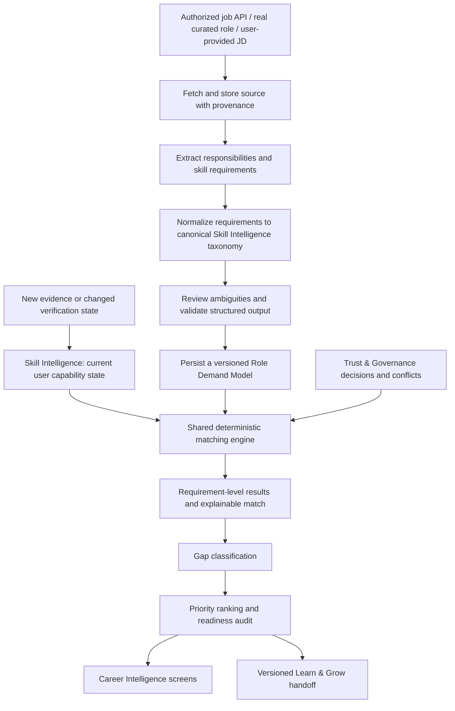

# Skill Passport — Career Intelligence
## Antigravity Execution Specification: What to Build, How It Must Work, and How to Prove It Works

**Document type:** Implementation directive, not a conceptual overview  
**Feature scope:** Career Intelligence only  
**Screens in scope:** Role Overview, Target Roles, Role Match, Skill Gaps, Gap Priorities, Career Readiness, Compare Roles, Job Description Parser  
**Design basis:** The supplied static UI screenshots and `GrowthLens_Adaptive_Role_Growth_Technical_Spec`  
**Upstream dependencies:** Evidence Workspace, AI Intelligence, Trust & Governance, Skill Intelligence  
**Downstream boundary:** Prepare a documented handoff to Learn & Grow; do not implement Learn & Grow in this task.

---

# 0. Instruction to Antigravity

Implement the Career Intelligence domain in the **existing** Skill Passport repository. Do not build a separate application, replacement frontend, parallel backend, duplicate skill database, or new verification engine.

The screenshots supplied by the project owner are **static UI references**. Preserve their visual language, navigation, cards, filters, tables, status chips, spacing, typography, and responsive behaviour where practical, but connect every control and displayed value to real behaviour. A screenshot value is not evidence that the corresponding record exists.

You must inspect the repository and the existing `SKILLPASSPORT_PROJECT_CONTEXT.md` and domain READMEs if present. Then inspect the relevant source code, backend routes, schemas, database models/migrations, service contracts, environment variables, and tests. Use actual names and patterns from the repository rather than blindly creating duplicate equivalents.

**Do not stop after the audit or after writing a plan.** After identifying the existing implementation and gaps, proceed through the phases below, implementing and testing the domain. If something genuinely cannot be completed because a required API/provider credential is unavailable, finish the supported parts, surface the exact configuration blocker in the UI and report, and do not fabricate results.

## Non-negotiable rules

1. **No fake live data.** No invented job postings, companies, role counts, match percentages, confidence values, role versions, skill requirements, gap counts, readiness scores, evidence records, or success states.
2. **Do not reimplement upstream truth.** Skill Intelligence owns the user's canonical capability state. Trust & Governance owns authoritative validation/guard decisions. Career Intelligence consumes their outputs and must not overwrite them.
3. **No “ideal candidate” person model.** Model role demand as a structured set of job requirements, not a fictional person or archetype.
4. **One calculation engine.** Role Overview, Role Match, Skill Gaps, Gap Priorities, Career Readiness, and Compare Roles must use the same versioned matching/gap services, not separate formulas per page.
5. **Every number must be explainable.** Each score must have an identified model version, policy/formula version, input versions, and a way to inspect its component requirements.
6. **Confidence is not proficiency or verification.** Preserve these as separate fields and concepts.
7. **Missing evidence is not proof the user lacks a skill.** Use “not demonstrated in current evidence” or equivalent wording.
8. **No unsafe changes.** Do not reset/drop/truncate databases, delete evidence, weaken RLS, expose keys in the browser, or make unrelated refactors.
9. **Preserve current UI and app behaviour.** Make targeted edits within the existing project and keep other domains operational.
10. **No pretend success.** A button reports success only after the relevant backend operation has actually succeeded and persisted.

---

# 1. The exact product we are building

Career Intelligence answers this question for the authenticated user:

> “Given the work and skills currently supported by my Skill Passport, how well do they align with the real requirements of a role I want, what is missing or uncertain, and which gaps should I address first?”

The feature must do five concrete things:

1. Obtain a **real target role definition** from an authorized job-data source, a clearly labelled curated role model that exists in the database, or a job description supplied by the user.
2. Convert role requirements into canonical skill requirements using the existing Skill Intelligence taxonomy.
3. Load the user's current capabilities from Skill Intelligence, including proficiency, confidence/uncertainty, verification state, evidence coverage and evidence references where available.
4. Compare each role requirement with the user's capability using a shared, deterministic, versioned matching policy.
5. Explain strengths, partial matches, evidence gaps, skill/depth/application/dependency/freshness gaps, then prioritize the gaps and generate a structured output that Learn & Grow can consume later.

This is a career-development and evidence-diagnostic tool. The readiness score is **not** a probability of being hired, a recommendation to reject a candidate, or a guarantee of job performance.

## 1.1 The end-to-end workflow



If one of these stages is not implemented upstream, do not pretend it exists. Use an existing real contract if available; otherwise report the exact missing dependency and implement only a clean, typed boundary for it.

---

# 2. Phase 0 — Audit the current repository and make an implementation map

Before modifying files, inspect and document the findings in your task notes (not just a chat response):

- Current Career Intelligence routes, pages, components, frontend data hooks, API clients, and state management.
- Existing Career Intelligence API endpoints, services, models, schemas, migrations, and data tables.
- How the current static UI is populated, including any mocks, fixtures, hardcoded role lists, scores, and fake job-description samples.
- Existing job-data provider integrations and environment variables, if any.
- Existing Skill Intelligence endpoints/services and their authoritative capability, proficiency, confidence, evidence, and verification fields.
- Existing Trust & Governance contracts for validation, conflicts, guard states, and audit events.
- Existing taxonomy IDs/aliases and how to query them.
- Current Supabase/PostgreSQL, SQLAlchemy session, caching, timeout, and retry patterns.
- Existing background-job mechanisms. Reuse them for longer operations where available.
- Existing tests and local run commands.

Produce an internal mapping from **each screen → its current data source → the backend service it should use → missing work**. Then implement. Do not create a second set of tables or endpoints until you establish that the current ones cannot support the contract.

If the banner “Database is temporarily recovering from high load. Showing cached data — reconnecting automatically” appears, inspect its actual source. Do not turn database outage, stale cache, or a failed query into a real `0%` match or zero gaps. If cached data is shown, label its last successful refresh time and mark its results stale.

---

# 3. Phase 1 — Define the integration contract with upstream domains

## 3.1 Input from Skill Intelligence

Use the existing authenticated service/API/database access pattern to obtain the **current capability state** for the user. For each relevant canonical skill, read these fields where available:

- Stable canonical `skill_id` and display name.
- Category/domain and canonical aliases.
- Proficiency/maturity level and its rubric version.
- Confidence value and its documented meaning, if present.
- Verification state from the authoritative workflow.
- Evidence coverage/strength state, if present.
- Valid linked evidence IDs and permitted locators.
- Relevant conflict/review flags.
- Evidence freshness/last supporting evidence time where available.
- Capability state version or last-updated timestamp.
- Reasons/limitations stored by upstream analysis or verification.

Do not treat a raw GitHub language percentage, a technology mention, a README statement, a resume claim, a course certificate, an AI candidate, or an extraction confidence score as a verified proficiency. Use the actual upstream verification status and its permitted meanings.

Career Intelligence is read-only with respect to upstream skill verification and proficiency state. It may store its own match snapshots and gap calculations. It must not directly promote, reject, or rewrite skills.

### If an upstream skill field is missing

- Do not invent it.
- Do not automatically map missing confidence to `1.0`.
- Do not automatically map a missing proficiency to an assumed level.
- Do not use the absence of a row as proof that the user knows nothing.
- Mark the requirement `NOT_ASSESSED` or an equivalent supported state when the missing field prevents a reliable calculation.
- Include the limitation in the result explanation and final report.

## 3.2 Input from Trust & Governance

Reuse the current validation, unsupported-claim, conflict, and review states. Career Intelligence may display those states and account for them in matching, but it must not implement a competing or weaker verification policy.

A rejected claim must not receive positive match credit. A blocking unresolved conflict must not be hidden. A pending candidate cannot be presented as a strong verified match merely because its AI confidence value is high.

## 3.3 Evidence references

Career Intelligence must not re-ingest evidence or duplicate source documents. It references the evidence records owned by Evidence Workspace and Skill Intelligence. For a “Why this gap?” interaction, show only evidence the authenticated user is permitted to access, using the existing evidence-detail navigation/service.

---

# 4. Phase 2 — Implement real role demand acquisition

The UI shows a target-role catalogue and a Job Description Parser. Both must be functional, but their source types must remain visibly distinct.

## 4.1 Support these three role model types

### A. Curated role model
A curated role definition that is genuinely present in the application's approved persisted catalogue. Its UI badge must say `Curated` (or the existing equivalent). Store its version and source/rationale. Do not label a curated definition as live market data.

### B. Job-derived role model
A demand model derived from real job postings retrieved through an authorized/configured provider. Show the provider/source, number of unique postings actually used, source freshness, creation time, taxonomy version, parser/model version, and demand-model version. If the data set is too small to substantiate aggregate “market” claims, label it as a limited sample rather than a market-wide benchmark.

### C. Custom job-description model
A versioned interpretation of one real job description submitted by the user, or retrieved through an explicitly supported authorized source. It is specific to that posting; do not merge it into the global catalogue or market frequency calculations unless an explicit, separately approved aggregation workflow exists.

## 4.2 Job data API/provider

Inspect the repository for an existing provider integration and configured API-key names before choosing a new one. Reuse any configured, working provider. If there is no provider, implement a server-side adapter interface and the configuration contract for the approved provider; do not silently pick a paid service, assume credentials exist, scrape prohibited pages, or ship fake API results.

The server-side provider adapter must:

- Use credentials only from backend environment/secret configuration.
- Respect the provider's terms, allowed use, pagination, rate limits, attribution, caching and retention rules.
- Normalize provider payloads to a documented internal schema.
- Preserve provider name, provider job ID, canonical URL, fetch time and provenance.
- Deduplicate records by stable provider ID, canonical URL and/or content fingerprint.
- Handle pagination, timeouts, rate limits, authentication errors, expired postings, malformed responses, and no-result responses explicitly.
- Never expose a secret API key in frontend code or logs.

If credentials are not available, keep custom-JD mode usable and show the provider as `Not configured` with the exact environment variable/setup needed. Do not populate the catalogue with fabricated “real” jobs.

## 4.3 Persist actual job posting data

Use existing tables if they already provide equivalent storage. Otherwise create reviewed, additive migrations for the minimum required records. A normalized job-posting record should contain only fields actually supplied or justifiably derived:

- Internal ID and owner/scope as appropriate.
- Provider/source ID and provider job ID.
- Canonical job URL.
- Published title and organization where provided.
- Location/work arrangement, employment type and seniority cues when available.
- Description text or an approved retained representation.
- Publication/expiry date when provided.
- Source fetch time, source freshness, and content fingerprint.
- Parsing status and parser/model version.
- Provenance and errors.

Do not guess missing company names, posting dates, seniority, location, requirements, or expected skill levels.

## 4.4 Extract requirements from each posting

The parser should identify candidate requirements from actual job-description text:

- Canonicalizable skill/tool/technology.
- Original text span supporting the requirement.
- Requirement type: core/required, supporting/preferred, or the existing equivalent.
- Importance/criticality and its provenance.
- Expected proficiency only if supported by job wording and the approved role/seniority mapping policy.
- Responsibility or outcome linked to the requirement, where present.
- Seniority/context cues and whether they are stated or inferred.
- Confidence/uncertainty only if the parser actually emits a meaningful value.
- Mapping status and validation issues.

Normalize recognized terms against the existing Skill Intelligence taxonomy. Keep unknown or ambiguous terms unresolved and visible for review. Do not force every phrase into a nearby skill ID. Preserve original text spans so users can verify why a requirement was extracted.

Deduplicate repeated phrases within one posting. Deduplicate repeated postings before calculating demand frequency.

## 4.5 Build a versioned Role Demand Model

A role demand model must include:

- Stable role identity and immutable version.
- Role title, seniority and context/variant where supported.
- Model type: curated, job-derived, or custom JD.
- Requirements linked to canonical skill IDs when mapped.
- Original requirement text spans and their source posting IDs.
- Requirement type, importance, expected level when known, and evidence expectation when supported.
- Source posting set/corpus identity and count.
- Taxonomy version, parser/model version, build time, and source freshness.
- Validation state and unresolved mappings.

Do not overwrite a role model currently used by a previous match. Create a new version so an old result can be reproduced and inspected.

---

# 5. Phase 3 — Create one deterministic matching engine

All six relevant result pages must use this single service:

`Role Demand Model + User Capability State + Matching Policy → Requirement Results + Aggregate Match + Explanations`

Use the existing service if one is present. Otherwise create a dedicated service module that can be called by all Career Intelligence endpoints. Do not place separate scoring algorithms inside React components or endpoint handlers.

Every calculated result must retain references to:

- User ID/authorized capability scope.
- Capability-state version used.
- Role-demand-model ID/version used.
- Taxonomy version used.
- Matching-policy/formula version used.
- Calculation timestamp.
- Requirement-by-requirement inputs, outcomes, and reason codes.

## 5.1 Evaluate each requirement separately

For each role requirement, determine:

1. Is there a canonical skill mapping?
2. Is there a user capability record for that skill?
3. Is the capability verified, partially verified, a candidate, rejected, conflicting, or not established?
4. What proficiency level is actually supported, if known?
5. What maturity level does the role require, if known?
6. What valid, relevant supporting evidence exists?
7. Is the evidence coverage sufficient under the upstream policy?
8. Is confidence low or uncertainty significant, according to a documented upstream meaning and configured policy?
9. Is the claim blocked by Trust & Governance?
10. Is the evidence stale or is a prerequisite missing, if those concepts are supported?

Return a structured requirement result, not a single boolean. Use current enums if available; otherwise define a single shared vocabulary such as:

- `STRONG_MATCH`
- `PARTIAL_MATCH`
- `EVIDENCE_GAP`
- `SKILL_GAP`
- `APPLICATION_GAP`
- `DEPENDENCY_GAP`
- `FRESHNESS_GAP`
- `CONFLICTING`
- `UNMAPPED_REQUIREMENT`
- `NOT_ASSESSED`

These labels must have documented meanings and tests. Do not create a new enum if the current domain contracts already support equivalent states.

### Required interpretation rules

- **Verified + sufficient relevant evidence + level meets target:** may count as a strong match.
- **Supported skill + level below target:** partial match / depth gap; show the maturity difference.
- **Candidate or low-confidence signal:** flag for investigation; do not call it a strong verified match.
- **Claim exists but evidence is inadequate:** evidence gap, not a definitive absence-of-skill conclusion.
- **Rejected/unsupported claim:** cannot count as positive capability credit.
- **Material unresolved conflict:** show conflicting/unresolved and follow the policy's scoring treatment.
- **No capability record:** say “not demonstrated in the current Skill Passport evidence”; never assert the person does not know the skill.
- **Requirement not mapped to the taxonomy:** keep it visible as unmapped and exclude it from canonical-skill calculations only according to a documented policy; disclose the limitation.
- **Missing expected level or insufficient input data:** mark not assessed or use a documented conservative policy; do not invent a level.

## 5.2 Define the score without hiding the math

Reuse any real, documented matching logic already in the code. If no implementation exists, implement a deterministic policy based on the supplied Adaptive Role Growth specification and document/version it before displaying results.

Use this basic structure:

```text
level_coverage = min(current_supported_level / expected_level, 1)
    when expected_level > 0 and both levels are known

eligible_requirement_credit = level_coverage * evidence_eligibility_factor

role_match_percent = 100 * sum(requirement_weight * eligible_requirement_credit)
                       / sum(applicable_requirement_weight)
```

The policy must define `requirement_weight`, `evidence_eligibility_factor`, conflict handling, unknown values, and denominator inclusion. Do not hide arbitrary factors in UI code. Verified claims with valid evidence may receive full evidence credit under the policy; rejected claims must receive no positive credit; unverified/low-confidence claims must never receive the same strong-match treatment as eligible verified claims. If partial estimates get discounted provisional credit, define that rule, show it separately from verified coverage, and test it.

If the product has a five-level proficiency model, use the established scale and rubric rather than inventing another scale. Verify that role expected levels and Skill Intelligence levels share the same semantics before comparing them.

Do not let a high number of low-importance matches conceal a missing critical/core requirement. Keep core and supporting coverage separately visible and surface core blockers.

### No-data and stale-data rules

- If no valid capability state exists, show a state such as `Not enough capability data to calculate`, not automatically `0%`.
- A legitimate zero may appear only after a valid calculation where the eligible credit is actually zero; label it as “no match currently established by available evidence.”
- If the API/database fails, do not translate the failure to `0%`, zero skills, or zero gaps.
- If cached real results are displayed during an outage, mark them `Stale` and show their last successful calculation time.
- Do not report a result as fresh until it was successfully recalculated with the current input versions.

---

# 6. Phase 4 — Implement gap classification and prioritization

## 6.1 Gap classification

Implement the following classifications where the underlying evidence supports them:

- **Skill gap:** adequate demonstrated baseline is not established for a required competency.
- **Depth gap:** evidence supports the skill, but current maturity is below the target.
- **Evidence gap:** a candidate/claim may exist, but direct, relevant or verified evidence is insufficient.
- **Application gap:** available support looks theoretical or indirect, while the requirement calls for practical application.
- **Dependency gap:** a prerequisite skill is not sufficiently established to support the target skill/path.
- **Freshness gap:** evidence is too old for a role context in which current practice matters.
- **Differentiation opportunity:** core baseline is supported and an optional competency could add value.
- **Unmapped/uncertain requirement:** taxonomy or source interpretation is unresolved.

Do not force every issue into `SKILL_GAP`. Keep confirmed skill absence, insufficient proof, lower proficiency, conflict, and unknown mapping distinct.

Each gap result must include a stable ID, role-model/version reference, skill/requirement reference, type, impact/importance, current and expected level where known, evidence state, reason codes, source/evidence references, uncertainties, and suggested next action. The next action must be derived from the actual gap and should preferably produce useful evidence.

## 6.2 Gap priority service

Use a single prioritization service for Gap Priorities, `Prioritize` buttons in Skill Gaps, and the priority summary in Role Overview.

The technical specification's intended priority factors are:

- Role criticality/importance.
- Proficiency/maturity distance.
- Dependency impact.
- Evidence leverage (one action might produce evidence for multiple skills).
- User fit/context.
- Marginal benefit.
- Estimated effort.

Use the documented formula shape:

```text
priority_score =
  criticality * level_gap * dependency_impact
  * evidence_leverage * user_fit * marginal_gain
  / max(estimated_effort, epsilon)
```

Inspect the existing code and specification for exact normalized ranges and defaults. If no concrete range exists, define a documented versioned policy with sensible validated bounds and tests. Do not imply that subjective estimated effort or marginal gain is a measured fact. Label estimates and expose actual formula inputs through “Inspect formula inputs”.

The rank must be deterministic for the same inputs and policy version.

Support the visible focus modes only when implementable from real data:

- Default Ranking.
- Top 3 Focus.
- Quick Wins.
- Core Blockers.

Define exact selection rules for each mode. Do not simply reorder cards randomly or label the top three rows “Quick Wins”. A quick win should be supported by relatively low effort and a meaningful expected gain; a core blocker should map to a core/critical requirement or actual dependency blocker.

If controls for effort sensitivity or evidence leverage are in the UI, they must change the prioritization scenario through validated inputs. They must not mutate the role-demand model, verification state, or upstream skill record. Show the effect and allow reset to the default policy. Persist only if the existing product requirement calls for persistence; otherwise treat it as a clearly labelled scenario setting.

## 6.3 Existing-project leverage

Where the UI recommends extending a project the user already has, resolve that project from Evidence Workspace/Skill Intelligence records. Do not invent a repository or claim the user has an artifact that does not exist. Explain which new capability the project extension could demonstrate, and distinguish a suggested future task from evidence already completed.

---

# 7. Phase 5 — Build the eight screens shown in the screenshots

Keep all existing routes and their visual design. Map each UI control to a concrete action and backend result. Reuse existing shared cards, inputs, badges, modals, toasts, breadcrumbs and responsive styles.

## Screen 1: Role Overview

**Goal:** At a glance, show the active role target, what the user's existing evidence supports, and which investigations/actions matter next.

It must:

- Load the authenticated user's active target role and exact demand-model version.
- Allow target switching using the persisted role catalogue.
- Show whether the model is curated, job-derived, or custom JD; show version and source freshness.
- Display overall match, readiness, verified matches, actionable gap count, core/supporting coverage and core blockers using the shared result objects.
- Show a role summary and actual requirement list.
- Explain the match formula and include a working “Inspect Demands”/taxonomy mapping action.
- Link each navigation item to its real page and preserve the active target context.
- Show an empty state if no target has been chosen and guide the user to Target Roles or Job Description Parser.
- Show an honest unavailable/stale state if the database or role source is unavailable.

The screenshot's `AI Engineer`, `0%`, `6 actionable gaps`, and `v2026.1` are examples only unless those values actually exist in persisted records. Never hardcode them as user output.

## Screen 2: Target Roles

**Goal:** Browse genuine role-demand models and choose the target for comparison.

It must:

- List actual persisted curated, job-derived, and custom role models with clear type badges.
- Search/filter by title, seniority/context, and available category/variant.
- Show source, model version, update time, real requirement counts, core/supporting counts, and description where present.
- `View Requirements` opens that model's actual normalized requirements and source provenance.
- `Set as Target` persists the exact role/model version for the authenticated user.
- `Active Target` reflects the server's saved selection after refresh/relogin.
- `Compare My Skills` invokes/reuses the shared matching engine for that exact role version.
- Avoid duplicate target records and prevent an older stale model from silently replacing a newer active selection.
- Provide a clear empty state when no role models exist. If the real job-data API is unconfigured, say so; do not manufacture role cards.

## Screen 3: Role Match

**Goal:** Answer “Which requirements are supported by my current evidence, at what level, and why?”

It must:

- Display the selected role and demand-model version.
- Display overall match only for a successful calculation and provide the calculation explanation.
- Display core baseline coverage and supporting strength separately.
- Display counts for strong matches, partial matches, evidence gaps, missing/weak skills, conflicts, unmapped and not-assessed items as appropriate.
- List every relevant role requirement with requirement type/importance, expected level, current supported level, verification/coverage state, supporting artifact count, reason/diagnosis, and a working `Why This Gap?` action.
- Implement filters such as All, Strong, Partial, and Evidence Gap based on the returned requirement status. Counts and list rows must agree.
- Link evidence to the real evidence detail screen through authorized existing routes.
- Show `Not demonstrated in current evidence` for absent evidence rather than asserting the user lacks a skill.
- Recalculate/mark stale when the active role version or upstream capability-state version changes.

## Screen 4: Skill Gaps

**Goal:** Diagnose each gap clearly and make it actionable.

It must:

- Display total gaps split into the real gap types returned by the shared engine.
- Support the existing gap-type chips, search, and requirement filter.
- For each gap card show title, canonical ID if available, requirement category, importance, target/current level where known, evidence/verification state, reason, and next-step direction.
- Explain whether the issue is missing demonstrated capability, depth, inadequate evidence, application, dependency, freshness, conflict, or an unresolved requirement mapping.
- `Why This Gap?` must open a reasoned detail based on the actual role requirement, current skill state and evidence references.
- `Prioritize` must pass the stable gap ID into Gap Priorities for the same role/model version.
- Never create learning resources or claim completion inside Career Intelligence. Provide a structured next-action recommendation and handoff reference for Learn & Grow.

## Screen 5: Gap Priorities

**Goal:** Rank realistic actions that improve alignment to the current role.

It must:

- Use the same gap list, role version and input versions as Skill Gaps.
- Show the prioritization formula and version.
- Show the actual selected number of prioritized gaps/actions.
- Implement Default Ranking, Top 3 Focus, Quick Wins and Core Blockers with explicit selection logic.
- Display priority score/rank and let the user expand all formula inputs: criticality, level gap, dependency impact, evidence leverage, user fit, marginal gain, estimated effort and any normalization/default applied.
- Make effort-sensitivity/evidence-leverage controls functional if retained from the screenshot, with validation, explanatory text and reset. These controls may rerank a scenario but cannot modify source role demand or verified skill state.
- Use real existing projects only when supporting records exist. Any suggested project extension must be labelled as a future action, not current evidence.
- Provide working `Why this Gap?` and Career Readiness navigation.
- Do not display precise-looking priority scores based on invented inputs.

## Screen 6: Career Readiness

**Goal:** Audit how well the current supported skill profile meets the role's baseline and expose the blockers/uncertainties.

It must:

- Display readiness score with its exact formula/policy version.
- Show core required coverage, proficiency alignment, and evidence traceability as separate, explainable components.
- Show each component's numerator/denominator or equivalent calculation trace.
- List critical blockers with the real skill/requirement, current state, expected level, effect on the readiness result, and link to its diagnosis.
- List major uncertainties separately from confirmed skill gaps.
- Show role model version and calculation time.
- State that the metric is for personal development, not a hiring probability.
- Show not-assessed when required inputs are missing. A true 0% must mean a completed, valid calculation with no eligible credit—not an API outage or missing payload.
- Generate any summary text from the same structured readiness result. Reject or avoid text that contradicts the metrics, such as claiming the core baseline is met while displaying 0% core coverage.

## Screen 7: Compare Roles

**Goal:** Help a user compare two or three real roles against the same capability state.

It must:

- Allow selection of 2 or 3 existing role models, respecting the UI's stated maximum.
- Show each role's title, context, version, match, readiness, blockers, core/supporting coverage and gap count using shared engine outputs.
- Render a competency comparison matrix with the user's current supported capability and each role's expected level/type.
- Support All Competencies, Gaps Only, and Requirement Differences filters.
- Differentiate “this role does not require this competency” from “the user's capability is not demonstrated”.
- Use the same scoring policy as Role Match and Career Readiness.
- Implement Set Active against the backend and make the change visible across Career Intelligence.
- Make View Demand Model open real versioned requirements/provenance.
- Detect stale/mixed input versions. If compared results use different capability versions, recalculate them or explicitly label the inconsistency instead of comparing silently.

## Screen 8: Job Description Parser

**Goal:** Convert a real job-description text into an editable, versioned custom role model.

Inputs:

- Job title (optional if extractable).
- Company/organization (optional).
- Target seniority/context (optional, with an explicit unknown state).
- Raw job-posting text, required unless a supported authorized URL flow is implemented.
- Source URL/provenance when actually supplied/retrieved.

Flow:

1. Validate input and require enough substantive text.
2. Treat job text as untrusted data, never as model/system instructions.
3. Call the existing parser/LLM service, if present, with a strict structured-output schema.
4. Extract responsibilities, candidate competencies, requirement type/importance, expected level only where supported, and source spans.
5. Normalize candidates to the canonical Skill Intelligence taxonomy.
6. Keep unknown/ambiguous requirements unresolved, visibly flagged for user review.
7. Validate response schema and source-span offsets against the original text. Reject fabricated spans and unknown skill IDs where strict mapping is required.
8. Show the parsed requirements on the right side of the existing layout for review/editing before save.
9. Allow the user to edit requirement type, importance and expected proficiency, remove an incorrect requirement, and inspect its original source span.
10. `Save & Compare My Skills` must save a new **versioned custom role model**, then run the same matching engine as the curated/job-derived roles.
11. Preserve the original submitted text or approved retained representation, parser/model version, source provenance, edits made by the user, taxonomy version, and creation time.
12. Never mutate the global role catalogue when saving a custom JD.
13. Provide accurate failure states for empty input, parser errors, malformed output, database errors, and unresolved taxonomy mappings.

The screenshot's sample company, job title, descriptions, requirement counts and source spans must not be used as live records. If any sample buttons are kept, label them unmistakably as local demo fixtures and never save them as genuine user job postings or market data.

---

# 8. Phase 6 — Data model and API implementation

Inspect existing schemas/models/migrations and reuse them whenever possible. The following are logical data responsibilities, not a command to create duplicate tables with these exact names.

## 8.1 Minimum persisted concepts

Ensure the existing system can persist, directly or through equivalent records:

- Job source/provider configuration metadata (never secret values in client-readable records).
- Normalized source job postings and provenance.
- Extracted job requirements with original text span, canonical skill mapping, importance, expected level if known, and validation state.
- Versioned role-demand models and their source posting set.
- User's active target role and exact role-model version.
- Versioned custom job-description models.
- Match result snapshots tied to capability, role, taxonomy, and formula versions.
- Per-requirement match result with reason codes and evidence references.
- Gap classifications and stable gap IDs.
- Prioritization result/input trace and policy version.
- Readiness component values and input trace.
- Creation/update timestamps and relevant audit references.

Add migrations only for genuinely missing persistence and follow the repository's existing migration style. Migrations must be additive and safe; do not reset the database.

## 8.2 API capabilities

Reuse existing routes where equivalent routes exist. Implement the missing capability, not a duplicate endpoint. Actual route names must follow repository convention; logical required operations include:

- List/search role catalogue with role type/source/version metadata.
- Retrieve a role's versioned demand model and requirements.
- Fetch/refresh role postings from a configured authorized provider.
- Build or refresh a demand-model version from a defined source set.
- Set/get the authenticated user's active target.
- Parse and validate a custom job description.
- Save/version a reviewed custom job model.
- Calculate/retrieve role match.
- Retrieve gap diagnoses and filter by type.
- Calculate/retrieve gap priorities and support focus modes/scenario inputs.
- Calculate/retrieve readiness details.
- Compare 2–3 selected role versions.
- Retrieve formula/policy explanations and source provenance.
- Retrieve the structured Learn & Grow handoff object.

Each endpoint must:

- Require authentication wherever user data is involved.
- Enforce ownership and authorization server-side.
- Validate all IDs and request bodies.
- Use existing Pydantic response models or equivalent.
- Return consistent errors for invalid input, unavailable provider, unauthorized access, no data, stale data and transient database failures.
- Never return API secrets or another user's private data.
- Avoid repeated LLM calls on ordinary page reads if a valid result exists for the same input versions.
- Confirm persistence before returning a success state.

## 8.3 Cache and recalculation invalidation

A role match becomes stale if any required input version changes: user capability state, role-demand model, taxonomy, or matching policy. A prior result may remain viewable as historical/stale data, but must not be labelled current.

Use the existing caching and background processing architecture if present. Do not keep stale results indefinitely without invalidation metadata. Do not treat a Supabase failure as an empty list or valid zero score.

---

# 9. Phase 7 — Learn & Grow handoff only

Career Intelligence must not implement learning roadmap pages or resource selection in this task. It must output a stable structured handoff that Learn & Grow can consume later.

For each eligible prioritized gap, provide fields equivalent to:

```json
{
  "user_id": "authenticated user reference",
  "target_role_id": "role identity",
  "target_role_version": "immutable demand version",
  "capability_state_version": "upstream capability version",
  "matching_policy_version": "policy version",
  "gap_id": "stable gap reference",
  "skill_id": "canonical skill ID when mapped",
  "gap_type": "DEPTH_GAP or other defined type",
  "expected_level": null,
  "current_supported_level": null,
  "evidence_status": "actual upstream status",
  "priority_rank": 1,
  "priority_score": null,
  "reason_codes": [],
  "evidence_ids": [],
  "prerequisite_skill_ids": [],
  "suggested_outcome": "describe the capability/evidence outcome to work toward"
}
```

This JSON is a shape example, not a seed record. Use actual values and actual schema names; use null/empty only where semantically valid and explain unavailable information. The handoff must not invent a skill, proficiency level, evidence ID, course, or resource URL. Learn & Grow will decide how to sequence learning resources and activities.

---

# 10. Phase 8 — UI and operation reliability

The screenshot set shows a dark connection-status banner reporting that the database is temporarily recovering from high load and cached data is being shown. Implement or preserve truthful handling for such events.

- Do not turn database errors into `0%`, zero gaps, no roles, or a successful parse.
- If valid cached data is shown, display `Stale` and its last successful load/calculation time.
- Keep the rest of the app operational when an individual Career Intelligence endpoint fails.
- Give `Retry Now` a real bounded retry/re-fetch action; do not create an infinite request loop.
- Keep a visible role selection and user input when an API fails.
- Do not show success before a role target, custom JD, or result is confirmed persisted.
- Distinguish `No data exists`, `Not configured`, `Not assessed`, `Loading`, `Stale`, `Failed`, and `Unauthorized`.
- Do not use localStorage as the authoritative store for role models, job postings, scoring outcomes, or skill states.
- Reuse the project's SQLAlchemy session lifecycle and bounded Supabase pool configuration. Do not hold database connections while calling an external job API or waiting for Ollama.
- Use bounded retries only where safe and idempotent.
- Do not weaken RLS or backend authorization to resolve load problems.

Maintain responsive behaviour on laptop, tablet, and mobile. The matrix/table views must not make mobile use impossible: use responsive overflow, stacked cards, or an accessible alternate layout without removing any feature.

---

# 11. Phase 9 — Tests Antigravity must run

Add focused tests in the existing test framework. Use isolated synthetic test fixtures only in tests; never insert them as live data for real users.

## Job source and role demand

1. Authorized provider result maps to normalized records with provider/job provenance.
2. Missing/invalid API credential shows a real configuration error, not fake results.
3. Provider rate limit/timeout does not delete existing demand models.
4. Duplicate jobs do not inflate frequency or requirement counts.
5. Each model version keeps its original source set and taxonomy/parser versions.
6. Expired/changed source handling follows a defined policy.

## Job-description parser

7. A real description produces structured candidate requirements with exact source spans.
8. Empty/short input is rejected with a useful message.
9. Malformed model output is rejected or retried safely.
10. Unknown skill IDs remain unresolved rather than silently mapped.
11. Prompt-injection-like text is treated as untrusted posting content.
12. User edits are persisted and custom-model versioning works.
13. A saved custom model can run through the same match engine.

## Skill matching and confidence

14. Verified supported skill meets role level → strong match according to policy.
15. Supported skill below target → partial/depth gap.
16. Low-confidence or candidate skill → review/evidence gap, not strong verified credit.
17. Rejected/unsupported claim → no positive match credit.
18. No capability record → not demonstrated by current evidence; do not assert the user lacks the skill.
19. Conflicting evidence remains explicitly conflicting.
20. Missing level/confidence is not replaced with a made-up value.
21. Match result reproduces from the same role/capability/taxonomy/policy versions.
22. Critical requirement missing is surfaced separately and cannot be obscured by many low-weight matches.

## Gaps, priorities and readiness

23. Every gap has supported type/reason codes and stable references.
24. Priority ranking is deterministic for identical inputs.
25. Quick Wins and Core Blockers use actual documented selection rules.
26. Slider/scenario changes affect prioritization only, not upstream data or verification.
27. Readiness component metrics and narrative cannot contradict one another.
28. Missing input or DB failure does not yield a fake zero score.
29. Changes to capability, role-model, taxonomy, or policy version invalidate/recalculate current results.

## Compare Roles and access

30. Two and three role comparisons work with one shared capability-state version.
31. Requirement differences and gaps-only filters work and counts match visible rows.
32. “Not required by this role” is distinct from “not demonstrated by user”.
33. User A cannot retrieve User B's custom JD, active target, or private match results.
34. Client-supplied role names/IDs cannot bypass backend permissions.

## Integration and recovery

35. Every button shown on the eight screens has a real handler and truthful resulting state.
36. API failure preserves entered JD text and selected roles.
37. Stale cache is visibly labelled and not described as current.
38. Learn & Grow handoff contains valid IDs, versions, reasons and no fabricated data.
39. Existing Evidence Workspace, AI Intelligence, Trust & Governance and Skill Intelligence workflows still work.
40. Tests clearly state whether provider/DB/Ollama checks were mocked or genuinely integrated.

---

# 12. Mandatory implementation sequence and phase gates

Do not attempt all screens as disconnected frontend work. Implement the core data flow first.

### Phase 0 — Repository inspection and map
**Deliver:** file/service map, existing routes/models, mock-data inventory, missing contracts.  
**Gate:** know what can be reused; no application behaviour changed just for the audit.

### Phase 1 — Role source adapter and versioned model
**Build:** real source/provider adapter; posting normalization and provenance; requirement extraction; canonical mapping; deduplication; versioned demand models; custom-JD persisted model.  
**Gate:** a real provider result or a genuinely submitted JD can be parsed, validated, saved, and reopened. No API credentials means provider mode is clearly blocked, not faked.

### Phase 2 — Capability integration and matching engine
**Build:** typed adapter to Skill Intelligence and Trust & Governance; shared deterministic requirement evaluation; formula/policy version; explainable match snapshots.  
**Gate:** same inputs produce reproducible per-requirement and aggregate outputs; low-confidence/rejected claims are handled correctly.

### Phase 3 — Gap and readiness services
**Build:** gap classification, prioritization, readiness audit, reason codes, policy/input traces.  
**Gate:** every gap and number can be traced to actual input records, and missing data is not mistaken for zero.

### Phase 4 — Wire the eight UI screens
**Build:** connect all UI controls to actual API/service operations; loading/empty/stale/error states; working navigation and filters.  
**Gate:** no live hardcoded role cards, scores, requirements or successful operations; cross-screen numbers agree.

### Phase 5 — Learn & Grow handoff
**Build:** typed, versioned output only.  
**Gate:** a future domain can consume prioritized gap records without rerunning Career Intelligence or guessing field meanings.

### Phase 6 — Security, performance, regression and final validation
**Build:** indexes only where needed, efficient queries, bounded requests, safe retries, authorization checks, tests, documentation updates.  
**Gate:** required tests run; failures/blockers are reported honestly; existing domains and persistence remain intact.

At each gate, continue to the next phase after recording the result unless a genuine blocker prevents safe progress. Do not stop after producing an audit report.

---

# 13. Acceptance walkthrough — prove the whole domain works

Run one positive and one negative end-to-end workflow using a genuine development record where possible. If a test fixture is necessary, isolate it to the test environment and label it as a fixture.

## Positive workflow

1. Load the authenticated user's real Skill Intelligence capability state.
2. Load a real persisted curated/job-derived role or submit a real job description.
3. Parse/map the role requirements and inspect source spans.
4. Save/reuse a versioned role-demand model.
5. Calculate the comparison using the current capability/model/policy versions.
6. Inspect each matching decision and linked evidence.
7. Inspect the resulting gaps and deterministic reason codes.
8. Open Gap Priorities and verify each factor/score.
9. Open Career Readiness and confirm every metric agrees with its explanation.
10. Compare the selected role with another actual role.
11. Reopen/reload pages and confirm persisted targets/results are still correct.
12. Inspect the structured Learn & Grow handoff.

## Negative workflow

Use a requirement with no supporting capability, an unsupported/rejected claim, a low-confidence candidate, or an unresolved taxonomy mapping.

Verify that it is not presented as a strong verified match; the correct gap/uncertainty is shown; it is not automatically promoted; source/verification states remain unchanged; and all pages use the same result.

## Final cross-page consistency check

For a given target role version and capability version, ensure:

- Role Overview's match and gap totals agree with Role Match.
- Skill Gaps contains the same gap IDs produced by matching.
- Gap Priorities ranks those same IDs rather than synthesizing new gaps.
- Career Readiness uses those same results and consistent blocker states.
- Compare Roles runs the same matching policy for each role.
- Job Description Parser's saved custom model can enter the exact same flow.

Any inconsistency is a failure to fix, not a cosmetic mismatch.

---

# 14. Final report after implementation

Provide a factual report with:

1. **Files changed** and why each changed.
2. **Existing code reused**: Skill Intelligence services, Trust & Governance rules, taxonomy, evidence services, DB/session patterns, UI components.
3. **Job source integration**: actual provider(s), configured/not-configured state, exact required environment variable names (never reveal values), and tested API path.
4. **Persistence**: models/tables reused or additive migrations applied.
5. **Matching policy**: formula/version, requirement weighting, treatment of confidence/verification/conflict/missing values.
6. **Gap and priority policy**: actual categories, inputs, defaults and versioning.
7. **Screens completed**: status for all eight pages and actions.
8. **Test results**: actual commands/tests and pass/fail/block status; distinguish mocks from live integrations.
9. **Unfinished items**: exact provider credentials, upstream contract, or service limitation blocking completion.
10. **Regression status**: confirm no intentional changes to the other four domains, authentication, RLS, existing evidence, or existing deployment root.

Use `PASS`, `FAIL`, `BLOCKED`, `NOT IMPLEMENTED`, or `NOT TESTED` for significant checks. Do not state that an API integration works unless a genuine request was tested.

---

# Final directive

Build Career Intelligence as a working, source-traceable role-demand and capability-comparison engine, not as a static set of dashboard cards. First connect the genuine inputs and persistence; then implement one deterministic match/gap/priority/readiness pipeline; then connect all eight screenshots to that pipeline. Keep AI limited to semantic extraction and grounded explanations, keep all authoritative calculations and state transitions deterministic and auditable, and preserve clear provenance from real job requirements to each result.

The project is done only when a real role model and a real user's current Skill Intelligence state can pass through the entire flow, every result can be explained, and the UI never invents a score or skill when data is missing or a service fails.
