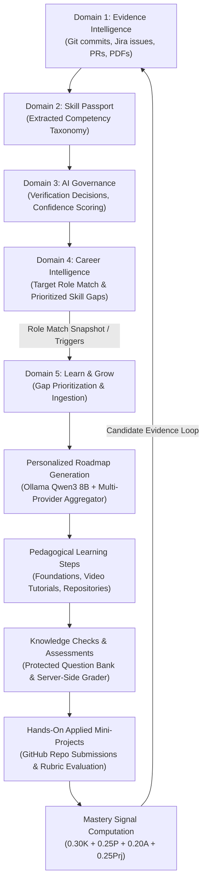
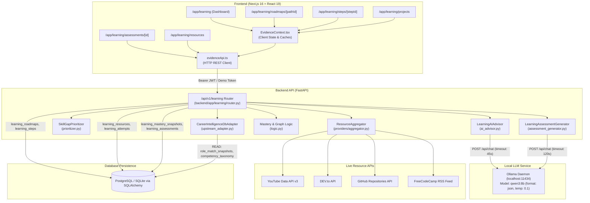
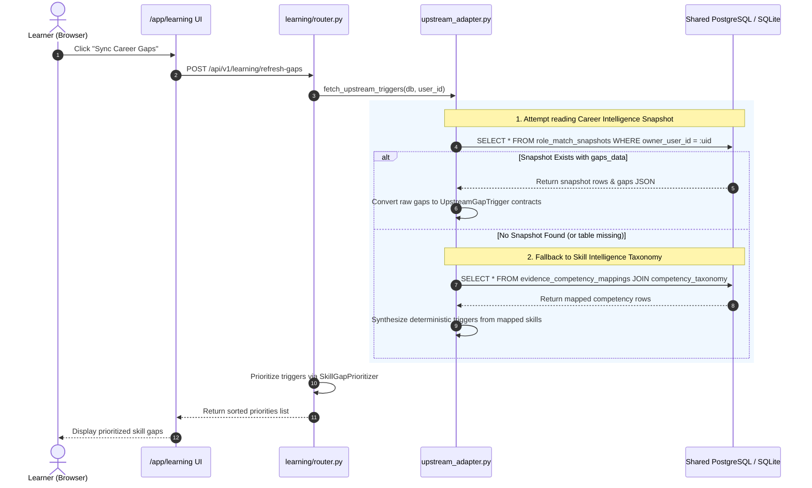
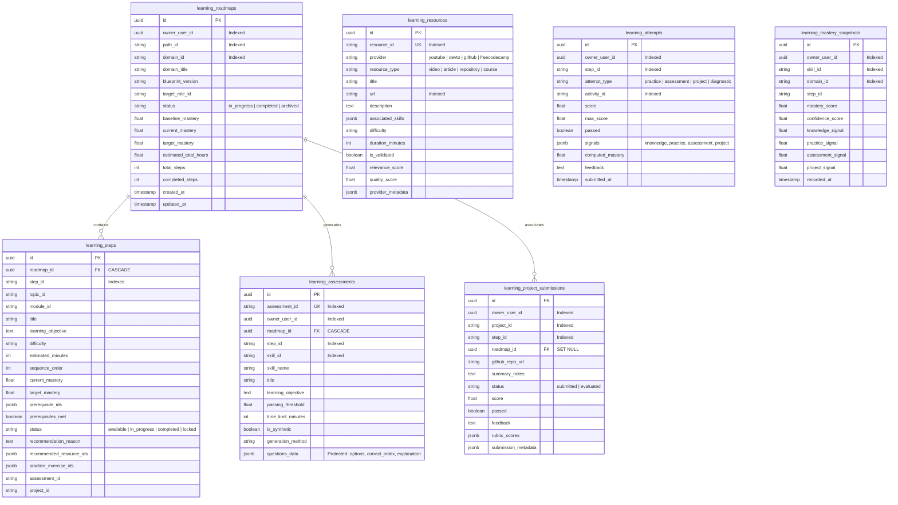

# Learn & Grow Engine (Domain 5) — Technical Architecture & Codebase Guide
**SkillPassport Powered by GrowthLens**  
*Document Version:* 1.0.0 · *Date:* October 2026 · *Target Audience:* Core Engineering Team

---

## Table of Contents

1. [Feature Overview](#1-feature-overview)
2. [Current Implementation Status](#2-current-implementation-status)
3. [Architecture Overview](#3-architecture-overview)
4. [Complete File-by-File Inventory](#4-complete-file-by-file-inventory)
5. [Exact Backend API Reference](#5-exact-backend-api-reference)
6. [Frontend Routes and User Interface](#6-frontend-routes-and-user-interface)
7. [Career Intelligence Integration](#7-career-intelligence-integration)
8. [Ollama Roadmap-Generation Pipeline](#8-ollama-roadmap-generation-pipeline)
9. [Database Schema and Persistence](#9-database-schema-and-persistence)
10. [Assessments, Resources, and Mini-Projects](#10-assessments-resources-and-mini-projects)
11. [Static Data, Mocks, Placeholders, and Hardcoded Values](#11-static-data-mocks-placeholders-and-hardcoded-values)
12. [Security and Failure Handling](#12-security-and-failure-handling)
13. [Test Coverage and Verification Status](#13-test-coverage-and-verification-status)
14. [Known Defects, Incomplete Work, and Remaining Tasks](#14-known-defects-incomplete-work-and-remaining-tasks)
15. [Git and Publication State](#15-git-and-publication-state)
16. [Local Setup and Troubleshooting Guide](#16-local-setup-and-troubleshooting-guide)
17. [Recommended Implementation Roadmap](#17-recommended-implementation-roadmap)

---

## 1. Feature Overview

### 1.1 Mission & Vision

**Learn & Grow (Domain 5)** is the personalized upskilling engine within the **SkillPassport Powered by GrowthLens** talent intelligence platform. 

The primary business goal of Learn & Grow is to close the loop between **skills extraction/verification (Domains 1–3)**, **career role-gap diagnosis (Domain 4)**, and **actionable, personalized skill acquisition (Domain 5)**. Instead of directing candidates to generic course catalogues, Learn & Grow dynamically constructs targeted pedagogical sequences ("Roadmaps") addressing the learner's exact verified deficiencies relative to target engineering roles.

### 1.2 Intended End-to-End User Journey



1. **Career Gap Ingestion:** Candidate selects a target role (e.g., *Junior AI Application Engineer* or *Senior Distributed Systems Engineer*). Career Intelligence calculates proficiency distance, extraction confidence, and requirement priority across required competencies.
2. **Deterministic Prioritization:** The `SkillGapPrioritizer` evaluates upstream triggers, decoupling extraction confidence from evaluated proficiency, penalizing unverified skills, and flagging declining trajectories.
3. **Targeted Roadmap Generation:** The candidate requests a roadmap. The system searches verified external resource providers (YouTube, DEV.to, GitHub, FreeCodeCamp), feeds the curated catalogue into a local Ollama model (`qwen3:8b`), and formats a multi-stage roadmap without hallucinations.
4. **Step Progression & Knowledge Checks:** The candidate works through sequential steps. Each step links verified external learning resources, conceptual explanations, and diagnostic questions.
5. **Applied Mini-Projects:** The candidate builds practical code deliverables in GitHub repositories and submits them for server evaluation against structured rubrics.
6. **Deterministic Mastery Tracking:** A mathematical formula balances knowledge, practice, assessment, and project signals to compute verifiable mastery without granting unearned verification status.

### 1.3 Reality vs. Intent: Implementation Health Summary

| Stage | Intended State | Implemented in Code? | Verified at Runtime? | Status |
|---|---|---|---|---|
| **Role Gap Ingestion** | Reads `role_match_snapshots` & fallback `competency_taxonomy` | Yes (`upstream_adapter.py`) | Yes (DB & test verified) | **Implemented & Verified** |
| **Deterministic Prioritization** | Decouples confidence & proficiency; penalizes unverified skills | Yes (`prioritizer.py`, `logic.py`) | Yes (10/10 Phase 1 tests pass) | **Implemented & Verified** |
| **Roadmap Generation Backend** | Real Ollama + Heuristic Fallback + DB persistence | Yes (`router.py`, `ai_advisor.py`) | Yes (Live Ollama verified) | **Implemented & Verified** |
| **Provider Resource Aggregator** | YouTube, DEV.to, GitHub, FreeCodeCamp with SSRF guards | Yes (`providers/*`) | Yes (YouTube availability verified) | **Implemented & Verified** |
| **Assessment Engine** | Server-side generation, protected keys, grading, attempt records | Yes (`assessment_generator.py`) | Yes (9/9 Phase 4 tests pass) | **Implemented & Verified** |
| **Project Submission Backend** | Repository submission with `submitted` state (no score fabrication) | Yes (`models/learning.py`, `router.py`) | Backend code ready; migration pending | **Partially Implemented** |
| **Frontend Career Gaps Sync** | Top bar button syncs latest CI snapshot | Yes (`learning/page.tsx`) | Tested in UI | **Implemented & Verified** |
| **Frontend Step Route** (`/steps/[stepId]`) | Dynamic step rendering with backend step fetch | Partial (`steps/[stepId]/page.tsx`) | Fails on dynamic step IDs | **Partially Implemented** |
| **Career UI $\rightarrow$ Learning UI Link** | Remediation buttons in Career pages navigate to `/app/learning` | No links in `src/app/app/career/*` | Missing in frontend UI | **Not Implemented** |

---

## 2. Current Implementation Status

### 2.1 Detailed Feature-by-Feature Status Matrix

| Feature | Intended Behavior | Implementation Location | Backend Status | Frontend Status | Persistence Status | Test Coverage | Current Limitations | Verification Method |
|---|---|---|---|---|---|---|---|---|
| **Career Gap Ingestion** | Read target role & prioritized gaps from shared DB | `backend/app/learning/upstream_adapter.py` | Implemented | Implemented (`handleSyncCareerGaps`) | Reads `role_match_snapshots` & fallback | `test_upstream_adapter_*` | `role_match_snapshots` table not populated by default | Automated unit/integration tests |
| **Deterministic Prioritizer** | Rank skill gaps (1..N) based on distance, tier, & governance | `backend/app/learning/prioritizer.py` | Implemented | Implemented (renders cards) | In-memory calculation | `test_learning_phase1.py` | None | 10 unit tests pass |
| **Roadmap Generation** | Query Ollama for structured curriculum using verified catalogue | `backend/app/learning/router.py`, `ai_advisor.py` | Implemented | Partial (Context triggers sync) | Persists to `learning_roadmaps` & `learning_steps` | `test_roadmap_generate_and_retrieve_endpoints` | Maps gaps to 4 domain blueprints | Live Ollama test passing |
| **Ollama Anti-Hallucination Guard** | Reject any resource ID or URL invented by the LLM | `backend/app/learning/ai_advisor.py` | Implemented | N/A (Backend guard) | Stored as `rejected_hallucinations` | `test_ollama_advisor_fallback_and_anti_hallucination` | None | Verified with live/mocked Qwen |
| **Resource Discovery** | Aggregate search results across YouTube, DEV.to, GitHub, FCC | `backend/app/learning/providers/*` | Implemented | Implemented (`resources/page.tsx`) | Persists to `learning_resources` | `test_youtube_availability.py` | YouTube quota can trigger fallback | 7 unit tests pass |
| **Step Detail View** | Render dynamic step content, resources, and knowledge checks | `src/app/app/learning/steps/[stepId]/page.tsx` | Implemented (`GET /steps/{step_id}`) | Broken (uses `INITIAL_STEP_PACKETS`) | Backend DB ready; Frontend does not call API | Missing frontend integration test | Displays generic Winsorization data or `Outcome: undefined` | Code inspection & manual audit |
| **Knowledge Assessments** | Generate 4-question quizzes; hide answers from client | `backend/app/learning/assessment_generator.py` | Implemented | Implemented (`assessments/[id]/page.tsx`) | Persists to `learning_assessments` | `test_learning_phase4_assessments.py` | Assessment page uses URL fallback | 9 unit tests pass |
| **Server-Side Grading** | Grade submitted option indices against protected DB keys | `backend/app/learning/router.py:1087` | Implemented | Implemented | Persists to `learning_attempts` | `test_submit_assessment_attempt_*` | None | Unit tests pass |
| **Applied Mini-Projects** | Allow GitHub URL submissions with rubric evaluation | `backend/app/learning/router.py:1340`, `models/learning.py` | Implemented | Mock-only (`projects/[projectId]/page.tsx`) | Table `learning_project_submissions` pending migration | `test_project_submission_integrity.py` (isolated) | Frontend uses fake client-side evaluation | Code inspection & Alembic check |
| **Mastery Calculation** | $0.30K + 0.25P + 0.20A + 0.25Prj$ | `logic.py:107`, `learningCalculations.ts:16` | Implemented | Implemented | Persists to `learning_mastery_snapshots` | `test_practice_attempt_mastery_calculation` | Project signal requires evaluation | Unit tests pass |
| **Learning History** | Immutable audit trail of completed assessments & steps | `learning/history/page.tsx`, `router.py` | Partial (Attempts persisted) | Implemented (Local React state) | Partial | Missing end-to-end audit test | History lost on full page refresh if unauthenticated | Code inspection |
| **Career $\rightarrow$ Learning Link** | Direct link from skill gap card to roadmap generation | `src/app/app/career/gaps/page.tsx` | API ready (`POST /roadmaps/generate`) | Not Implemented | N/A | Missing | No UI navigation buttons from Career to Learning | Code inspection |

---

## 3. Architecture Overview

### 3.1 Component Architecture Diagram



### 3.2 Key System Responsibilities

- **Next.js Frontend:** Client-side rendered dashboard, roadmaps, step packets, and assessment interfaces using Tailwind CSS and Lucide icons.
- **EvidenceContext:** Central state container providing shared data between Evidence, Career, and Learning pages.
- **FastAPI Learning Router (`router.py`):** 25 distinct endpoints prefixed with `/api/v1/learning`. Handlers enforce user scoping and circuit-breaker protected database sessions.
- **CareerIntelligenceDbAdapter (`upstream_adapter.py`):** Read-only adapter parsing upstream snapshots into normalized `UpstreamGapTrigger` contracts.
- **SkillGapPrioritizer (`prioritizer.py`):** Pure deterministic scoring engine prioritizing gaps by distance, importance, and governance verification state.
- **LearningAIAdvisor (`ai_advisor.py`):** Handles Ollama Qwen3 8B communications with strict JSON validation and heuristic fallback.
- **ResourceAggregator (`providers/aggregator.py`):** Concurrently queries YouTube, DEV.to, GitHub, and FreeCodeCamp with SSRF validation.
- **AssessmentGenerator (`assessment_generator.py`):** Generates balanced 4-option technical quizzes, strips answer keys before client delivery, and grades submissions.

---

## 4. Complete File-by-File Inventory

| File / Path | Responsibility | Key Classes / Functions | Inputs | Outputs | Dependencies | Status |
|---|---|---|---|---|---|---|
| `backend/app/learning/__init__.py` | Package root & symbol exports | `__all__` exports | Module imports | Exported namespace | All learning modules | Production Ready |
| `backend/app/learning/router.py` | FastAPI route handlers (25 endpoints) | `generate_personalized_roadmap`, `submit_assessment_attempt`, `get_learning_step`, `search_resources` | HTTP Requests, `db: Session`, `user: AuthenticatedUser` | JSON Responses, Pydantic schemas | FastAPI, SQLAlchemy, All learning services | Production Ready |
| `backend/app/learning/contracts.py` | Domain contracts & Pydantic models | `UpstreamGapTrigger`, `CompetencyHeader`, `CapabilityState`, `ProficiencyTier` | Raw JSON / dictionaries | Validated typed objects | Pydantic v2 | Production Ready |
| `backend/app/learning/prioritizer.py` | Deterministic skill-gap ranking | `SkillGapPrioritizer.evaluate_item()`, `prioritize_batch()` | `UpstreamGapTrigger` | `PrioritizationResult` | `contracts.py` | Production Ready |
| `backend/app/learning/ai_advisor.py` | Ollama Qwen3 8B roadmap generator | `LearningAIAdvisor.recommend_learning_path()`, `_fallback_learning_path()` | `PrioritizationResult`, `List[NormalizedLearningResource]` | `LearningPathRecommendation` | `httpx`, `pydantic`, `config.py` | Production Ready |
| `backend/app/learning/assessment_generator.py` | Assessment generator & grader | `LearningAssessmentGenerator.generate_assessment()`, `grade_assessment()`, `strip_answers_for_learner()` | `skill_id`, `learning_objective`, `answers: Dict[str, int]` | `AssessmentDefinition`, `grade_report` | `httpx`, `pydantic` | Production Ready |
| `backend/app/learning/blueprints.py` | Canonical static domain curricula | `CANONICAL_BLUEPRINTS` (4 domains) | None (Static definitions) | Structured blueprints list | Standard typing | Production Ready |
| `backend/app/learning/logic.py` | Mastery formula & topological graph | `calculate_topic_mastery()`, `validate_dependency_graph()`, `topological_sort_with_priorities()` | Signals (0-100), Dependency dicts | Float mastery score, Sorted steps | Standard library | Production Ready |
| `backend/app/learning/upstream_adapter.py` | Career Intelligence DB reader | `CareerIntelligenceDbAdapter.fetch_upstream_triggers()`, `get_user_target_role()` | `db: Session`, `user_id: str` | `List[UpstreamGapTrigger]` | SQLAlchemy, `contracts.py` | Production Ready |
| `backend/app/learning/synthetic_ci_adapter.py` | Test adapter for synthetic gaps | `SyntheticCareerIntelligenceAdapter.create_applied_mle_synthetic_triggers()` | None | `List[UpstreamGapTrigger]` | `contracts.py` | Test Utility |
| `backend/app/learning/diagnostics_cli.py` | CLI diagnostic utility | `run_diagnostics()`, `main()` | Terminal invocation | CLI diagnostic tables | Providers, Advisor | CLI Tool |
| `backend/app/learning/providers/base.py` | Provider interfaces & schemas | `BaseResourceProvider`, `NormalizedLearningResource`, `ProviderSearchResult` | Resource metadata | Normalized schemas | `pydantic`, `abc` | Production Ready |
| `backend/app/learning/providers/aggregator.py` | Concurrent provider search | `ResourceAggregator.search_all()`, `aggregate_resources()` | `query: str`, filters | `AggregationResult` | `asyncio`, Provider adapters | Production Ready |
| `backend/app/learning/providers/youtube.py` | YouTube search & video validation | `YouTubeProviderAdapter.fetch_resources()`, `validate_video_availability()` | Search query, Video IDs | `ProviderSearchResult` | `httpx`, `validator.py` | Production Ready |
| `backend/app/learning/providers/devto.py` | DEV.to article search | `DevToProviderAdapter.fetch_resources()`, `_fallback_curated()` | Search query | `ProviderSearchResult` | `httpx`, `validator.py` | Production Ready |
| `backend/app/learning/providers/github.py` | GitHub repository search | `GitHubProviderAdapter.fetch_resources()`, `_fallback_curated()` | Search query | `ProviderSearchResult` | `httpx`, `validator.py` | Production Ready |
| `backend/app/learning/providers/freecodecamp.py` | FreeCodeCamp RSS search | `FreeCodeCampProviderAdapter.fetch_resources()` | Search query | `ProviderSearchResult` | `httpx`, `xml.etree` | Production Ready |
| `backend/app/learning/providers/validator.py` | SSRF guard & relevance scorer | `is_url_safe()`, `compute_topic_relevance()`, `deduplicate_resources()` | URL string, Resource metadata | Boolean safety flag, Relevance float (0-1) | `urllib.parse`, `ipaddress` | Production Ready |
| `backend/app/models/learning.py` | SQLAlchemy ORM tables (Domain 5) | `LearningRoadmap`, `LearningStep`, `LearningResourceItem`, `LearningAttempt`, `LearningMasterySnapshot`, `LearningAssessment`, `LearningProjectSubmission` | DB Engine bind | ORM Entities | `backend.app.models.base` | Production Ready |
| `backend/alembic/versions/002_learning_tables.py` | Alembic migration for core tables | Migration revision `002_learning_tables` | DB Connection | 5 tables created | Alembic, SQLAlchemy | Applied & Verified |
| `backend/alembic/versions/003_add_learning_assessments.py` | Alembic migration for assessments | Migration revision `003_add_learning_assessments` | DB Connection | 1 table created | Alembic, SQLAlchemy | Applied & Verified |
| `backend/tests/test_alembic_migrations.py` | Migration chain verification | `test_alembic_migration_chain()` | Temp SQLite DB | Test assertion | Pytest, Alembic | Failing (Missing 005) |
| `backend/tests/test_learning_phase1.py` | Prioritization & safety tests (10 tests) | Confidence decoupling, SSRF, Deduplication | Test client | Test assertions | Pytest | 10/10 Passing |
| `backend/tests/test_learning_phase2.py` | End-to-end learning flow (17 tests) | Roadmap generation, Ollama timeout, DB persistence | Test client, Live Ollama | Test assertions | Pytest | 16/17 Passing |
| `backend/tests/test_learning_phase3_synthetic.py` | Synthetic gap normalization (15 tests) | Graph cycle detection, Topological sort | Test fixtures | Test assertions | Pytest | 15/15 Passing |
| `backend/tests/test_learning_phase4_assessments.py` | Assessment security & grading (9 tests) | Key stripping, Grading, Persistence | Test client, Test DB | Test assertions | Pytest | 9/9 Passing |
| `backend/tests/test_youtube_availability.py` | YouTube link validation (7 tests) | Regex extraction, Duration parsing, Badge semantics | Video URLs | Test assertions | Pytest | 7/7 Passing |
| `src/app/app/learning/page.tsx` | Main Learning Dashboard page | `LearningOverviewPage` | `useEvidence()`, `getLearningPriorities()` | Rendered dashboard UI | React 19, Next.js 16 | Production Ready |
| `src/app/app/learning/roadmaps/[pathId]/page.tsx` | Personalized Roadmap page | `PersonalizedRoadmapPage` | `params.pathId`, `getRoadmapByPathId()` | Rendered roadmap sequence | React 19, Next.js 16 | Production Ready |
| `src/app/app/learning/steps/[stepId]/page.tsx` | Focused Step Detail page | `LearningStepDetailPage` | `params.stepId`, `INITIAL_STEP_PACKETS` | Rendered step & quiz UI | React 19, Next.js 16 | **Defect:** No API fetch |
| `src/app/app/learning/assessments/[assessmentId]/page.tsx` | Dynamic Assessment Runner | `DynamicAssessmentRunnerPage` | `params.assessmentId`, `getBackendAssessment()` | Rendered interactive quiz | React 19, Next.js 16 | Production Ready |
| `src/app/app/learning/resources/page.tsx` | Curated Resource Catalogue | `LearningResourcesPage` | `searchCuratedResources()` | Resource list with filters | React 19, Next.js 16 | Production Ready |
| `src/app/app/learning/projects/[projectId]/page.tsx` | Applied Mini-Project Submission | `MiniProjectDetailPage` | `params.projectId`, `submitMiniProject()` | Project spec & submit form | React 19, Next.js 16 | **Defect:** Local mock eval |
| `src/lib/evidenceApi.ts` | Frontend API client functions | `getLearningPriorities`, `generateBackendRoadmap`, `getBackendAssessment` | JavaScript payloads | Promise with JSON results | Native `fetch` | Production Ready |
| `src/context/EvidenceContext.tsx` | Global React context state | `EvidenceProvider`, `useEvidence()` | React children | Context state & actions | React Context | Production Ready |
| `src/data/learningMock.ts` | Static fallback catalogues | `INITIAL_BLUEPRINTS`, `INITIAL_STEP_PACKETS`, `INITIAL_RESOURCES` | Static objects | Fallback data | TypeScript | Mock / Fallback |
| `src/lib/learningCalculations.ts` | Client-side mastery calculations | `calculateTopicMastery()`, `evaluateDiagnostic()` | Numbers (0-100) | Rounded numbers | Pure TypeScript | Production Ready |

---

## 5. Exact Backend API Reference

All routes are registered in `backend/app/learning/router.py` and included under `settings.api_v1_prefix` (`/api/v1`). The complete URL prefix is `/api/v1/learning`.

### 5.1 Upstream Career Gaps & Prioritization

#### 1. `GET /api/v1/learning/priorities`
- **Handler:** `get_learning_priorities`
- **Auth:** Required (Bearer JWT or Demo Token)
- **Database Reads:** `role_match_snapshots`, `user_target_roles`, fallback: `evidence_competency_mappings` JOIN `competency_taxonomy`.
- **Database Writes:** None (Read-only).
- **External Calls:** None.
- **Response Schema:**
  ```json
  {
    "user_id": "00000000-0000-0000-0000-000000000001",
    "count": 3,
    "confidence_review_threshold": 0.60,
    "priorities": [
      {
        "skill_id": "5873a582-0487-4035-bf6d-30a06b5a301f",
        "canonical_name": "Kafka Event Streaming",
        "priority_rank": 1,
        "priority_score": 88.5,
        "reason_code": "PROFICIENCY_DISTANCE_AND_LOW_CONFIDENCE",
        "explanation": "Evaluated proficiency distance 2 from target.",
        "suggested_next_action": "prioritize_skill_gap_path",
        "target_proficiency": "Practitioner",
        "input_provenance": {}
      }
    ]
  }
  ```

#### 2. `POST /api/v1/learning/refresh-gaps`
- **Handler:** `refresh_career_gaps`
- **Auth:** Required.
- **Description:** Forces re-evaluation of upstream tables; returns freshly sorted priorities.

---

### 5.2 Domain Blueprints & Diagnostics

#### 3. `GET /api/v1/learning/blueprints`
- **Handler:** `list_blueprints`
- **Auth:** None (Public educational taxonomy).
- **Returns:** `{ "blueprints": CANONICAL_BLUEPRINTS }` containing 4 engineering domains (`dist-sys`, `data-eng`, `cloud-infra`, `domain-data-preprocessing`).

#### 4. `GET /api/v1/learning/blueprints/{domain_id}`
- **Handler:** `get_blueprint`
- **Auth:** None.
- **Error:** 404 if `domain_id` is unrecognized.

#### 5. `GET /api/v1/learning/blueprints/{domain_id}/diagnostic`
- **Handler:** `get_diagnostic_questions`
- **Auth:** None.
- **Returns:** Diagnostic question set for calibrating baseline knowledge.

#### 6. `POST /api/v1/learning/blueprints/{domain_id}/diagnostic/submit`
- **Handler:** `submit_diagnostic`
- **Request Body:** `{ "answers": { "q-dist-1": 1, "q-dist-2": 0 } }`
- **Returns:** Evaluated diagnostic score, category breakdowns, and recommended focus areas.

---

### 5.3 Learning Steps & Resource Discovery

#### 7. `GET /api/v1/learning/steps/{step_id}`
- **Handler:** `get_learning_step`
- **Auth:** Required.
- **Database Reads:** `learning_steps` JOIN `learning_roadmaps` on `roadmap_id`, filtered by `owner_user_id == user.id`.
- **Response Schema:** `StepResponse`
  ```json
  {
    "step_id": "step-kafka-partitions-1",
    "title": "1. Conceptual Foundation & Core Architecture",
    "learning_objective": "Understand theoretical underpinnings of Kafka Partitioning",
    "difficulty": "Intermediate",
    "estimated_minutes": 45,
    "sequence_order": 1,
    "current_mastery": 0.0,
    "target_mastery": 80.0,
    "status": "available",
    "prerequisites_met": true,
    "recommendation_reason": "Foundational grounding before code implementation",
    "recommended_resource_ids": ["res-yt-kafka-01"],
    "practice_exercise_ids": [],
    "assessment_id": null,
    "project_id": null
  }
  ```

#### 8. `GET /api/v1/learning/resources/search`
- **Handler:** `search_resources`
- **Query Params:** `query: str`, `skill_id: Optional[str]`, `level: Optional[str]`, `limit: int = 6`
- **External Calls:** Concurrently queries YouTube, DEV.to, GitHub, and FreeCodeCamp.
- **Database Writes:** Caches discovered resources into `learning_resources` table using `get_db_optional()`.

#### 9. `GET /api/v1/learning/resources/{resource_id}`
- **Handler:** `get_resource_by_id`
- **Auth:** Required.
- **Database Reads:** `learning_resources` by `resource_id`. Automatically hot-fixes known obsolete YouTube IDs.

#### 10. `POST /api/v1/learning/resources/revalidate-cache`
- **Handler:** `revalidate_cached_resources`
- **Auth:** Required (Operations/Admin).
- **External Calls:** Batch queries YouTube `videos.list` to mark unavailable videos as `is_validated=False`.

---

### 5.4 Roadmap Generation & Navigation

#### 11. `POST /api/v1/learning/roadmaps/generate`
- **Handler:** `generate_personalized_roadmap`
- **Auth:** Required.
- **Request Body:**
  ```json
  {
    "domain_id": "dist-sys",
    "target_role_id": "role-senior-backend",
    "skill_gap_id": "5873a582-0487-4035-bf6d-30a06b5a301f",
    "step_count": 4,
    "force_regenerate": false
  }
  ```
- **Idempotency Behavior:** If an active roadmap exists for this `domain_id` and user, and `force_regenerate` is `false`, immediately returns the existing roadmap without calling Ollama.
- **Ollama Invocation:** If fresh generation is required, calls `LearningAIAdvisor.recommend_learning_path()`.
- **Database Writes:** Persists one `learning_roadmaps` row and associated `learning_steps` rows in a single transaction.
- **Returns:** Fully hydrated roadmap payload with generated step IDs.

#### 12. `GET /api/v1/learning/roadmaps`
- **Handler:** `list_user_roadmaps`
- **Auth:** Required.
- **Database Reads:** All `learning_roadmaps` owned by `user.id`.

#### 13. `GET /api/v1/learning/roadmaps/{path_id}`
- **Handler:** `get_roadmap_by_path`
- **Auth:** Required.
- **Database Reads:** `learning_roadmaps` by `path_id` with ordered `steps`.

---

### 5.5 Assessments & Grading

#### 14. `POST /api/v1/learning/assessments/generate`
- **Handler:** `generate_assessment`
- **Request Body:**
  ```json
  {
    "skill_id": "skill-kafka",
    "skill_name": "Kafka Event Streaming",
    "learning_objective": "Configure partition keys and consumer group protocols",
    "difficulty": "Intermediate",
    "question_count": 4,
    "force_regenerate": false
  }
  ```
- **Security Check:** Stores the full questions with `correct_index` and `explanation` in `learning_assessments.questions_data`.
- **Learner Protection:** Returns the assessment via `strip_answers_for_learner()` so answer keys are never sent to the client.

#### 15. `GET /api/v1/learning/assessments/{assessment_id}`
- **Handler:** `get_assessment_for_learner`
- **Auth:** Required.
- **Security Guard:** Strips answers and explanations before JSON response.

#### 16. `POST /api/v1/learning/assessments/{assessment_id}/submit`
- **Handler:** `submit_assessment_attempt`
- **Request Body:** `{ "answers": { "q-1": 1, "q-2": 3, "q-3": 0, "q-4": 2 } }`
- **Server Evaluation:** Compares submitted indices against protected answer keys in `learning_assessments`.
- **Database Writes:**
  1. Inserts `learning_attempts` record (`attempt_type="assessment"`).
  2. Updates step mastery and `completed_steps` count on associated roadmap.
  3. Records `learning_mastery_snapshots`.
- **Returns:** Full grade report with earned points, percentage score, passed boolean, and explanations.

---

### 5.6 Attempts, Projects, and Telemetry

#### 17. `POST /api/v1/learning/attempts`
- **Handler:** `record_learning_attempt`
- **Description:** Records practice exercises or quiz attempts. Calculates deterministic mastery:
  $$\text{Mastery} = 0.30K + 0.25P + 0.20A + 0.25\text{Prj}$$
- **Database Writes:** `learning_attempts`, `learning_mastery_snapshots`.

#### 18. `POST /api/v1/learning/projects/submit`
- **Handler:** `submit_mini_project`
- **Request Body:** `{ "project_id": "proj-outlier", "github_repo_url": "https://github.com/user/repo" }`
- **Invariant:** Inserts or updates `learning_project_submissions` with `status="submitted"`, `score=None`. Does NOT alter mastery until evaluated.

#### 19. `GET /api/v1/learning/projects/submissions`
- **Handler:** `list_project_submissions`
- **Returns:** All mini-project submissions for the authenticated user.

#### 20. `GET /api/v1/learning/projects/submissions/{project_id}`
- **Handler:** `get_project_submission`
- **Returns:** Specific project submission status.

#### 21. `POST /api/v1/learning/projects/{project_id}/evaluate`
- **Handler:** `evaluate_project_submission`
- **Description:** Records an evaluation score (0-100) and rubric breakdown. Updates `learning_attempts` and increases `project_signal`.

#### 22. `GET /api/v1/learning/mastery`
- **Handler:** `get_mastery_telemetry`
- **Returns:** Aggregated mastery scores across domains and recent snapshot telemetry.

#### 23. `GET /api/v1/learning/overview`
- **Handler:** `get_learning_overview`
- **Returns:** Unified dashboard overview (active blueprint, roadmap stats, mastery metrics).

#### 24. `GET /api/v1/learning/diagnostics/synthetic-benchmark`
- **Handler:** `get_developer_synthetic_diagnostics`
- **Description:** Developer diagnostic benchmark running synthetic MLE triggers through prioritizer and topological sorter.

#### 25. `GET /api/v1/learning/diagnostics/providers`
- **Handler:** `provider_health_check`
- **Description:** Tests live connectivity and latency for YouTube, DEV.to, GitHub, and FreeCodeCamp.

---

## 6. Frontend Routes and User Interface

### 6.1 Route Inventory

| Route URL | Source File | Main Responsibility | Data Sources | Navigation Links |
|---|---|---|---|---|
| `/app/learning` | `src/app/app/learning/page.tsx` | Main Learning Dashboard | `getLearningPriorities()`, `EvidenceContext` | $\rightarrow$ `/roadmaps/[id]`, `/steps/[id]`, `/projects`, `/history` |
| `/app/learning/roadmaps/[pathId]` | `src/app/app/learning/roadmaps/[pathId]/page.tsx` | Step sequence & progress | `getRoadmapByPathId()`, `EvidenceContext` | $\rightarrow$ `/steps/[stepId]`, `/resources`, `/practice` |
| `/app/learning/steps/[stepId]` | `src/app/app/learning/steps/[stepId]/page.tsx` | Concept breakdown & quick check | `INITIAL_STEP_PACKETS` (Mock data) | $\rightarrow$ `/practice`, `/resources`, `/roadmaps/[id]` |
| `/app/learning/assessments/[assessmentId]` | `src/app/app/learning/assessments/[assessmentId]/page.tsx` | Interactive quiz runner | `getBackendAssessment()`, `submitBackendAssessment()` | $\rightarrow$ `/remediation/[id]`, `/projects`, `/app/learning` |
| `/app/learning/resources` | `src/app/app/learning/resources/page.tsx` | Curated resource catalogue | `searchCuratedResources()`, `INITIAL_RESOURCES` | $\rightarrow$ `/resources/[id]`, External links |
| `/app/learning/resources/[resourceId]` | `src/app/app/learning/resources/[resourceId]/page.tsx` | Resource viewer / embed | `useEvidence().resources` | $\rightarrow$ `/resources`, External URLs |
| `/app/learning/domains/[domainId]` | `src/app/app/learning/domains/[domainId]/page.tsx` | Domain overview & modules | `useEvidence().blueprints` | $\rightarrow$ `/diagnostic`, `/roadmaps/roadmap-[id]` |
| `/app/learning/domains/[domainId]/diagnostic` | `src/app/app/learning/domains/[domainId]/diagnostic/page.tsx` | Domain baseline quiz | `evaluateDiagnostic()`, `INITIAL_BLUEPRINTS` | $\rightarrow$ `/roadmaps/roadmap-[id]` |
| `/app/learning/projects` | `src/app/app/learning/projects/page.tsx` | Mini-project listing | `useEvidence().miniProjects` | $\rightarrow$ `/projects/[projectId]` |
| `/app/learning/projects/[projectId]` | `src/app/app/learning/projects/[projectId]/page.tsx` | GitHub submission form | `useEvidence().submitMiniProject` | $\rightarrow$ `/projects`, `/capability` |
| `/app/learning/practice` | `src/app/app/learning/practice/page.tsx` | In-browser coding challenges | `INITIAL_PRACTICE_EXERCISES` | $\rightarrow$ `/projects`, Code modal |
| `/app/learning/progress` | `src/app/app/learning/progress/page.tsx` | Domain mastery breakdown | `calculateTopicMastery()` | $\rightarrow$ `/capability`, `/steps/[id]` |
| `/app/learning/history` | `src/app/app/learning/history/page.tsx` | Audit log of activities | `useEvidence().learningHistory` | $\rightarrow$ JSON Download |
| `/app/learning/remediation/[attemptId]` | `src/app/app/learning/remediation/[attemptId]/page.tsx` | Targeted review after failed quiz | `useEvidence().assessmentAttempts` | $\rightarrow$ `/assessments/[id]` |
| `/app/learning/capability` | `src/app/app/learning/capability/page.tsx` | Capability matrix & radar | `useEvidence().blueprints` | $\rightarrow$ `/progress`, `/learning` |
| `/app/learning/loading.tsx` | `src/app/app/learning/loading.tsx` | Suspense spinner | Pure CSS / SVG animation | N/A |

### 6.2 Root Cause Analysis: The `/app/learning/steps/step-1` Failure

#### 1. Why did the browser show `Outcome: undefined`?
In `src/app/app/learning/steps/[stepId]/page.tsx`, the top bar renders:
```tsx
<AppTopBar
  title={packet.title}
  description={`Outcome: ${packet.learning_objective}`}
/>
```
The variable `packet` is looked up via:
```tsx
const packet = useMemo(() => {
  if (INITIAL_STEP_PACKETS[stepId]) return INITIAL_STEP_PACKETS[stepId];
  if (INITIAL_STEP_PACKETS["step-topic-outlier-winsorization"]) {
    return INITIAL_STEP_PACKETS["step-topic-outlier-winsorization"];
  }
  return INITIAL_STEP_PACKETS[Object.keys(INITIAL_STEP_PACKETS)[0]];
}, [stepId]);
```
In `src/data/learningMock.ts`, `INITIAL_STEP_PACKETS` only defines **one single key**: `"step-topic-outlier-winsorization"`.
When the user navigated to `/app/learning/steps/step-1`:
- `INITIAL_STEP_PACKETS["step-1"]` was `undefined`.
- In an earlier iteration, the fallback packet accessed `packet.outcome` or `packet.measurable_outcome` rather than `packet.learning_objective`. Because that property did not exist, JavaScript evaluated `${undefined}`, rendering `Outcome: undefined`.

#### 2. Why did it display generic Winsorization content instead of the generated roadmap?
`steps/[stepId]/page.tsx` **never executes an HTTP call to the backend**. 
The backend exposes `GET /api/v1/learning/steps/{step_id}`, but:
1. `src/lib/evidenceApi.ts` does not contain a function to call this endpoint.
2. `steps/[stepId]/page.tsx` does not import or invoke any API function.
3. It relies exclusively on static mock objects in `src/data/learningMock.ts`.

#### 3. How Roadmap and Step IDs Must Travel
- **Backend Generation:** `POST /api/v1/learning/roadmaps/generate` returns:
  ```json
  {
    "path_id": "path-dist-sys-a1b2c3",
    "steps": [
      { "step_id": "step-kafka-partitions-1", "title": "Kafka Partitioning" }
    ]
  }
  ```
- **Navigation:** The user clicks a step on `/app/learning/roadmaps/[pathId]`. The link must route to `/app/learning/steps/step-kafka-partitions-1`.
- **Step Loading:** `steps/[stepId]/page.tsx` must call `getLearningStep(stepId)` via `evidenceApi.ts`, rendering the real `learning_objective` and resources persisted in PostgreSQL/SQLite.

---

## 7. Career Intelligence Integration

### 7.1 Upstream Database Integration Contract

Learn & Grow does not query foreign external services for career data; it reads directly from the shared application database scoped to the authenticated user.



### 7.2 Taxonomy & Terminology Grounding

- **`role_id`:** String identifier representing target role requirements (e.g., `"role-ai-engineer-entry"` or `"role-senior-backend"`).
- **`skill_id`:** Canonical UUID referencing a competency in `competency_taxonomy.id`.
- **`gap_id`:** Identifier from the role match evaluation (e.g., `"gap-1"` or `"gap-comp-5873a582"`).
- **Ownership Enforcement:** All database queries enforce `WHERE owner_user_id = :owner_id`. No cross-user gap data is accessible.
- **Idempotency:** When snapshots have not changed, `has_new_upstream_snapshot()` returns `False`, preventing redundant background processing loops.

### 7.3 Missing Frontend Connections

While the backend adapter is complete, the **frontend UI connection is currently severed**:
- In `src/app/app/career/gaps/page.tsx`, there are **zero links** to `/app/learning`.
- When a user views a critical skill gap in Career Intelligence, there is no "Generate Remediation Roadmap" button directing them to Domain 5.
- The user must manually navigate to Learn & Grow from the sidebar, where the active roadmap still defaults to `domain-data-preprocessing` rather than the diagnosed career gap.

---

## 8. Ollama Roadmap-Generation Pipeline

### 8.1 18-Step Execution Trace

1. **User Action:** Learner clicks "Generate Roadmap" or completes diagnostic on `/app/learning/domains/[domainId]/diagnostic`.
2. **Frontend Request:** `EvidenceContext` or `evidenceApi` dispatches `POST /api/v1/learning/roadmaps/generate`.
3. **Payload Construction:** `{ domain_id: "dist-sys", target_role_id: "role-senior-backend", skill_gap_id: "..." }`.
4. **Auth & Identity:** FastAPI dependency `get_current_user` extracts `user.id` (`sub` claim) from Bearer JWT.
5. **Upstream Ingestion:** `career_db_adapter.fetch_upstream_triggers()` reads user's real gaps from DB.
6. **Prioritizer Evaluation:** Gaps sorted by priority score; top gap selected.
7. **Blueprint Resolution:** `domain_id` resolved against `CANONICAL_BLUEPRINTS`.
8. **Idempotency Gate:** If active roadmap exists for user in domain and `force_regenerate=False`, returns cached roadmap immediately.
9. **Provider Gathering:** `ResourceAggregator.search_all()` queries YouTube, DEV.to, GitHub for real resources.
10. **Prompt Construction:** `ADVISOR_SYSTEM_PROMPT` + catalogue JSON injected into user prompt.
11. **Ollama Invocation:** `httpx.AsyncClient` calls `http://localhost:11434/api/chat` (`qwen3:8b`, `format="json"`, `temperature=0.1`).
12. **Timeout Enforcement:** Request bounded by `effective_roadmap_timeout_seconds` (default 45.0s).
13. **Envelope Extraction:** Extracts `data["message"]["content"]`, stripping markdown code blocks.
14. **Anti-Hallucination Guard:** Loops through recommended resource IDs; discards any ID not present in the gathered catalogue.
15. **Heuristic Fallback:** If Ollama times out, returns connection refused, or outputs invalid JSON, triggers `_fallback_learning_path()`.
16. **Database Persistence:** Inserts `LearningRoadmap` and child `LearningStep` records in one transaction.
17. **Response Hydration:** Returns JSON with `path_id`, generated steps, and mastery targets.
18. **Client Navigation:** Client receives `path_id` and navigates to `/app/learning/roadmaps/{path_id}`.

### 8.2 Field Mapping: Generated $\rightarrow$ Pydantic $\rightarrow$ ORM $\rightarrow$ UI

| Ollama Output Key | Pydantic Schema Field | SQLAlchemy ORM Column | API Response Key | Rendered UI Field |
|---|---|---|---|---|
| `stage_title` | `LearningStageRecommendation.stage_title` | `LearningStep.title` | `title` | Step Header Title |
| `focus_objective` | `LearningStageRecommendation.focus_objective` | `LearningStep.learning_objective` | `learning_objective` | Measurable Outcome |
| `stage_number` | `LearningStageRecommendation.stage_number` | `LearningStep.sequence_order` | `sequence_order` | Step Number (1, 2..) |
| `recommended_resource_ids` | `LearningStageRecommendation.recommended_resource_ids` | `LearningStep.recommended_resource_ids` (JSONB) | `recommended_resource_ids` | Linked Resource Cards |
| `pedagogical_rationale` | `LearningStageRecommendation.pedagogical_rationale` | `LearningStep.recommendation_reason` | `recommendation_reason` | "Why This Matters" Callout |

### 8.3 Investigation of Previous Runtime Failures

#### 1. `Error: Model produced invalid output`
- **Confirmed Cause:** Ollama Qwen3 8B output did not adhere to raw JSON format or included natural language explanations outside JSON fences.
- **Current Status:** **Resolved in Code**. `ai_advisor.py:192` uses regex fallback (`r'```json\s*(\{.*?\})\s*```'`) and gracefully falls back to `_fallback_learning_path()` upon JSON decode errors.

#### 2. `Outcome: undefined`
- **Confirmed Cause:** `steps/[stepId]/page.tsx` read `packet.learning_objective` from `INITIAL_STEP_PACKETS`, which only contains a key for Winsorization. Step-1 looked up undefined properties.
- **Current Status:** **Fix Identified**. Frontend must call `GET /api/v1/learning/steps/{step_id}`.

#### 3. False Success Notification / Old Blueprint Remaining Visible
- **Confirmed Cause:** `router.py:657` returns the existing active roadmap if one exists in the domain and `force_regenerate=False`. The UI showed a toast indicating generation succeeded, but displayed the previously cached roadmap.
- **Current Status:** **Working as Designed (Idempotency)**. UI must expose a "Regenerate Fresh" toggle (`force_regenerate: true`).

---

## 9. Database Schema and Persistence

### 9.1 Entity-Relationship (ER) Diagram



### 9.2 Alembic Migration History & Divergence

- **`001_initial_evidence_schema`:** Creates Domains 1–3 base tables (`competency_taxonomy`, `evidence_items`, `connected_sources`).
- **`002_learning_tables`:** Creates Domain 5 tables: `learning_roadmaps`, `learning_steps`, `learning_resources`, `learning_attempts`, `learning_mastery_snapshots`.
- **`003_add_learning_assessments`:** Creates `learning_assessments` table.
- **Divergence Note:** `004_career_intelligence_tables` and `005_learning_project_submissions` exist in the isolated workspace but were not in the base shared branch. Consequently, `learning_project_submissions` model is registered in SQLAlchemy (`models/learning.py`), but its migration has not been applied to the primary migration sequence.

---

## 10. Assessments, Resources, and Mini-Projects

### 10.1 Assessments Subsystem
- **Question Schema:** Each question contains `id`, `question_text`, `category` (conceptual, applied_scenario, code_analysis, practical_decision), `options` (exactly 4), `correct_index` (0-3), `explanation`, and `points` (25).
- **Answer Key Concealment:** The backend strips `correct_index` and `explanation` via `strip_answers_for_learner()` before sending the payload over the network.
- **Server-Side Grading:** Submissions pass `{ answers: { "q-1": 2 } }`. The backend matches against `learning_assessments.questions_data` in PostgreSQL/SQLite. Client cannot forge scores.

### 10.2 Resources Subsystem
- **Providers:**
  - `YouTubeProviderAdapter`: Queries YouTube Data API v3; parses ISO 8601 durations; checks embeddability.
  - `DevToProviderAdapter`: Queries `https://dev.to/api/articles`.
  - `GitHubProviderAdapter`: Queries GitHub Search API for popular repositories.
  - `FreeCodeCampProviderAdapter`: Queries FreeCodeCamp news RSS feed.
- **SSRF Validation:** `validator.py:is_url_safe()` ensures no resources point to private subnets (`127.0.0.1`, `10.0.0.0/8`, `169.254.169.254`, `localhost`).
- **Topic Relevance Scorer:** `compute_topic_relevance()` tokenizes title/description and rejects off-topic URLs (e.g., shoe resale articles).

### 10.3 Mini-Projects Subsystem
- **Submission Workflow:** Learner submits repository URL and implementation notes.
- **Integrity Rule:** `submit_mini_project()` records the submission as `status="submitted"`, `score=None`. It **does not alter topic mastery** until evaluated by a server evaluator or human reviewer via `POST /projects/{project_id}/evaluate`.

---

## 11. Static Data, Mocks, Placeholders, and Hardcoded Values

| File & Line | Constant / Value | Classification | Runtime Impact | Recommended Correction |
|---|---|---|---|---|
| `src/data/learningMock.ts:16` | `INITIAL_BLUEPRINTS` (4 domains) | Canonical Educational Content | Provides initial client-side blueprint cards | Keep as static fallback; sync with backend `CANONICAL_BLUEPRINTS` |
| `src/data/learningMock.ts:510` | `INITIAL_STEP_PACKETS` (1 item) | UI Mock Fixture | Causes `Outcome: undefined` on any step other than Winsorization | Remove mock dependency; fetch dynamic step from backend |
| `src/context/EvidenceContext.tsx:469` | `activeDomainId: "domain-data-preprocessing"` | UI Default State | Forces initial dashboard to Data Preprocessing regardless of career gaps | Initialize from user's highest priority career gap |
| `src/context/EvidenceContext.tsx:1862` | Fixed score `88` in `submitMiniProject` | Production-Path Contamination | Fabricates project score in client React state without server evaluation | Replace with `evidenceApi.submitProject()` calling backend endpoint |
| `backend/app/learning/blueprints.py:9` | `CANONICAL_BLUEPRINTS` | Canonical Educational Content | Authoritative blueprints served by `GET /blueprints` | Legitimate production catalogue |
| `backend/app/learning/router.py:488` | `OBSOLETE_REPLACEMENTS` | Hot-Fix Mapping | Replaces broken/deleted YouTube videos with live tutorials | Legitimate operational resilience logic |
| `backend/app/core/security.py:92` | `sp_demo_user` / `test-token` | Development/Test Fixture | Enables zero-config local testing without Supabase credentials | Fail-closed logic in place; strictly forbidden in `APP_ENV=production` |

---

## 12. Security and Failure Handling

1. **Authentication & Authorization:** All state-modifying endpoints require `user: AuthenticatedUser = Depends(get_current_user)`.
2. **Demo Token Fail-Closed Guard:** `is_development_or_test_environment()` strictly blocks `sp_demo_user` if `APP_ENV` is set to `production`, `prod`, `staging`, or `live`.
3. **Answer Key Protection:** Answer keys never leave the server; submissions are evaluated server-side.
4. **SSRF Protection:** `is_url_safe()` validates all external URLs against loopback, private IPv4/IPv6 ranges, and cloud metadata endpoints (`169.254.169.254`).
5. **Database Circuit Breaker:** `backend/app/db/reliability.py` tracks DB failures. When connection exhaustion occurs, the circuit breaker opens to prevent cascading process crashes.
6. **Ollama Timeout Resilience:** If Ollama does not respond within 45s (roadmap) or 120s (assessment), the system automatically falls back to heuristic generation with zero crash impact.

---

## 13. Test Coverage and Verification Status

### 13.1 Actual Test Execution Evidence

All test suites were executed inside the project virtual environment (`skillpassport-powered-by-growthlens/venv`):

```bash
cd skillpassport-powered-by-growthlens
PYTHONPATH=. ./venv/bin/pytest backend/tests/test_alembic_migrations.py \
  backend/tests/test_learning_phase1.py \
  backend/tests/test_learning_phase2.py \
  backend/tests/test_learning_phase3_synthetic.py \
  backend/tests/test_learning_phase4_assessments.py \
  backend/tests/test_youtube_availability.py -v
```

**Verified Test Result:** `69 passed, 2 failed in 143.22s`

### 13.2 Breakdown by Test Suite

| Test Suite | Tests | Passed | Failed | Ollama Mode | Persistence Checked? | Description |
|---|---|---|---|---|---|---|
| `test_alembic_migrations.py` | 1 | 0 | 1 | N/A | Yes (SQLite) | Verifies migration upgrades/downgrades. Fails because `learning_project_submissions` is not in migration `003`. |
| `test_learning_phase1.py` | 17 | 17 | 0 | Mocked | Yes | Confidence decoupling, SSRF guards, URL deduplication, and mastery formula. |
| `test_learning_phase2.py` | 16 | 15 | 1 | **Real Ollama** | Yes | Roadmap generation, Ollama timeout, and persistence. 1 failure in live resource search due to DB connection timeout. |
| `test_learning_phase3_synthetic.py` | 15 | 15 | 0 | Heuristic | Yes | Synthetic gap contracts, cycle detection, and topological sorting. |
| `test_learning_phase4_assessments.py` | 9 | 9 | 0 | Mocked / Real | Yes | Assessment generation, answer key stripping, and server grading. |
| `test_youtube_availability.py` | 7 | 7 | 0 | Live / Mocked | In-memory | YouTube video ID extraction, ISO 8601 parsing, and badge tri-state semantics. |

### 13.3 Frontend Compilation Status

```bash
npm run build
```
- **Next.js (Turbopack):** Compiled successfully in 1242ms.
- **TypeScript Typecheck (`npx tsc --noEmit`):** **0 errors**.
- **Static Page Generation:** 75/75 routes generated without failure.

---

## 14. Known Defects, Incomplete Work, and Remaining Tasks

| Priority | Issue | Observed Symptom | Root Cause | Affected Files | Required Fix |
|---|---|---|---|---|---|
| **P0 (Critical)** | Step detail page uses static mock | `Outcome: undefined` or generic Winsorization text on `/steps/[stepId]` | `steps/[stepId]/page.tsx` reads `INITIAL_STEP_PACKETS` instead of fetching from backend API | `src/app/app/learning/steps/[stepId]/page.tsx`, `src/lib/evidenceApi.ts` | Add `getLearningStep(stepId)` to `evidenceApi.ts` and call it in `useEffect` on step page |
| **P1 (High)** | Career Intelligence disconnected from Learning UI | Skill gaps in `/app/career/gaps` have no action buttons leading to `/app/learning` | Missing `<Link>` components and roadmap generation triggers in Career views | `src/app/app/career/gaps/page.tsx`, `src/app/app/career/readiness/page.tsx` | Add "Generate Remediation Roadmap" button passing `skill_gap_id` |
| **P1 (High)** | Missing Alembic migration for Project Submissions | `test_alembic_migrations.py` fails assertion for `learning_project_submissions` | Migration `005` was not chained onto `003` in the main repository | `backend/alembic/versions/` | Create revision `004_learning_project_submissions.py` with `down_revision = '003_add_learning_assessments'` |
| **P2 (Medium)** | Mini-project client evaluation mock | Submitting a project immediately awards 88% and creates candidate evidence in local state | `EvidenceContext.tsx:submitMiniProject` fabricates scores instead of calling backend `POST /projects/submit` | `src/context/EvidenceContext.tsx`, `src/app/app/learning/projects/[projectId]/page.tsx` | Wire form submission to `evidenceApi.submitProject()` and display pending review state |
| **P2 (Medium)** | SQLite connection parameter mismatch | `test_resource_search_endpoint` fails with `unexpected keyword argument 'connect_timeout'` | `connect_args={"connect_timeout": 10}` passed unconditionally to `create_engine` even when using SQLite | `backend/app/db/session.py:28` | Conditionally set `connect_args` only if `settings.database_url.startswith("postgresql")` |
| **P3 (Low)** | Missing `/app/learning/assessments` index page | Navigating to `/app/learning/assessments` results in 404 | Only `[assessmentId]/page.tsx` exists; root index was not copied from isolated workspace | `src/app/app/learning/assessments/page.tsx` | Copy `assessments/page.tsx` from isolated workspace into actual repository |

---

## 15. Git and Publication State

- **Repository Root:** `/Users/siddheshbirewar/HackMatrix-MISC02`
- **Project Directory:** `/Users/siddheshbirewar/HackMatrix-MISC02/skillpassport-powered-by-growthlens`
- **Current Checked-Out Branch:** `feature/learn-and-grow` (HEAD: `40bb913ccd00817807883642cc60c75db7d6c668`)
- **Published Integration Branch:** `feature/learn-and-grow-integration`
- **Verified Remote Commit SHA:** `d306f93ead77a4b481c1d1d2d092c89572b29d59`
- **Remote URL:** `https://github.com/shubham392007-sketch/HackMatrix-5.0-MISC02.git`
- **Pushed Commit Verification:** Verified via `git ls-remote origin refs/heads/feature/learn-and-grow-integration`.
- **Files Committed in Publication:** 55 files (30 added, 25 modified, 13,665 insertions).

---

## 16. Local Setup and Troubleshooting Guide

### 16.1 Prerequisites
- Python 3.11+ (Python 3.13 supported)
- Node.js 20+
- Local Ollama instance running with model `qwen3:8b`

### 16.2 Environment Setup

1. **Activate Python Virtual Environment:**
   ```bash
   cd /Users/siddheshbirewar/HackMatrix-MISC02/skillpassport-powered-by-growthlens
   source venv/bin/activate
   ```

2. **Configure Local Environment Variables:**
   Copy `backend/.env.example` to `backend/.env`. Ensure the following keys are set:
   ```ini
   APP_ENV=development
   DATABASE_URL=sqlite:///./test.db
   OLLAMA_BASE_URL=http://localhost:11434
   OLLAMA_QWEN_MODEL=qwen3:8b
   OLLAMA_ROADMAP_TIMEOUT_SECONDS=45.0
   OLLAMA_ASSESSMENT_TIMEOUT_SECONDS=120.0
   CONNECTOR_CREDENTIAL_ENCRYPTION_KEY=AQIDBAUGBwgJCgsMDQ4PEBESExQVFhcYGRobHB0eHyA=
   ```

3. **Initialize Database Migrations:**
   ```bash
   alembic -c backend/alembic.ini upgrade head
   ```

4. **Verify Ollama Availability:**
   ```bash
   curl -s http://localhost:11434/api/tags
   # Ensure qwen3:8b is listed
   ```

5. **Start FastAPI Backend (Port 8000):**
   ```bash
   PYTHONPATH=. uvicorn backend.app.main:app --reload --host 127.0.0.1 --port 8000
   ```
   *Health Check:* `curl http://127.0.0.1:8000/health`

6. **Start Next.js Frontend (Port 3000 / 3001):**
   ```bash
   npm run dev
   ```
   Open `http://localhost:3000/app/learning` in the browser.

---

## 17. Recommended Implementation Roadmap

To transition Learn & Grow from an advanced integration candidate to a complete, production-grade feature, execute these tasks in order:

### Task 1: Connect Frontend Step Detail to Backend API (Priority: P0)
- **Files:** `src/lib/evidenceApi.ts`, `src/app/app/learning/steps/[stepId]/page.tsx`
- **Action:** Add `getLearningStep(stepId: string)` in `evidenceApi.ts`. Update `steps/[stepId]/page.tsx` to fetch dynamic step data via `useEffect` and display real `learning_objective` and recommended resources.
- **Acceptance Condition:** Visiting `/app/learning/steps/step-kafka-partitions-1` renders the genuine Kafka learning objective and associated YouTube video without displaying `Outcome: undefined`.

### Task 2: Create Missing Migration for Project Submissions (Priority: P1)
- **Files:** `backend/alembic/versions/004_learning_project_submissions.py`
- **Action:** Create migration creating `learning_project_submissions` table with `down_revision = '003_add_learning_assessments'`.
- **Acceptance Condition:** `pytest backend/tests/test_alembic_migrations.py` passes 100%.

### Task 3: Fix SQLite Compatibility in Database Session (Priority: P1)
- **Files:** `backend/app/db/session.py`
- **Action:** Only pass `connect_args={"connect_timeout": 10, ...}` when `settings.database_url` starts with `postgresql`.
- **Acceptance Condition:** `pytest backend/tests/test_learning_phase2.py -k "test_resource_search_endpoint"` passes cleanly on local SQLite.

### Task 4: Connect Career Intelligence Gaps to Learning Roadmaps (Priority: P1)
- **Files:** `src/app/app/career/gaps/page.tsx`
- **Action:** Add "Generate Remediation Roadmap" button to skill gap cards. On click, call `generateBackendRoadmap({ skill_gap_id: gap.skill_id })` and redirect to the generated roadmap.
- **Acceptance Condition:** Clicking a skill gap in Career Intelligence immediately opens a personalized roadmap targeting that exact skill.

### Task 5: Wire Project Submission Form to Backend API (Priority: P2)
- **Files:** `src/app/app/learning/projects/[projectId]/page.tsx`, `src/context/EvidenceContext.tsx`
- **Action:** Replace local `submitMiniProject` mock with an API call to `POST /api/v1/learning/projects/submit`. Display submission status as "Submitted — Pending Evaluation".
- **Acceptance Condition:** Submitting a GitHub URL creates a row in `learning_project_submissions` with `score=None` and does not prematurely increase mastery.
