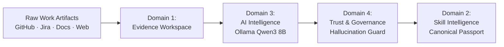

# Skill Passport

> **Evidence-Backed Skill Intelligence Platform**  
> *Transform real engineering work, repository artifacts, and operational documents into verifiable, audit-proof skill records.*

[](https://nextjs.org/)
[](https://fastapi.tiangolo.com/)
[](https://www.sqlalchemy.org/)
[](https://supabase.com/)
[-purple?style=flat-square)](https://ollama.ai/)
[](#)

---

## 1. Executive Summary

**Skill Passport** is not a conversational chatbot or simple keyword-matching resume parser. It is a deterministic, evidence-backed skill intelligence platform.

Modern tech workers generate extensive proof of their competencies daily across git repositories, code reviews, architectural RFCs, Jira issue completions, and technical documentation. Skill Passport ingests these raw work artifacts, normalizes them into tamper-evident records, analyzes them using local high-performance LLMs (Qwen3 8B), and subjects every extracted claim to a multi-stage **Trust & Governance** verification gate before writing immutable, verified skill records to the canonical Skill Passport.



---

## 2. Core Implemented Domains

### 📁 Domain 1: Evidence Workspace
*The ingestion foundation and raw provenance layer.*
- **Connected Sources**: Secure OAuth and PAT integrations with GitHub (repositories, pull requests, commits, language distributions, README files) and Jira (tickets, sprint work, project keys).
- **External Credential Vault**: Symmetrically encrypted at rest via 32-byte Fernet keys (`CONNECTOR_CREDENTIAL_ENCRYPTION_KEY`). Tokens never leak to client responses or system logs.
- **Document Processing**: Robust multi-format parsing for PDF (PyMuPDF), DOCX (python-docx), PPTX (python-pptx), plain text, and markdown with automatic sha256 checksumming.
- **SSRF-Hardened Web Ingestion**: Distills portfolio websites and project writeups using Trafilatura while enforcing strict private IP blocking (`127.0.0.1`, RFC 1918 subnets, cloud metadata endpoints).
- **Ingestion Telemetry**: Real-time progress tracking through `source_sync_runs` and `ingestion_jobs`.

### 🧠 Domain 3: AI Intelligence
*Deep technical work decomposition and skill extraction.*
- **Ollama Inference Engine**: Configured for `qwen3:8b` running locally at `http://localhost:11434` with an 8192-token context window (`num_ctx: 8192`) optimized for 100% GPU offload on 6GB-8GB VRAM.
- **Work Analysis Pipeline**: Segregates raw text into observed facts, claimed work, inferred attributes, and technical tasks with confidence scoring.
- **Deterministic Fallback Engine**: If Ollama is offline or experiences transient timeouts, the system falls back gracefully to deterministic keyword and regex heuristics, flagging outputs as `fallback_used: true`.
- **Semantic Vector Storage**: ChromaDB integration (`./chroma_data`) providing dense vector indexing using `nomic-embed-text` embeddings.

### 🛡️ Domain 4: Trust & Governance
*Zero-hallucination verification, provenance validation, and safety controls.*
- **7-Point Hallucination Guard**: Every AI claim undergoes strict verbatim citation checking against the source text, author attribution validation, and contradiction checks.
- **Schema & Reference Output Validation**: Validates AI JSON structures against strict Pydantic contracts; flags and quarantines missing fields or invalid references.
- **Prompt Injection Defense**: Evaluates incoming document text against known prompt injection and jailbreak patterns, automatically quarantining suspect excerpts.
- **Human Review Queue**: High-uncertainty claims and unresolved conflicts are routed to a human review workflow with complete decision logging.
- **Tamper-Evident Audit Trail**: Every status transition, manual override, and verification decision is logged in `review_audit_events`.

### 🎓 Domain 2: Skill Intelligence
*Canonical taxonomy, skill graphs, and verified passport records.*
- **Curated Competency Taxonomy**: Normalized hierarchy of technical and operational competencies (`competency_taxonomy`) with synonym resolution.
- **Evidence-to-Skill Mapping**: Many-to-many relationship tracking with relevance scoring, proficiency levels, and direct artifact provenance.
- **Skill Passport Ledger**: The authoritative, aggregated view of an engineer's verified capabilities, verified history, and evidence coverage metrics.

---

## 3. Technology Stack

| Layer | Technologies | Role / Justification |
| :--- | :--- | :--- |
| **Frontend** | Next.js 16.3.6 (App Router), React 19, Tailwind CSS v4, Lucide Icons | High-performance server/client architecture with Turbopack and Moonwood Neobrutalist design system |
| **Backend API** | FastAPI 0.115+, Uvicorn, Pydantic v2 | High-throughput asynchronous REST API with strict request/response validation |
| **Database & ORM**| PostgreSQL (Supabase), SQLAlchemy 2.0, Alembic | Relational data persistence with 27 models, connection pooling, and circuit breaker |
| **Security** | Fernet (cryptography), PyJWT, Supabase Auth | Field-level token encryption, bearer token JWT auth, role/owner enforcement |
| **AI / LLM** | Ollama, Qwen3 8B, nomic-embed-text, ChromaDB | Local private inference, zero data leakage to external LLM APIs, vector index |
| **Document Ingestion**| PyMuPDF, python-docx, python-pptx, Trafilatura, BeautifulSoup4 | Multi-modal file extraction, OCR support, and SSRF-safe web parsing |
| **Background Jobs** | Celery 5.4+, Redis (with in-memory async runner fallback) | Asynchronous ingestion pipeline and batch work analysis |

---

## 4. System Architecture

```text
                                  ┌───────────────────────────────┐
                                  │   Next.js 16 App Frontend     │
                                  │    (http://localhost:3001)    │
                                  └──────────────┬────────────────┘
                                                 │
                                                 │ Proxies /api/v1/*
                                                 ▼
                                  ┌───────────────────────────────┐
                                  │      FastAPI Backend API      │
                                  │   (http://127.0.0.1:8001)     │
                                  └──────┬───────────────┬────────┘
                                         │               │
                 ┌───────────────────────┴──────┐        └────────────────────────┐
                 ▼                              ▼                                 ▼
      ┌────────────────────┐         ┌────────────────────┐            ┌────────────────────┐
      │ PostgreSQL /       │         │  Local Ollama      │            │  Local ChromaDB    │
      │ Supabase Pooler    │         │  (Qwen3 8B @       │            │  Vector Storage    │
      │ 27 Models + Audit  │         │   port 11434)      │            │  (./chroma_data)   │
      └────────────────────┘         └────────────────────┘            └────────────────────┘
```

---

## 5. Quickstart Guide (Local Development)

### 5.1 Prerequisites
- **Node.js**: v20.x or v22.x LTS
- **Python**: v3.11.x or v3.12.x
- **Ollama**: Installed and running locally ([Download Ollama](https://ollama.ai/))
- **PostgreSQL**: A Supabase project or local PostgreSQL instance

### 5.2 Step 1: Clone & Configure Environment
```bash
git clone <repo-url>
cd HackMatrix-MISC02/skillpassport-powered-by-growthlens

# Setup Frontend Environment
cp .env.example .env.local

# Setup Backend Environment
cp .env.example backend/.env
```
*Edit `.env.local` and `backend/.env` with your actual Supabase URL, keys, and database connection strings.*

### 5.3 Step 2: Install Dependencies
```bash
# Frontend Dependencies
npm install

# Backend Dependencies (use a Python virtual environment)
python -m venv venv
# On Windows:
.\venv\Scripts\Activate.ps1
# On macOS/Linux:
source venv/bin/activate

pip install -r requirements.txt
```

### 5.4 Step 3: Run Database Migrations
```bash
cd backend
alembic upgrade head
cd ..
```

### 5.5 Step 4: Setup & Warm Up Ollama
```bash
# Pull required models
ollama pull qwen3:8b
ollama pull nomic-embed-text

# Verify Ollama is serving
curl http://localhost:11434/api/tags
```

### 5.6 Step 5: Launch Services
In two separate terminal windows:

**Terminal 1 (Backend - Port 8001):**
```bash
python -m uvicorn backend.app.main:app --host 127.0.0.1 --port 8001 --reload
```

**Terminal 2 (Frontend - Port 3001):**
```bash
npm run dev
```

Visit **`http://localhost:3001`** in your browser. The application dashboard is accessible at `/app/evidence/library` and `/app/passport/skills`.

---

## 6. Project Layout

```text
skillpassport-powered-by-growthlens/
├── README.md                           # Master project README (this file)
├── CONTRIBUTING.md                     # Engineering values, branching & PR rules
├── SECURITY.md                         # Security policy, credential isolation & SSRF
├── .env.example                        # Unified environment variable template
├── requirements.txt                    # Backend Python dependencies
├── package.json                        # Frontend Node dependencies & scripts
├── next.config.ts                      # Next.js config & backend API rewrites
│
├── docs/                               # Developer & Architecture Documentation
│   ├── README.md                       # Documentation hub & reading paths
│   ├── setup/                          # Local installation & operations guides
│   │   ├── LOCAL_DEVELOPMENT.md        # Complete developer setup walkthrough
│   │   ├── DEPENDENCIES.md             # System & package prerequisites
│   │   ├── ENVIRONMENT_VARIABLES.md    # Comprehensive configuration dictionary
│   │   ├── DATABASE_SETUP.md           # Supabase, migrations & connection pool rules
│   │   ├── OLLAMA_SETUP.md             # Local LLM setup, context tuning & GPU check
│   │   ├── TROUBLESHOOTING.md          # Diagnostic runbook for common failure modes
│   │   └── VERIFICATION_CHECKLIST.md   # Pre-flight readiness verification steps
│   ├── architecture/                   # Deep system designs
│   │   ├── SYSTEM_ARCHITECTURE.md      # Multi-tier design & component boundaries
│   │   ├── DATA_FLOW.md                # Ingestion, analysis & verification pipelines
│   │   ├── DATABASE_AND_DATA_MODEL.md  # 27 SQLAlchemy models & schema catalog
│   │   ├── AUTHENTICATION_AND_AUTHORIZATION.md # JWT auth, RBAC & Fernet security
│   │   └── BACKGROUND_JOBS.md          # Ingestion workers, Celery & async execution
│   └── domains/                        # Domain-specific deep dives
│       ├── README.md                   # Domain boundary index & responsibility matrix
│       ├── EVIDENCE_WORKSPACE.md       # Ingestion, connectors & document processing
│       ├── SKILL_INTELLIGENCE.md       # Taxonomy, proficiency & passport ledger
│       ├── AI_INTELLIGENCE.md          # Ollama extraction, RAG & fallback mechanics
│       └── TRUST_AND_GOVERNANCE.md     # Hallucination guard, validation & audit trail
│
├── backend/                            # FastAPI Application
│   ├── alembic/                        # Database migration scripts
│   ├── app/
│   │   ├── ai/                         # Extractors, guards, validators, injections
│   │   ├── api/                        # REST routes (ai, evidence, passport, etc.)
│   │   ├── core/                       # Config, logging, encryption, exceptions
│   │   ├── db/                         # Session, pooling, reliability circuit breaker
│   │   ├── integrations/               # GitHub & Jira API clients
│   │   ├── models/                     # 27 SQLAlchemy ORM models
│   │   ├── rag/                        # ChromaDB vector collection manager
│   │   ├── schemas/                    # Pydantic v2 validation contracts
│   │   ├── storage/                    # Storage adapters
│   │   └── workers/                    # Ingestion job runner
│   └── tests/                          # 16 Pytest test suites
│
└── src/                                # Next.js 16 Frontend
    ├── app/                            # App Router routes
    │   ├── page.tsx                    # Public marketing homepage
    │   ├── features/                   # Public features showcase
    │   ├── about/                      # Product manifesto
    │   ├── developers/                 # Developer engineering page
    │   ├── login/ & signup/            # Public authentication pages
    │   └── app/                        # Authenticated product application
    │       ├── evidence/               # Evidence Workspace pages
    │       ├── passport/               # Skill Passport pages
    │       └── ai/                     # AI Intelligence & Trust Governance pages
    ├── components/                     # Reusable UI component library
    ├── context/                        # React Context providers (EvidenceContext)
    ├── lib/                            # API client proxies & Supabase client
    └── types/                          # Shared TypeScript type definitions
```

---

## 7. Verification & Automated Tests

### Run Backend Test Suite
```bash
python -m pytest backend/tests -v
```

### Run Frontend Linting & Build
```bash
npm run lint
npm run build
```

---

## 8. Vercel Deployment Instructions

The repository root is structured for direct deployment to Vercel:

1. Import the repository into **Vercel**.
2. Under **Project Settings** → **General**:
   - Set **Root Directory** to: `skillpassport-powered-by-growthlens`
3. Under **Build & Development Settings**:
   - Framework Preset: **Next.js** (auto-detected)
   - Build Command: `npm run build`
   - Output Directory: `.next`
   - Install Command: `npm install`
4. Set required frontend environment variables (`NEXT_PUBLIC_SUPABASE_URL`, `NEXT_PUBLIC_SUPABASE_ANON_KEY`, `NEXT_PUBLIC_BACKEND_URL`).
5. Deploy.

---

## 9. Documentation Directory Map

For in-depth architectural and operational instructions:
- [Setup & Local Development](docs/setup/LOCAL_DEVELOPMENT.md)
- [System Architecture](docs/architecture/SYSTEM_ARCHITECTURE.md)
- [Evidence Workspace Guide](docs/domains/EVIDENCE_WORKSPACE.md)
- [Skill Intelligence Guide](docs/domains/SKILL_INTELLIGENCE.md)
- [AI Intelligence Guide](docs/domains/AI_INTELLIGENCE.md)
- [Trust & Governance Guide](docs/domains/TRUST_AND_GOVERNANCE.md)
