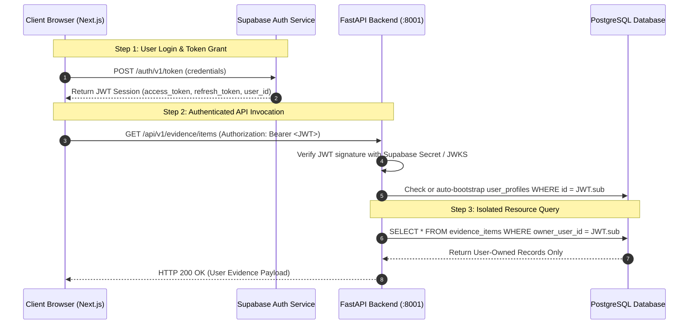

# Authentication, Authorization & Security Architecture — Skill Passport

This document details the authentication protocols, user authorization layers, role-based controls, and credential cryptography implemented in Skill Passport.

---

## 1. Authentication Lifecycle

Skill Passport integrates with **Supabase Auth** (GoTrue) for identity management. The system supports email/password, magic links, and OAuth identity providers.



---

## 2. Token Verification & User Resolution

The backend verifies incoming JWTs inside [`backend/app/api/dependencies.py`](../../backend/app/api/dependencies.py) using the `get_current_user` dependency:

```python
async def get_current_user(
    credentials: HTTPAuthorizationCredentials = Security(security_scheme),
    db: Session = Depends(get_db),
) -> UserProfile:
    token = credentials.credentials
    # 1. Decode & verify JWT signature using Supabase secret / public keys
    payload = verify_supabase_jwt(token)
    user_id = payload.get("sub")
    if not user_id:
        raise HTTPException(status_code=401, detail="Invalid token claims: missing sub")

    # 2. Retrieve or automatically bootstrap UserProfile
    profile = db.query(UserProfile).filter(UserProfile.id == user_id).first()
    if not profile:
        profile = bootstrap_user_profile(db, user_id, payload)
    
    return profile
```

### Development Mock Mode:
In local development environments (`APP_ENV=development`), if no bearer token is supplied, `dependencies.py` provides an isolated test user context (`dev-user-001`) to allow immediate local experimentation and automated pytest execution without configuring external login flows.

---

## 3. Tenant Isolation & Resource Ownership

Skill Passport enforces strict user data isolation across all storage and query layers:

### 3.1 PostgreSQL Isolation
Every user-owned table (`evidence_items`, `uploaded_documents`, `connected_sources`, `source_sync_runs`, `work_analysis_results`, `human_review_tasks`) contains an **`owner_user_id`** column:
- All repository queries and SQLAlchemy filters apply `.filter(Model.owner_user_id == current_user.id)`.
- Updates or deletes on IDs belonging to another user raise an immediate `HTTP 404 Not Found` or `HTTP 403 Forbidden`.

### 3.2 ChromaDB Semantic Index Isolation
Vector collections in ChromaDB store the `owner_user_id` in the document metadata:
```python
results = collection.query(
    query_embeddings=query_vector,
    n_results=10,
    where={"owner_user_id": current_user.id}  # Enforces cross-tenant isolation
)
```

### 3.3 Supabase Storage Bucket Isolation
Uploaded evidence files are stored in directory paths prefixed with the user's UUID:
```text
evidence-originals/{owner_user_id}/{sha256_hash}.pdf
evidence-derivatives/{owner_user_id}/{document_id}.json
```

---

## 4. Role-Based Access Control (RBAC)

Skill Passport recognizes two primary authorization roles:

| Role | Permissions & Scope |
| :--- | :--- |
| **`employee`** | • Ingest and manage personal GitHub, Jira, and document sources.<br/>• Trigger AI work analysis and view candidate skills.<br/>• View canonical Skill Passport and evidence coverage.<br/>• Dispute unverified skills or flag extraction discrepancies. |
| **`reviewer`** / **`manager`** | • All `employee` permissions.<br/>• Access the **Human Review Queue** (`/app/ai/review-queue`).<br/>• Resolve contradictory claims in `evidence_conflicts`.<br/>• Execute manual overrides with mandatory reason logging in `review_audit_events`.<br/>• Trigger golden dataset AI evaluation suites (`/app/ai/evaluation`). |

Role enforcement is handled via the `require_reviewer` dependency:
```python
def require_reviewer(current_user: UserProfile = Depends(get_current_user)) -> UserProfile:
    if current_user.role not in ("reviewer", "manager", "admin"):
        raise HTTPException(
            status_code=status.HTTP_403_FORBIDDEN,
            detail="Reviewer privileges required to perform this action"
        )
    return current_user
```

---

## 5. External Credential Encryption (Fernet Vault)

When a user links GitHub or Jira, their Personal Access Tokens or API tokens are encrypted prior to database insertion:

```text
[Plaintext GitHub PAT] 
          │
          ▼
[Fernet Symmetric Cipher (AES-128-CBC + HMAC-SHA256)]
  Using: CONNECTOR_CREDENTIAL_ENCRYPTION_KEY (32 bytes)
          │
          ▼
[Encrypted Ciphertext Token in connected_sources.encrypted_credentials]
```

### Security Guarantees:
1. **Zero Secret Leakage**: API routes (`GET /api/v1/connections`) never return the raw or decrypted token. The client receives only a boolean indicator (`is_configured: true`) and connection health telemetry.
2. **Key Rotation Readiness**: The `credential_key_version` column records which key generated the ciphertext, allowing non-disruptive key rotation routines.
3. **Decryption at Execution**: Tokens are decrypted strictly in memory at the exact moment an API sync call is dispatched to GitHub or Jira, then discarded from memory.
