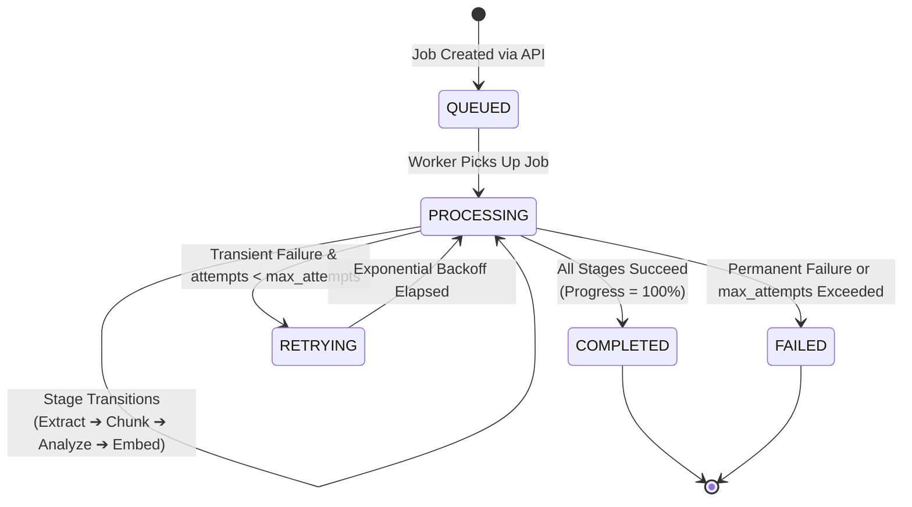

# Background Jobs & Asynchronous Processing — Skill Passport

This document explains the asynchronous job execution engine, queue architectures, progress telemetry, and failure retry semantics implemented in Skill Passport.

---

## 1. Why Asynchronous Processing?

Evidence ingestion and AI skill extraction involve high-latency operations that cannot run synchronously within a standard HTTP request/response window:

| Workload | Typical Duration | Processing Mode |
| :--- | :--- | :--- |
| **Document Upload & Storage** | ~200 – 500 ms | Synchronous API |
| **PDF Text Extraction & Parsing** | ~1 – 3 seconds | Background Job |
| **Multi-Repository GitHub Sync** | ~5 – 30 seconds | Background Job |
| **Ollama Qwen3 8B Work Analysis** | ~2 – 6 seconds per item | Background Job |
| **ChromaDB Vector Embedding Generation**| ~500 ms per chunk | Background Job |

---

## 2. Ingestion Job State Machine

Every asynchronous ingestion task is tracked via the `ingestion_jobs` table:



### State Definitions:
- **`QUEUED`**: The task record is persisted in the database; waiting for worker availability.
- **`PROCESSING`**: A worker thread has locked the job. Granular stage updates (`stage_metadata`) and `progress_percentage` (0–100) are emitted continuously.
- **`COMPLETED`**: Work artifacts are fully normalized into `evidence_items` and indexed in ChromaDB.
- **`FAILED`**: The task halted due to an unrecoverable error (e.g., corrupted file, bad encryption key). Diagnostic details are saved to `error_summary`.

---

## 3. Dual-Mode Worker Architecture

Skill Passport supports two execution models for background processing:

```text
┌────────────────────────────────────────────────────────┐
│               Task Dispatcher (FastAPI)                │
└───────────┬────────────────────────────────┬───────────┘
            │                                │
      Redis Available?                 Redis Offline?
            │                                │
            ▼                                ▼
┌────────────────────────┐      ┌────────────────────────┐
│     Celery Worker      │      │   In-Memory Async Pool  │
│  (Redis Broker @ :6379)│      │  (ThreadPoolExecutor)  │
│    Production-Ready    │      │ Zero-Dependency Dev    │
└────────────────────────┘      └────────────────────────┘
```

### 3.1 Mode A: Distributed Celery + Redis (Production)
- **Broker**: Redis (`REDIS_URL=redis://localhost:6379/0`).
- **Configuration**: [`backend/app/workers/celery_app.py`](../../backend/app/workers/celery_app.py).
- **Execution Command**:
  ```bash
  celery -A backend.app.workers.celery_app worker --loglevel=info -c 2
  ```
- **Strengths**: Horizontal scaling, cross-process queue isolation, persistent task retries.

### 3.2 Mode B: In-Memory Async Pool (Local Development Default)
- **Fallback Activation**: If `REDIS_URL` is unreachable or not configured, the backend automatically diverts background tasks to an internal `concurrent.futures.ThreadPoolExecutor`.
- **Strengths**: Collaborators can run the full project locally without installing or configuring Redis.

---

## 4. Ingestion Telemetry & Progress Reporting

The frontend displays real-time progress for active syncs and document extractions by polling the ingestion telemetry endpoint:

- **Endpoint**: `GET /api/v1/ingestion-runs/{run_id}`
- **Payload Structure**:
  ```json
  {
    "id": "run-8853fee2",
    "status": "PROCESSING",
    "progress_percentage": 65,
    "current_stage": "ai_work_decomposition",
    "records_discovered": 14,
    "records_imported": 9,
    "records_skipped": 0,
    "records_failed": 0,
    "stages": [
      {"stage": "raw_extraction", "status": "COMPLETED", "duration_ms": 120},
      {"stage": "text_chunking", "status": "COMPLETED", "duration_ms": 45},
      {"stage": "ai_work_decomposition", "status": "PROCESSING", "duration_ms": 1820}
    ]
  }
  ```

---

## 5. Idempotency & Rate Limit Retries

1. **SHA-256 Deduplication**: Every incoming file or raw git commit payload generates a deterministic `content_hash`. If a job is resubmitted with an identical hash, the worker identifies the existing record, flags it as `records_skipped += 1`, and skips redundant AI processing.
2. **External Rate Limits (GitHub HTTP 429)**: The GitHub connector inspects `X-RateLimit-Reset` headers. When limits are approached, the sync job enters a sleeping backoff state before resuming.
3. **Max Attempt Bounds**: Ingestion jobs enforce `max_attempts = 3`. If a job fails due to network disconnects, it is retried up to 3 times before failing permanently.
