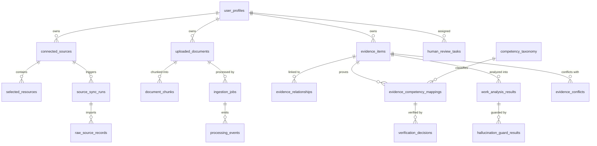

# Database & Data Model Catalog — Skill Passport

This document catalogs the complete relational data model of Skill Passport, documenting all 27 SQLAlchemy 2.0 ORM models, relationships, cascading rules, and storage bucket bindings.

---

## 1. Entity-Relationship Domain Map

---

## 2. Model Catalog by Domain

### 2.1 User Profile & Identity

#### `user_profiles` ([`backend/app/models/user_profile.py`](../../backend/app/models/user_profile.py))
Represents the authenticated engineer's profile and onboarding state.
- **`id`** (`String(36)`, PK): UUID matching the Supabase `auth.users.id`.
- **`email`** (`String(255)`, Unique, Indexed): Verified user email address.
- **`display_name`**, **`headline`**, **`job_title`**, **`specialization`**, **`department_or_team`**: Profile metadata.
- **`experience_level`**: Enum/string (`entry`, `mid`, `senior`, `staff`, `principal`).
- **`professional_goal`**, **`professional_summary`**: High-level career narrative.
- **`onboarding_status`**: State machine (`not_started`, `in_progress`, `completed`).
- **`onboarding_current_step`**, **`onboarding_current_category`**: Multi-step wizard position.
- **`github_skipped`**, **`jira_skipped`**: Tracks connector bypass actions during onboarding.
- **`onboarding_completed_at`**: Timestamp of completed setup.

---

### 2.2 Integrations & Connected Sources

#### `connected_sources` ([`backend/app/models/connection.py`](../../backend/app/models/connection.py))
Stores external OAuth/PAT credentials and connection health.
- **`id`** (`String(36)`, PK): UUID.
- **`owner_user_id`** (`String(36)`, Indexed): Foreign key reference to `user_profiles.id`.
- **`provider`** (`String(50)`): Provider identity (`github`, `jira`).
- **`account_identity`** (`String(255)`): Username, email, or GitHub login.
- **`connection_status`**: Status (`active`, `revoked`, `error`, `disconnected`).
- **`encrypted_credentials`** (`Text`): Fernet AES-128 encrypted token payload.
- **`credential_key_version`**: Key rotation version tag.
- **`requested_scopes`**, **`granted_scopes`** (`JSONB`): Granted OAuth scope arrays.
- **`connection_metadata`** (`JSONB`): Rate limit metadata, avatar URLs, organization names.
- **`last_sync_at`**, **`last_sync_attempt_at`**, **`disconnected_at`**: Sync timestamps.

#### `selected_resources` ([`backend/app/models/connection.py`](../../backend/app/models/connection.py))
Individual repositories or projects chosen by the user for ingestion.
- **`id`** (`String(36)`, PK): UUID.
- **`connection_id`** (`String(36)`, FK): References `connected_sources.id`.
- **`external_resource_id`** (`String(255)`): GitHub repository ID or Jira Project Key.
- **`name`**, **`url`**: Resource display name and external URL.
- **`is_selected`** (`Boolean`): Ingestion inclusion toggle.
- **`content_categories`** (`JSONB`): Categories enabled (`["code", "prs", "issues", "releases"]`).

#### `source_sync_runs` ([`backend/app/models/sync_run.py`](../../backend/app/models/sync_run.py))
Execution run tracker for connector synchronization.
- **`id`** (`String(36)`, PK): UUID.
- **`owner_user_id`** (`String(36)`, Indexed): User reference.
- **`connection_id`** (`String(36)`, FK): Connection reference.
- **`trigger_type`**: `manual`, `scheduled`, `webhook`.
- **`status`**: `queued`, `in_progress`, `completed`, `failed`, `partial_success`.
- **Counters**: `records_discovered`, `records_imported`, `records_skipped`, `records_duplicated`, `records_failed`.
- **`error_summary`** (`Text`): Error diagnostic message if failed.

#### `raw_source_records` ([`backend/app/models/sync_run.py`](../../backend/app/models/sync_run.py))
Immutable raw JSON payloads ingested from external APIs.
- **`id`** (`String(36)`, PK): UUID.
- **`sync_run_id`** (`String(36)`, FK): Sync run reference.
- **`record_type`**: `github_commit`, `github_pr`, `jira_issue`, `github_readme`.
- **`external_record_id`**: SHA commit hash, PR number, or Jira issue key.
- **`content_hash`** (`String(64)`, Indexed): SHA-256 hash for deduplication.
- **`raw_payload`** (`JSONB`): Untruncated external JSON response.

---

### 2.3 Document Processing & Web Scraping

#### `uploaded_documents` ([`backend/app/models/document.py`](../../backend/app/models/document.py))
Uploaded file metadata and storage pointers.
- **`id`** (`String(36)`, PK): UUID.
- **`owner_user_id`** (`String(36)`, Indexed): User reference.
- **`original_filename`**, **`mime_type`**, **`file_size_bytes`**: File descriptors.
- **`sha256_hash`** (`String(64)`, Indexed): Cryptographic content hash.
- **`storage_bucket`**: Defaults to `evidence-originals`.
- **`private_storage_key`**: S3/Supabase storage path (`{user_id}/{sha256_hash}.pdf`).
- **`processing_state`**: `uploaded`, `parsing`, `chunked`, `analyzed`, `failed`.
- **`extraction_summary`** (`JSONB`): Page counts, word counts, detected language.

#### `document_chunks` ([`backend/app/models/document.py`](../../backend/app/models/document.py))
Normalized paragraph and slide-level text segments.
- **`id`** (`String(36)`, PK): UUID.
- **`document_id`** (`String(36)`, FK): References `uploaded_documents.id`.
- **`page_or_slide_number`** (`Integer`): Physical document location.
- **`chunk_index`** (`Integer`): Sequential reading order index.
- **`original_text`**, **`normalized_text`**: Raw and cleaned extracted text.
- **`char_offset_start`**, **`char_offset_end`**: Character span offsets.
- **`extraction_method`**: `pymupdf_direct`, `python_docx`, `trafilatura_scrape`, `winocr`.

#### `web_crawl_records` ([`backend/app/models/web_crawl.py`](../../backend/app/models/web_crawl.py))
Distilled portfolio and web article records with SSRF tracking.
- **`id`** (`String(36)`, PK): UUID.
- **`submitted_url`**, **`final_url`**: Target and resolved URLs.
- **`page_title`**, **`content_hash`**: Cleaned metadata.
- **`http_status`**, **`extraction_status`**: Crawler telemetry.
- **`cleaned_content`** (`Text`): Distilled markdown/text stripped of ads and navigation.

---

### 2.4 Evidence & Canonical Taxonomy

#### `evidence_items` ([`backend/app/models/evidence.py`](../../backend/app/models/evidence.py))
The central normalized work artifact ledger.
- **`id`** (`String(36)`, PK): UUID.
- **`owner_user_id`** (`String(36)`, Indexed): User reference.
- **`source_provider`**: `github`, `jira`, `document_upload`, `web_portfolio`.
- **`source_type`**: `pull_request`, `commit`, `issue`, `pdf_resume`, `architecture_rfc`.
- **`source_url`**, **`source_name`**: Human-readable provenance.
- **`title`**, **`description`**: Normalized summary.
- **`extracted_excerpt`**: Representative work excerpt (used for citation checks).
- **`observed_timestamp`**: When the work was actually performed.
- **`attribution_status`**: `direct_author`, `collaborator`, `reviewer`, `assigned`.
- **`is_collaborative`** (`Boolean`): Indicates team participation.
- **`evidence_strength`** (`Float`): Composite quality score (0.0 – 100.0).
- **`extraction_confidence`** (`Float`): AI model confidence (0.00 – 1.00).
- **`verification_status`**: `unverified`, `pending_review`, `verified`, `rejected`, `quarantined`.
- **`content_hash`** (`String(64)`, Indexed): Deduplication hash.

#### `competency_taxonomy` ([`backend/app/models/taxonomy.py`](../../backend/app/models/taxonomy.py))
The authoritative, curated skills taxonomy.
- **`id`** (`String(36)`, PK): UUID.
- **`canonical_name`** (`String(255)`, Unique): Official standardized skill name.
- **`normalized_name`** (`String(255)`, Indexed): Lowercase slug (`postgresql`, `fastapi`).
- **`category`**: Domain grouping (`backend`, `cloud_infrastructure`, `ai_ml`, `governance`).
- **`aliases`** (`JSONB`): Synonyms array (`["Postgres", "pg", "PostgreSQL 15"]`).
- **`parent_competency_id`** (`String(36)`, FK): Hierarchical parent skill.
- **`status`**: `active`, `deprecated`, `candidate`.

#### `evidence_competency_mappings` ([`backend/app/models/taxonomy.py`](../../backend/app/models/taxonomy.py))
Many-to-many relationship linking work evidence to taxonomy competencies.
- **`id`** (`String(36)`, PK): UUID.
- **`evidence_id`** (`String(36)`, FK): References `evidence_items.id`.
- **`competency_id`** (`String(36)`, FK): References `competency_taxonomy.id`.
- **`mapping_method`**: `ollama_qwen`, `deterministic_heuristic`, `manual_expert`.
- **`relevance_score`** (`Float`): Competency relevance to this artifact (0.0 – 1.0).
- **`supporting_excerpt`** (`Text`): Exact verbatim quote demonstrating the skill.
- **`proficiency_level`**: Assessed level (`foundational`, `practitioner`, `advanced`, `expert`).
- **`status`**: `suggested`, `verified`, `disputed`, `rejected`.

---

### 2.5 AI Decomposition & Trust Governance

#### `work_analysis_results` ([`backend/app/models/ai_governance.py`](../../backend/app/models/ai_governance.py))
Structured output produced by Ollama Qwen3 8B.
- **`id`** (`String(36)`, PK): UUID.
- **`evidence_id`** (`String(36)`, FK): References `evidence_items.id`.
- **`observed_facts`**, **`claimed_information`**, **`inferred_attributes`** (`JSONB`): Deconstructed factual segments.
- **`technical_tasks`**, **`technologies`** (`JSONB`): Extracted technical signals.
- **`uncertainty_flags`** (`JSONB`): Ambiguities detected by the LLM.
- **`confidence_score`** (`Float`): Calibrated model confidence.
- **`fallback_used`** (`Boolean`): Set to `True` if heuristic fallback was activated.
- **`model_name`**, **`model_version`**: e.g., `qwen3:8b`.

#### `hallucination_guard_results` ([`backend/app/models/ai_governance.py`](../../backend/app/models/ai_governance.py))
Stores the results of the 7-stage deterministic citation and hallucination check.
- **`id`** (`String(36)`, PK): UUID.
- **`analysis_id`** (`String(36)`, FK): References `work_analysis_results.id`.
- **`claim_text`** (`Text`): The specific technical claim being tested.
- **`citation_verbatim_found`** (`Boolean`): True if citation exists verbatim in source.
- **`ownership_check`** (`Boolean`): True if user is verified author/contributor.
- **`semantic_support_score`** (`Float`): Dense cosine similarity score.
- **`contradiction_check`** (`Boolean`): True if no contradictory evidence exists.
- **`guard_outcome`**: `PASS`, `FLAG`, `QUARANTINE`, `REJECT`.
- **`reason_codes`** (`JSONB`): Specific failure codes (`["NO_VERBATIM_CITATION"]`).

#### `human_review_tasks` ([`backend/app/models/ai_governance.py`](../../backend/app/models/ai_governance.py))
Manages manual review items flagged by low AI confidence or governance alerts.
- **`id`** (`String(36)`, PK): UUID.
- **`task_type`**: `hallucination_review`, `conflict_resolution`, `prompt_injection_audit`.
- **`priority`**: `low`, `medium`, `high`, `critical`.
- **`status`**: `open`, `in_review`, `resolved`, `dismissed`.
- **`reviewer_action`**, **`reviewer_notes`**: Action taken and notes.
- **`reviewed_at`**: Timestamp of resolution.

#### `review_audit_events` ([`backend/app/models/audit.py`](../../backend/app/models/audit.py))
Immutable append-only audit trail logging all state transitions and human overrides.
- **`id`** (`String(36)`, PK): UUID.
- **`actor_user_id`**: User ID who performed the action.
- **`target_record_id`**, **`target_record_type`**: Affected record.
- **`event_type`**: `skill_verified`, `guard_override`, `source_revoked`.
- **`previous_state`**, **`new_state`** (`JSONB`): State diff snapshot.
- **`reason_note`**: Required explanation for overrides.
- **`event_timestamp`**: UTC timestamp.
