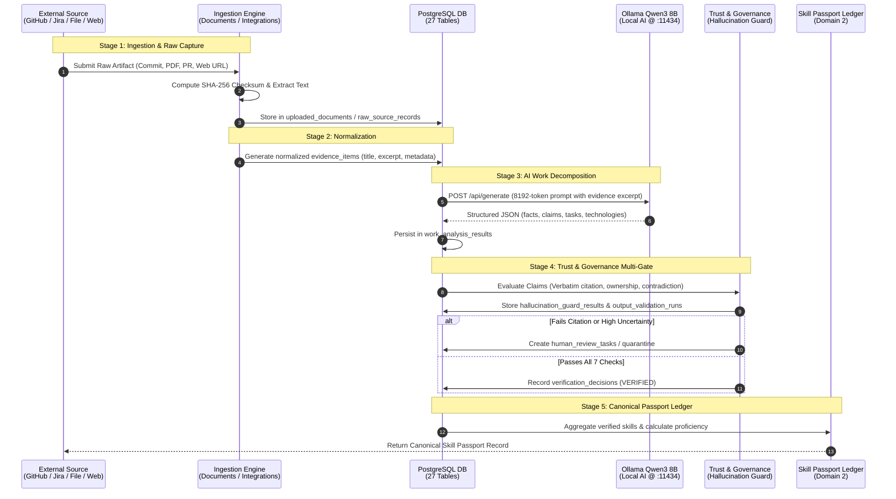

# Data Flow & Pipelines — Skill Passport

This document traces the complete end-to-end data lifecycle in Skill Passport: from raw work artifact ingestion through AI decomposition, governance gates, and canonical Skill Passport generation.

---

## 1. End-to-End Data Pipeline Architecture



---

## 2. Stage-by-Stage Pipeline Breakdown

### 2.1 Stage 1: Ingestion & Raw Capture

Raw engineering artifacts enter the platform through four distinct ingestion adapters:

1. **GitHub Adapter** ([`backend/app/integrations/github/`](../../backend/app/integrations/github/)):
   - Connects using a personal access token encrypted with Fernet.
   - Syncs selected repositories, commits, pull requests, language breakdowns, and README files.
   - Records raw JSON responses in `raw_source_records` with immutable `content_hash` keys.
2. **Jira Adapter** ([`backend/app/integrations/jira/`](../../backend/app/integrations/jira/)):
   - Ingests closed tickets, issue descriptions, sprint stories, and story point allocations.
3. **Document Processor** ([`backend/app/api/documents.py`](../../backend/app/api/documents.py)):
   - Ingests uploaded PDF, DOCX, PPTX, or text files up to 25 MB.
   - Computes SHA-256 checksums to guarantee idempotency and detect duplicates.
   - Slices documents into paragraph-level segments stored in `document_chunks`.
4. **Portfolio & Web Scraper** ([`backend/app/api/portfolio.py`](../../backend/app/api/portfolio.py)):
   - SSRF-hardened crawler that validates target URLs against private IP blacklists.
   - Extracts semantic text via Trafilatura into `web_crawl_records`.

---

### 2.2 Stage 2: Evidence Normalization & Integrity Check

Raw inputs are normalized into canonical `evidence_items`:
- **Attribution Check**: Determines if the work artifact was authored individually, co-authored, or generated collaboratively (`is_collaborative`).
- **Provenance Tagging**: Assigns permanent lineage pointers (`source_provider`, `source_url`, `external_record_id`).
- **Evidence Quality Scoring**: Evaluates recency, completeness, verifiable links, and complexity into an `evidence_strength` score (0–100).

---

### 2.3 Stage 3: AI Work Decomposition (Ollama Qwen3 8B)

The normalized evidence excerpt is formatted into an 8192-token prompt and dispatched to Ollama:

```text
[Input Evidence] ➔ [Prompt Injection Filter] ➔ [Ollama Qwen3 8B / Heuristic Fallback]
```

The model executes a structured technical decomposition returning a validated JSON schema:
- **`observed_facts`**: Verifiable statements explicitly stated in the source text (e.g., "Configured SQLAlchemy QueuePool with pool_size=8").
- **`claimed_information`**: Self-reported or subjective assertions (e.g., "Led team architecture redesign").
- **`inferred_attributes`**: Competencies suggested by the technical context (e.g., "Database Reliability Engineering").
- **`technical_tasks`**: Concrete tasks executed (e.g., "Alembic schema migration generation").
- **`technologies`**: Languages, libraries, and frameworks referenced.
- **`confidence_score`**: Model's calibrated certainty (0.00 – 1.00).

---

### 2.4 Stage 4: Trust & Governance Verification Gate

Before any extracted skill is allowed into the canonical passport, it must clear the **7-point deterministic verification gate**:

```text
       ┌────────────────────────┐
       │   Extracted AI Claim   │
       └───────────┬────────────┘
                   │
                   ▼
     ┌────────────────────────────┐
     │ 1. Verbatim Citation Check │ ──► Must find exact character span in source text
     └─────────────┬──────────────┘
                   │
     ┌────────────────────────────┐
     │ 2. Author Attribution     │ ──► Confirms commit/author matches user profile
     └─────────────┬──────────────┘
                   │
     ┌────────────────────────────┐
     │ 3. Semantic Support Score  │ ──► Cosine similarity >= 0.75 via ChromaDB
     └─────────────┬──────────────┘
                   │
     ┌────────────────────────────┐
     │ 4. Contradiction Check     │ ──► Scans evidence_conflicts for contradicting data
     └─────────────┬──────────────┘
                   │
     ┌────────────────────────────┐
     │ 5. Schema Validation       │ ──► Validates output against Pydantic schema
     └─────────────┬──────────────┘
                   │
     ┌────────────────────────────┐
     │ 6. Prompt Injection Gate   │ ──► Ensures text does not contain jailbreak payloads
     └─────────────┬──────────────┘
                   │
     ┌────────────────────────────┐
     │ 7. Audit Logging           │ ──► Writes decision to review_audit_events
     └─────────────┬──────────────┘
                   │
          Passes All Gates?
         /                 \
       YES                  NO / Low Confidence
        │                   │
        ▼                   ▼
[ Canonical Passport ]  [ Human Review Queue / Quarantine ]
```

---

### 2.5 Stage 5: Canonical Skill Passport Ledger Aggregation

When a skill mapping is verified:
1. It is linked to the standardized competency in `competency_taxonomy`.
2. Proficiency is calculated using multi-source evidence weighting:
   - **Foundational (Level 1)**: Single verified evidence item.
   - **Practitioner (Level 2)**: Multiple verified evidence items across independent projects.
   - **Advanced (Level 3)**: Long-term track record with high evidence strength (>80) and collaborative reviews.
   - **Expert / Master (Level 4–5)**: Multi-year continuous contributions, architectural ownership, and cross-team leadership artifacts.
3. The result is served via `GET /api/v1/passport/skills` with full clickable citation links back to the source work artifacts.
