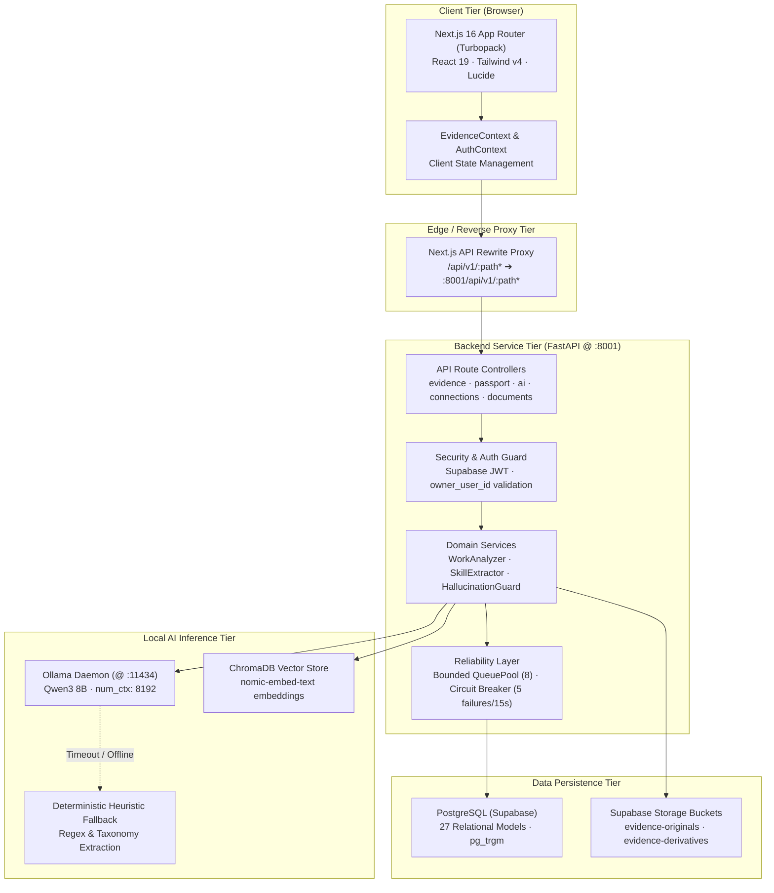

# System Architecture — Skill Passport

This document provides a comprehensive technical overview of the multi-tier architecture, system boundaries, component interactions, and security perimeters of Skill Passport.

---

## 1. High-Level Architectural Diagram

Skill Passport is structured as a decoupled multi-tier system composed of a modern React/Next.js frontend, an asynchronous FastAPI backend service, an enterprise PostgreSQL database, local private AI inference via Ollama, and an embedded ChromaDB vector store.



---

## 2. Component Tier Responsibilities

### 2.1 Client Presentation Tier (Next.js 16)
- **Host / Port**: `http://localhost:3001`
- **Framework**: Next.js 16 (App Router with Turbopack), React 19, TypeScript.
- **Styling**: Tailwind CSS v4 using the Moonwood Neobrutalist design tokens (`#DFE968`, `#FBF1CF`, `#F6C8D6`, `#1C1C1C`).
- **Core Views**:
  - `/app/evidence/library` — Filterable card grid of ingested evidence items.
  - `/app/evidence/sources` — Integration management for GitHub and Jira.
  - `/app/evidence/upload` — Multi-file document dropzone (PDF, DOCX, PPTX).
  - `/app/passport/skills` — Canonical Skill Passport with proficiency cards.
  - `/app/ai` — Consolidated AI Overview and 7 governance sub-pages.
- **Client State**: Centralized in [`src/context/EvidenceContext.tsx`](../../src/context/EvidenceContext.tsx), which loads data via the unified `GET /api/v1/ai/bootstrap` endpoint.

---

### 2.2 Backend Service Tier (FastAPI)
- **Host / Port**: `http://127.0.0.1:8001`
- **Application Factory**: [`backend/app/main.py`](../../backend/app/main.py)
- **Framework**: FastAPI 0.115+, Uvicorn ASGI server, Pydantic v2.
- **Key Responsibilities**:
  - Serves 9 modular API routers: `health`, `profile`, `connections`, `documents`, `portfolio`, `evidence`, `ingestion_runs`, `ai`, and `passport`.
  - Enforces request-level authentication and ownership isolation (`owner_user_id`).
  - Implements response gzip compression for payloads exceeding 1000 bytes.
  - Protects external integration secrets using Fernet AES-128 encryption.
  - Houses the bounded SQLAlchemy connection pool with active pre-pinging.

---

### 2.3 Local AI Inference Tier (Ollama & ChromaDB)
- **Host / Port**: `http://localhost:11434`
- **Engine**: Ollama serving `qwen3:8b` with an 8192-token context window (`num_ctx: 8192`).
- **Privacy Guarantee**: Zero source code, documentation, or user data ever leaves the local host. All work analysis and skill candidate extraction runs locally on GPU/CPU.
- **Embedded Vector Store**: ChromaDB (`./chroma_data`) persists 768-dimensional embeddings generated by `nomic-embed-text` for semantic artifact retrieval.

---

### 2.4 Data Persistence Tier (PostgreSQL via Supabase)
- **Database Engine**: PostgreSQL 15+ hosted on Supabase.
- **Relational Models**: 27 SQLAlchemy 2.0 ORM models covering the full lifecycle from raw web crawls and commits to audited skill passport entries.
- **Object Storage**: Private Supabase Storage buckets storing original uploaded PDFs/DOCXs (`evidence-originals`) and derived text extractions (`evidence-derivatives`).

---

## 3. Network Boundaries & Port Allocation

| Service | Protocol | Host / Address | External Visibility | Authentication |
| :--- | :--- | :--- | :--- | :--- |
| **Next.js Frontend** | HTTP / WS | `0.0.0.0:3001` | Public / Local Browser | Supabase Auth Session |
| **FastAPI Backend** | HTTP | `127.0.0.1:8001` | Localhost only | Supabase Bearer JWT |
| **Ollama Inference** | HTTP | `127.0.0.1:11434`| Localhost only | Loopback bound |
| **PostgreSQL (Pooler)**| TCP / TLS | `*.pooler.supabase.com:6543` | Outbound TLS only | SCRAM-SHA-256 / SSL |
| **ChromaDB Index** | File I/O | `./chroma_data` | Internal disk only | OS File Permissions |

---

## 4. Security Perimeters & Defense in Depth

```text
       [ External Network / Browser ]
                     │
      ─── Perimeter 1: HTTPS & Supabase JWT ───
                     ▼
           [ Next.js Application ]
                     │
      ─── Perimeter 2: Localhost Proxy Rewrite ───
                     ▼
            [ FastAPI Backend ]
                     │
      ─── Perimeter 3: Fernet Token Vault & SSRF Guard ───
                     ▼
      [ PostgreSQL DB & Local Ollama Inference ]
```

1. **Perimeter 1 (Edge Authentication)**: The client authenticates with Supabase Auth, obtaining a signed JWT containing the user's UUID.
2. **Perimeter 2 (Localhost Proxy)**: Browser requests target the frontend origin (`:3001`), which transparently proxies backend requests to `:8001`, preventing CORS misconfigurations and exposing only necessary REST endpoints.
3. **Perimeter 3 (Field-Level Encryption & Isolation)**: Sensitive integration tokens are encrypted using a master Fernet key before hitting disk. All SQL queries and vector searches strictly filter on `owner_user_id`. Web scrapers reject all private IPv4/IPv6 ranges before initiating outbound HTTP connections.
