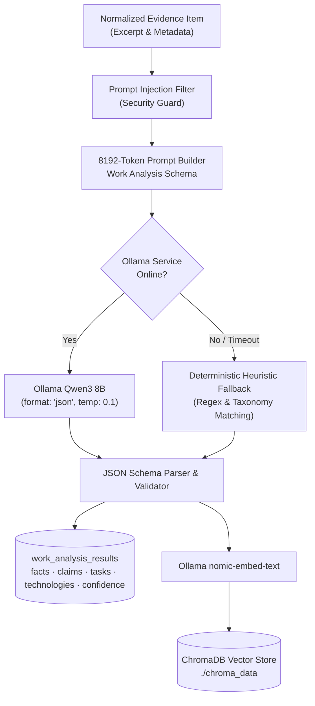

# Domain 3: AI Intelligence — Technical Guide

The **AI Intelligence** domain performs deep technical decomposition of engineering work. It extracts verified technical tasks, technologies, and skill signals while maintaining strict boundaries between observed facts and subjective claims using local private LLM inference.

---

## 1. Domain Architecture & Processing Pipeline



---

## 2. The Ollama Qwen3 8B Engine

Skill Passport conducts all language modeling locally using **Ollama**:
- **Endpoint**: `http://localhost:11434/api/generate`
- **Model**: `qwen3:8b`
- **Context Window**: 8192 tokens (`num_ctx: 8192`) configured in `backend/app/core/config.py`.
- **Low Temperature**: Fixed at `temperature: 0.1` to maximize determinism and consistency across repeated runs.

### Privacy & Data Sovereignty:
Because inference is hosted locally:
- Proprietary source code is never transmitted to public LLM APIs (OpenAI, Anthropic).
- PII and internal credentials remain within the developer's network perimeter.
- Inference operates completely offline without third-party API rate limits.

---

## 3. Four-Part Technical Work Decomposition

The AI engine avoids naive skill keyword matching by decomposing work evidence into four segregated categories:

```text
┌─────────────────────────────────────────────────────────────────┐
│                     Work Decomposition Schema                   │
├──────────────────┬──────────────────────────────────────────────┤
│ observed_facts   │ Verifiable statements explicitly in text.    │
│                  │ e.g. "Configured SQLAlchemy QueuePool(8)"    │
├──────────────────┼──────────────────────────────────────────────┤
│ claimed_info     │ Subjective, self-reported assertions.        │
│                  │ e.g. "Spearheaded enterprise modernization"  │
├──────────────────┼──────────────────────────────────────────────┤
│ inferred_attrs   │ Competencies implied by the technical scope. │
│                  │ e.g. "Database Reliability Engineering"      │
├──────────────────┼──────────────────────────────────────────────┤
│ technical_tasks  │ Specific technical operations performed.     │
│                  │ e.g. "Alembic schema migration generation"   │
└──────────────────┴──────────────────────────────────────────────┘
```

### JSON Response Schema ([`backend/app/ai/work_analyzer.py`](../../backend/app/ai/work_analyzer.py)):
```json
{
  "observed_facts": [
    "Added 27 SQLAlchemy models to backend/app/models/",
    "Implemented circuit breaker tripping on 5 consecutive failures"
  ],
  "claimed_information": [
    "Reduced database latency by 40%"
  ],
  "inferred_attributes": [
    "High-throughput API Design",
    "Fault-Tolerant Architecture"
  ],
  "technical_tasks": [
    "Configured Alembic migration script",
    "Integrated PyMuPDF document extraction"
  ],
  "technologies": [
    "FastAPI",
    "SQLAlchemy",
    "PostgreSQL",
    "Python"
  ],
  "uncertainty_flags": [],
  "confidence_score": 0.94,
  "summary": "Engineered database reliability layer with connection pooling and circuit breaking for FastAPI backend."
}
```

---

## 4. The Heuristic Fallback Engine

If Ollama is offline or times out (exceeding `OLLAMA_TIMEOUT_SECONDS=180.0`), the system executes a deterministic fallback:

1. `WorkAnalyzer` catches `httpx.ConnectError` or `httpx.TimeoutException`.
2. Extracts technologies by regex pattern matching against known programming languages and libraries.
3. Derives technical tasks from action verbs (e.g., `Add`, `Fix`, `Implement`, `Refactor`).
4. Persists the result with:
   - `fallback_used = True`
   - `fallback_reason = "ollama_unavailable"`
   - `confidence_score = 0.50`
5. The frontend displays an alert badge informing the user that deterministic heuristic extraction was utilized.

---

## 5. ChromaDB Vector Store & Semantic Retrieval

Skill Passport uses **ChromaDB** (`./chroma_data`) to index evidence embeddings:
- **Embedding Model**: `nomic-embed-text` running via Ollama (`http://localhost:11434/api/embeddings`).
- **Vector Dimensions**: 768 dimensions.
- **Multi-Tenant Isolation**: Every embedding is stored with `{"owner_user_id": current_user.id}` in its metadata.
- **Semantic Support Scoring**: Used by the Hallucination Guard to calculate cosine similarity between extracted claims and underlying evidence text.

---

## 6. Key REST API Endpoints

### 6.1 Work Analysis
- **`POST /api/v1/ai/analyze-work`**:  
  Submits an evidence item for technical decomposition using Ollama Qwen3 8B. Returns the structured JSON decomposition.
- **`POST /api/v1/ai/extract-skills`**:  
  Extracts candidate skills from analyzed work and matches them against `competency_taxonomy`.

### 6.2 The Consolidated Bootstrap Endpoint
- **`GET /api/v1/ai/bootstrap`**:  
  **Atomic overview loader**: Retrieves AI overview stats, work analyses, candidates, guard results, output validations, conflicts, review tasks, injections, and audit events in a single database session. Powers the main AI dashboard in the frontend.

---

## 7. Frontend Routes

- **`/app/ai`**: Consolidated AI Overview with quick links and high-level extraction metrics.
- **`/app/ai/work-analysis`**: Deconstructed technical task view showing observed facts vs claimed info.
- **`/app/ai/skill-extraction`**: Real-time extraction view showing proposed competencies and confidence scores.
