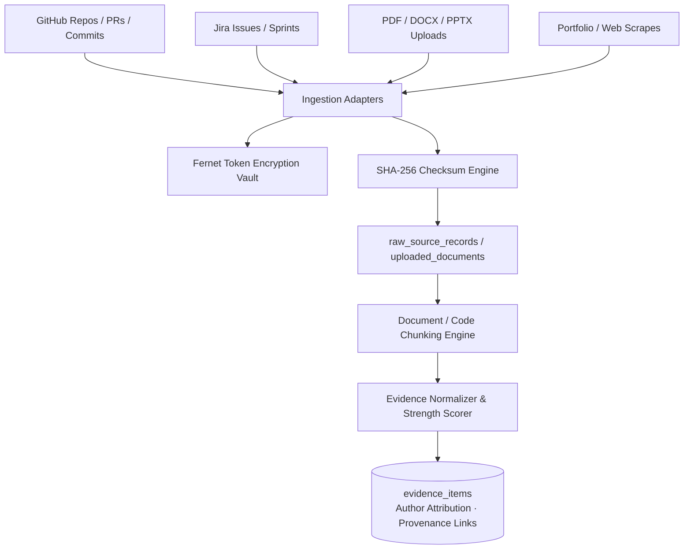

# Domain 1: Evidence Workspace — Technical Guide

The **Evidence Workspace** is the ingestion, provenance, and work artifact management foundation of Skill Passport. It transforms scattered developer footprints across git repositories, project trackers, documents, and portfolios into tamper-evident, structured evidence.

---

## 1. Domain Scope & Capabilities

The Evidence Workspace provides four primary ingestion channels:

1. **Connected Code & Issue Trackers**: Deep synchronization with GitHub and Jira.
2. **Multi-Format Document Processing**: High-fidelity text extraction for PDFs, Word documents, PowerPoint slides, and markdown.
3. **SSRF-Protected Web Scraping**: Clean body-text distillation from portfolio sites and technical blogs.
4. **Normalized Evidence Ledger**: Tamper-evident storage with SHA-256 content hashes, author attribution, and evidence strength scoring.

---

## 2. Ingestion Adapters

### 2.1 GitHub Connector ([`backend/app/integrations/github/`](../../backend/app/integrations/github/))
- **Authentication**: Personal Access Token (PAT) with `repo` and `read:user` scopes. Encrypted with Fernet before storage.
- **Synchronized Artifacts**:
  - **Repositories**: Star counts, fork status, primary language.
  - **Commits**: Author identity, commit message, timestamp, modified files.
  - **Pull Requests**: PR description, review discussions, merged state, labels.
  - **Languages**: Byte-level language distribution per repository saved in `repository_language_snapshots`.
  - **README Files**: Full markdown text extracted into `repository_readme_snapshots` for high-level project context.

### 2.2 Jira Connector ([`backend/app/integrations/jira/`](../../backend/app/integrations/jira/))
- **Authentication**: Jira API token, email, and base URL.
- **Synchronized Artifacts**: Closed sprint issues, technical task descriptions, acceptance criteria, story points, and epic memberships.

### 2.3 Document Processor ([`backend/app/api/documents.py`](../../backend/app/api/documents.py))
- **Supported Formats**: `.pdf`, `.docx`, `.pptx`, `.txt`, `.md`.
- **Extraction Libraries**:
  - `PyMuPDF` (`fitz`): Extracts text with page-number tracking and font block boundaries.
  - `python-docx`: Extracts structured paragraphs, bullet points, and tables.
  - `python-pptx`: Extracts text per slide index.
- **Idempotency**: Computes `sha256_hash` of raw uploaded bytes. Duplicate files are detected immediately, preventing re-extraction.

### 2.4 SSRF-Hardened Web Crawler ([`backend/app/api/portfolio.py`](../../backend/app/api/portfolio.py))
- **Security Guard**: Validates destination IP addresses before dispatching HTTP GET requests. Rejects:
  - Localhost loops: `127.0.0.1`, `::1`.
  - RFC 1918 subnets: `10.0.0.0/8`, `172.16.0.0/12`, `192.168.0.0/16`.
  - Cloud metadata endpoints: `169.254.169.254`.
- **Content Distillation**: Employs `trafilatura` to remove cookie banners, navigation menus, ads, and footers, preserving clean technical prose in `web_crawl_records`.

---

## 3. Evidence Normalization & Scoring

Raw records are normalized into canonical `evidence_items`:

### 3.1 Attribution Classification
Every piece of evidence is tagged with an `attribution_status`:
- **`direct_author`**: The user is the primary author of the commit, document, or PR.
- **`collaborator`**: The user co-authored the PR or pair-programmed on the task.
- **`reviewer`**: The user performed code review or provided technical feedback.
- **`assigned`**: The user owned the Jira ticket or issue.

### 3.2 Evidence Strength Rubric (0 – 100)
A composite algorithm evaluates:
- **Verifiability (40%)**: Public repository URL, verifiable commit SHA, or signed document hash.
- **Substantiveness (30%)**: Length and technical depth of the excerpt (e.g., code diff vs 1-line typo fix).
- **Recency (20%)**: Time-decay scoring prioritizing active work over historical artifacts.
- **Peer Review (10%)**: Presence of peer approval or collaborative review.

---

## 4. Database Schema Catalog

| Table Name | Description | Key Columns |
| :--- | :--- | :--- |
| `connected_sources` | Integration credentials and sync health | `id`, `owner_user_id`, `provider`, `encrypted_credentials`, `connection_status` |
| `selected_resources` | Repositories/projects selected for sync | `id`, `connection_id`, `name`, `url`, `is_selected`, `content_categories` |
| `source_sync_runs` | Sync job telemetry and counters | `id`, `owner_user_id`, `status`, `records_discovered`, `records_imported`, `records_failed` |
| `raw_source_records` | Immutable raw JSON API payloads | `id`, `sync_run_id`, `external_record_id`, `content_hash`, `raw_payload` |
| `uploaded_documents` | File metadata and storage keys | `id`, `original_filename`, `mime_type`, `sha256_hash`, `private_storage_key` |
| `document_chunks` | Segmented paragraph/slide text chunks | `id`, `document_id`, `page_or_slide_number`, `normalized_text`, `extraction_method` |
| `evidence_items` | The normalized work evidence ledger | `id`, `source_provider`, `title`, `extracted_excerpt`, `evidence_strength`, `verification_status` |
| `evidence_relationships`| Cross-evidence graph links | `id`, `source_evidence_id`, `target_evidence_id`, `relationship_type` |
| `web_crawl_records` | Distilled web portfolio records | `id`, `submitted_url`, `page_title`, `cleaned_content`, `extraction_status` |

---

## 5. Key REST API Endpoints

### 5.1 Connected Sources
- `GET /api/v1/connections` — Lists configured connections with status and counts.
- `POST /api/v1/connections/github` — Links GitHub via PAT (Fernet encrypted).
- `POST /api/v1/connections/jira` — Links Jira via API token.
- `GET /api/v1/connections/{id}/resources` — Lists repositories/projects available for selection.
- `PUT /api/v1/connections/{id}/resources` — Toggles sync selection for specific repositories.
- `POST /api/v1/connections/{id}/sync` — Dispatches an asynchronous synchronization run.

### 5.2 Documents & Portfolio
- `POST /api/v1/documents/upload` — Multipart file upload (PDF, DOCX, PPTX).
- `GET /api/v1/documents` — Lists user's uploaded documents with processing states.
- `POST /api/v1/portfolio/crawl` — Submits a portfolio URL for SSRF-safe crawling.

### 5.3 Evidence Library
- `GET /api/v1/evidence/items` — Filterable evidence list (`provider`, `category`, `status`, `search`).
- `GET /api/v1/evidence/items/{id}` — Detailed view of an evidence item including citation spans and mapped skills.

---

## 6. Frontend Routes

- **`/app/evidence/library`**: Searchable and filterable card grid of all ingested evidence items with strength meters and source badges.
- **`/app/evidence/sources`**: Integration control plane for connecting GitHub and Jira and managing selected repositories.
- **`/app/evidence/upload`**: Drag-and-drop file upload dropzone with progress tracking.
- **`/app/evidence/activity`**: Timeline of recent sync jobs and document parsing events.
