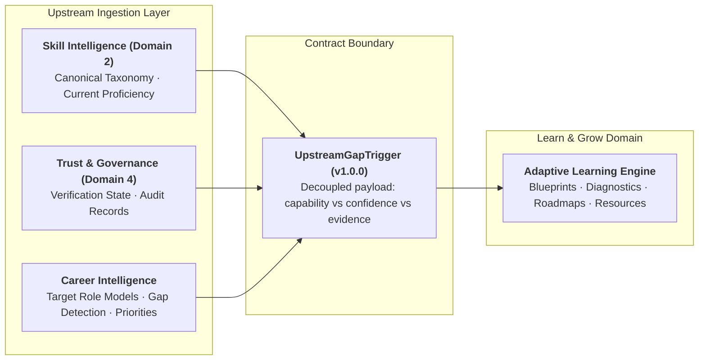

# Learn & Grow: Upstream Integration Contracts & Domain Boundaries

> **Authoritative Specification: Upstream Contracts between Skill Intelligence (Domain 2), Career Intelligence, Trust & Governance (Domain 4), and Learn & Grow**  
> *Contract Schema Version: v1.0.0*

---

## 1. Architectural Scope & Boundary Overview

The **Learn & Grow** domain is the prescriptive learning and capability growth engine of Skill Passport. It translates identified skill and depth gaps into personalized, prerequisite-aware learning journeys.



### The Non-Negotiable Governance Invariant
**Learning completion alone does NOT automatically verify a skill in the canonical Skill Passport.**  
Completing tutorials, quizzes, or roadmaps increases internal topic mastery ($0.30K + 0.25P + 0.20A + 0.25Prj$). To achieve verified status in Domain 2, the learner must complete an applied mini-project that produces authentic engineering artifacts (commits, PRs, manifests). These artifacts are ingested into Domain 1 and subjected to the 7-Point Hallucination Guard in Domain 4 before credential elevation.

---

## 2. Domain 2: Skill Intelligence Contract

The Skill Intelligence domain provides the standardized taxonomy foundation and verified credential ledger.

### 2.1 Sourced Fields & Endpoints

| Field Name | Type | Source Table / API | Definition & Semantics |
| :--- | :--- | :--- | :--- |
| `canonical_skill_id` | `str` | `competency_taxonomy.id` | Immutable UUID or standardized slug (e.g., `skill-python`, `skill-data-preprocessing`). |
| `canonical_name` | `str` | `competency_taxonomy.canonical_name` | Official human-readable competency name (e.g., "Python", "Data Preprocessing"). |
| `taxonomy_category` | `str` | `competency_taxonomy.category` | Category classification (`backend_engineering`, `ai_and_machine_learning`, `cloud_and_infrastructure`). |
| `current_proficiency_level` | `enum` | `GET /api/v1/passport/skills` | Active verified tier: `Not Established`, `Foundation`, `Working`, `Practitioner`, `Advanced`, `Expert`. |
| `current_proficiency_numeric`| `int (0-5)` | Rubric Mapping | Discrete numeric equivalent: $0 = \text{Not Established}$, $1 = \text{Foundation}$, $2 = \text{Working}$, $3 = \text{Practitioner}$, $4 = \text{Advanced}$, $5 = \text{Expert}$. |
| `verification_status` | `enum` | `evidence_competency_mappings.status` | Credential state: `verified`, `candidate`, `insufficient_evidence`, `conflicting`, `rejected`. |
| `supporting_evidence_ids` | `List[str]` | `evidence_competency_mappings.evidence_id` | Array of linked UUIDs in `evidence_items` demonstrating this skill. |

---

## 3. Career Intelligence Contract

Career Intelligence evaluates target career roles against the learner's current Skill Passport to diagnose gaps and prioritize interventions.

### 3.1 Sourced Fields

| Field Name | Type | Origin / Status | Definition & Semantics |
| :--- | :--- | :--- | :--- |
| `role_id` | `str` | Role Demand Model | Unique target role identifier (e.g. `role-senior-ml-engineer-v2026.1`). |
| `role_title` | `str` | Role Demand Model | Display title (e.g. "Senior Machine Learning Engineer"). |
| `seniority` | `str` | Role Demand Model | Seniority tier ("Entry Level", "Mid Level", "Senior Level", "Staff / Lead"). |
| `gap_id` | `str` | Gap Evaluator | Identifier for the diagnosed deficiency (e.g. `gap-skill-data-preprocessing`). |
| `gap_type` | `enum` | Gap Evaluator | `skill_gap`, `depth_gap`, `evidence_gap`, `application_gap`, `dependency_gap`, `differentiation_opportunity`, `freshness_gap`. |
| `target_proficiency_level` | `enum` | Role Competency | Required proficiency tier for the role (`Practitioner`, `Advanced`, etc.). |
| `target_proficiency_numeric`| `int (1-5)` | Role Competency | Target numerical level. |
| `proficiency_distance` | `int` | Gap Evaluator | Difference: $\max(0, \text{target\_numeric} - \text{current\_numeric})$. |
| `role_importance` | `enum` | Role Competency | Criticality to role success: `critical`, `high`, `medium`, `low`. |
| `requirement_type` | `enum` | Role Competency | `core_required`, `supporting`, `preferred`, `differentiating`. |
| `priority_score` | `float` | Priority Engine | Weighted ranking score based on criticality, gap magnitude, and effort. |
| `priority_rank` | `int` | Priority Engine | Ordinal position in learner's prioritized gap queue ($1 = \text{highest}$). |
| `why_prioritized` | `str` | Priority Engine | Deterministic explanation for priority ordering. |
| `gap_diagnosis` | `str` | Gap Evaluator | Detailed narrative explaining root cause of deficiency. |
| `missing_evidence_types` | `List[str]`| Evidence Auditor | Artifact types required to satisfy evidence gaps (e.g. `["production_pipeline", "helm_chart"]`). |

---

## 4. Orthogonal Signal Interpretation (Confidence vs. Proficiency vs. Trend)

A core requirement is ensuring orthogonal signals are never conflated into an ambiguous single score:

```
┌────────────────────────────────────────────────────────────────────────────────────────┐
│                        ORTHOGONAL SIGNAL INTERPRETATION MATRIX                         │
├──────────────────────────┬─────────────────────────────────┬───────────────────────────┤
│ Signal                   │ Definition                      │ Learn & Grow Action       │
├──────────────────────────┼─────────────────────────────────┼───────────────────────────┤
│ 1. Low Capability Score  │ Demonstrated work indicates     │ Build foundational to     │
│    (e.g. Level 1 vs 3)   │ beginner/limited proficiency    │ intermediate learning     │
│                          │ despite high confidence.        │ roadmap.                  │
├──────────────────────────┼─────────────────────────────────┼───────────────────────────┤
│ 2. Low Confidence Score  │ Model uncertainty is high       │ DO NOT assume weak skill! │
│    (e.g. confidence <0.7)│ due to sparse text or fallback. │ Intercept with Topic-Level│
│                          │                                 │ Diagnostic Assessment.    │
├──────────────────────────┼─────────────────────────────────┼───────────────────────────┤
│ 3. Insufficient Evidence │ User has zero attributable PRs  │ Trigger Practical         │
│    (evidence_gap)        │ or commits for this competency. │ Mini-Project to generate  │
│                          │                                 │ attributable proof.       │
├──────────────────────────┼─────────────────────────────────┼───────────────────────────┤
│ 4. Declining Trajectory  │ Longitudinal observation shows  │ Prescribe targeted review │
│    (trend == 'declining')│ reduced activity over 90+ days. │ / refresher exercise.     │
├──────────────────────────┼─────────────────────────────────┼───────────────────────────┤
│ 5. Proficiency Mismatch  │ User is proficient at Level 2,  │ Construct advanced        │
│    (depth_gap)           │ but role requires Level 4.      │ optimization steps.       │
└──────────────────────────┴─────────────────────────────────┴───────────────────────────┘
```

### Strategic Rules:
1. **Confidence Thresholding:** If `assessment_confidence < 0.70`, the system MUST NOT treat the skill as weak or decaying. Instead, Learn & Grow initiates a **Topic-Level Diagnostic Check** to establish a high-confidence baseline.
2. **Evidence Gap vs. Depth Gap:** If `gap_type == "evidence_gap"`, the learner likely knows the subject but lacks public proof. The engine prioritizes **Applied Mini-Projects** over basic instructional videos.
3. **Decoupled Verification:** A skill with high confidence and high mastery remains in status `candidate` until cleared through Domain 4 Hallucination Guard checks.
