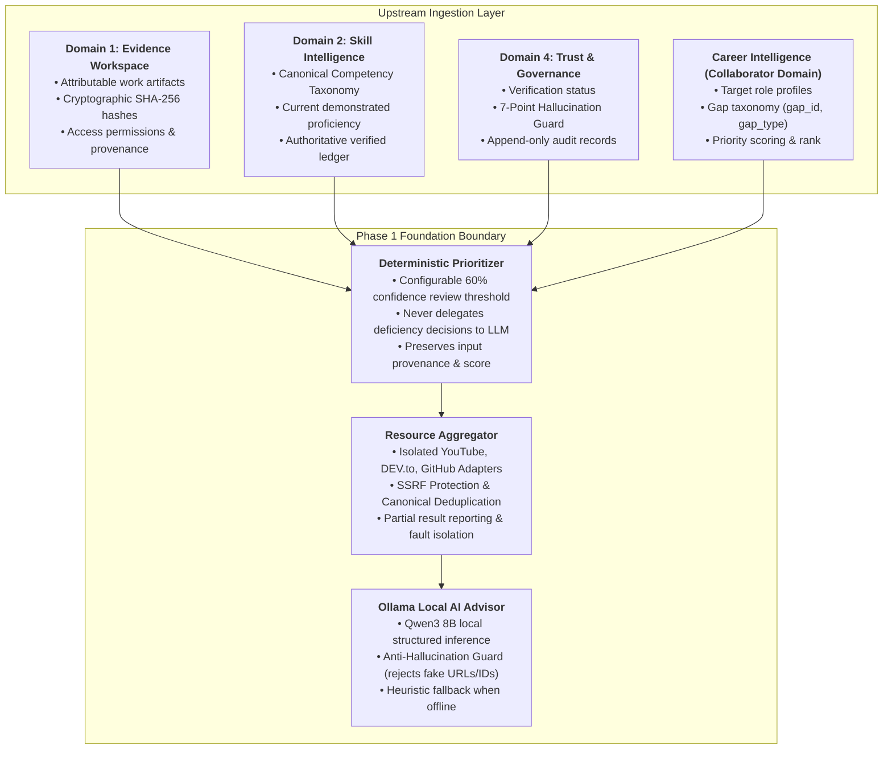

# Learn & Grow — Phase 1: Learning Intelligence Foundation

> **Domain:** Learn & Grow (Adaptive Role Growth & Learning Intelligence)  
> **Repository:** `shubham392007-sketch/HackMatrix-5.0-MISC02`  
> **Subproject:** `skillpassport-powered-by-growthlens`  
> **Active Working Branch:** `feature/learn-and-grow`  
> **Status:** Phase 1 Complete (Tested, Isolated Learning Foundation)

---

## 1. Architecture and Responsibilities

The **Learn & Grow** domain is the prescriptive growth and upskilling engine of Skill Passport. It translates verified skill records and diagnosed career gaps into prerequisite-aware, personalized learning journeys.



### Core Domain Responsibilities
1. **Deterministic Prioritization:** Distinguishes uncertainty (< 60% confidence) from proven lack of skill.
2. **Multi-Provider Discovery:** Safely aggregates high-signal educational materials from YouTube, DEV.to, and GitHub with complete error isolation.
3. **Local AI Curriculum Structuring:** Employs local Ollama Qwen3 8B to organize resources into progressive stages while strictly preventing resource fabrication.
4. **Governance Invariance:** Enforces that learning completion alone **never** elevates a skill to verified status without Domain 4 governance clearance.

---

## 2. Existing-Domain Integration Contracts

All integration interfaces are codified in [`backend/app/learning/contracts.py`](file:///Users/siddheshbirewar/HackMatrix-MISC02/skillpassport-powered-by-growthlens/backend/app/learning/contracts.py) and documented below:

### A. Skill Intelligence Contract (Domain 2)
- `stable_skill_id`: Immutable competency UUID or slug (`competency_taxonomy.id`).
- `canonical_skill_name`: Standardized name (e.g., "Data Preprocessing", "Python").
- `taxonomy_category`: Technical domain category (`ai_and_machine_learning`, `backend_engineering`).
- `current_proficiency_level`: Optional tier (`Not Established`, `Foundation`, `Working`, `Practitioner`, `Advanced`, `Expert`).
- `confidence_score`: Optional float ($0.00$ to $1.00$). *Invariant: Confidence is never treated as proof of proficiency.*
- `verification_status`: Status from `evidence_competency_mappings` (`verified`, `candidate`, `insufficient_evidence`, `conflicting`, `rejected`).
- `evidence_references`: Array of linked `evidence_items` UUIDs.

### B. Evidence & Workspace Contract (Domain 1)
- `evidence_id`: UUID matching `evidence_items.id`.
- `evidence_type`: Artifact type (`pull_request`, `commit`, `document`, `jira_issue`).
- `source`: Connector provider (`github`, `jira`, `upload`, `portfolio`).
- `relevant_skill_associations`: Associated canonical skill IDs.
- `access_permissions`: Tenant ownership and visibility scoping (`owner_user_id`).
- `provenance`: Commit SHA, branch, repo URL, PR number.

### C. Trust & Governance Contract (Domain 4)
- Verification outcomes and review queue states are strictly respected.
- Unverified or disputed evidence cannot be represented as confirmed skill mastery.

### D. Career Intelligence Contract (Collaborator Domain)
- `role_id` & `role_title`: Target career demand model.
- `seniority`: Target seniority tier.
- `gap_id`: Unique gap identifier (e.g. `gap-skill-data-preprocessing`).
- `gap_type`: Structural gap category (`skill_gap`, `depth_gap`, `evidence_gap`, `application_gap`, `dependency_gap`, `differentiation_opportunity`, `freshness_gap`).
- `target_proficiency_level` & `target_proficiency_numeric`: Role expected depth.
- `role_importance`: Criticality weighting (`critical`, `high`, `medium`, `low`).
- `priority_score` & `priority_rank`: Queue ordering metrics.
- `pending_integration_fields`: Explicitly tracks fields awaiting live backend persistence from the Career Intelligence team.

### E. Student Learning State Contract
- `user_id`: Authenticated user UUID matching Supabase `auth.users`.
- Reuses the existing user session; no secondary auth or duplicate accounts.

---

## 3. Actual Files Created (Phase 1)

All files were created in new, isolated directories. Existing domains and configuration remain 100% untouched.

```
skillpassport-powered-by-growthlens/
├── backend/app/learning/
│   ├── __init__.py                # Domain package exports
│   ├── contracts.py               # Pydantic v2 schemas for all cross-domain contracts
│   ├── logic.py                   # Deterministic topic mastery calculation & trigger routing
│   ├── prioritizer.py             # Deterministic SkillGapPrioritizer with 60% confidence threshold
│   ├── ai_advisor.py              # Ollama Qwen3 8B advisor with anti-hallucination guard
│   └── providers/
│       ├── __init__.py            # Provider package exports
│       ├── base.py                # BaseResourceProvider, NormalizedLearningResource, ProviderSearchResult
│       ├── validator.py           # SSRF protection, URL validation, deduplication, ranking
│       ├── youtube.py             # YouTube Data API v3 adapter with timestamp deep-linking & pagination
│       ├── devto.py               # DEV.to REST API adapter with rate-limit handling & pagination
│       ├── github.py              # GitHub REST API adapter with star ranking & pagination
│       └── aggregator.py          # Parallel multi-provider dispatcher with fault isolation
├── backend/tests/
│   └── test_learning_phase1.py    # 16 comprehensive unit tests covering all Phase 1 requirements
└── docs/domains/
    ├── LEARN_AND_GROW_CONTRACTS.md# Authoritative upstream contract specifications
    └── LEARN_AND_GROW_PHASE1.md   # Phase 1 architecture and operational reference (this document)
```

---

## 4. Resource Provider Behavior & Reliability

| Provider | Role in Engine | Endpoint / Query | Rate Limit / Failure Strategy | Caching & Deep-Linking |
| :--- | :--- | :--- | :--- | :--- |
| **YouTube** | Primary video provider | `GET /youtube/v3/search`<br/>`videoCaption=closedCaption` | Quota exhaustion (HTTP 403) or timeout $\to$ falls back to curated offline catalog. Explicitly reports `QUOTA_EXHAUSTED`. | Generates precision deep links (`t=45s`). 14-day caching strategy. |
| **DEV.to** | Practitioner articles | `GET /articles`<br/>`tag=datascience/python` | Rate limit (HTTP 429) or timeout $\to$ falls back to curated offline articles. Explicitly reports `RATE_LIMITED`. | Standardized reading time and author attribution. |
| **GitHub** | Practical code & templates | `GET /search/repositories`<br/>`language:python stars:>20` | Rate limit (HTTP 403) $\to$ falls back to curated reference repos. Explicitly reports `RATE_LIMITED`. | Displays star counts and license pills (`MIT`, `BSD`). |
| **Aggregator** | Fault-tolerant coordinator | Parallel dispatch with `asyncio.gather` | **Fault Isolation:** If YouTube or DEV fails, GitHub continues unaffected. Returns `AggregationResult` with explicit provider health statuses. | SSRF filter blocks private IPs; multi-factor deduplication and ranking. |

---

## 5. Environment Configuration

### Documented Variable Names

| Environment Variable | Description | Default / Example Value | Secret Status |
| :--- | :--- | :--- | :--- |
| `YOUTUBE_API_KEY` | Google Cloud YouTube Data API v3 Key | `AIzaSy...` | Secret (Do not commit) |
| `DEVTO_API_KEY` | DEV.to / Forem Personal API Key | Optional (public read supported) | Secret (Optional) |
| `GITHUB_TOKEN` | GitHub Personal Access Token (PAT) | Reused from Domain 1 | Secret (Reused) |
| `OLLAMA_BASE_URL` | Local Ollama service endpoint | `http://localhost:11434` | Non-secret |
| `OLLAMA_QWEN_MODEL` | Configured local LLM identifier | `qwen3:8b` | Non-secret |

> [!IMPORTANT]
> Zero secret values are hardcoded in the codebase. Existing environment files (`.env`, `backend/.env`) were inspected for variable names only and were not modified.

---

## 6. Local Setup and How to Run Tests

### Prerequisites
- Python 3.11+ or 3.12+ (or project virtual environment at `skillpassport-powered-by-growthlens/venv`).
- Dependencies from `requirements.txt` installed.

### Executing Phase 1 Automated Tests
Run pytest from the `skillpassport-powered-by-growthlens` directory:

```bash
cd skillpassport-powered-by-growthlens
./venv/bin/pytest backend/tests/test_learning_phase1.py -v
```

All 16 tests execute in $\sim 0.15\text{s}$ with 100% pass rate.

---

## 7. Security and Privacy Boundaries

1. **SSRF Defense:** The URL validator in [`validator.py`](file:///Users/siddheshbirewar/HackMatrix-MISC02/skillpassport-powered-by-growthlens/backend/app/learning/providers/validator.py) strictly validates external hostnames and blocks:
   - Loopback addresses (`127.0.0.0/8`, `::1`).
   - RFC 1918 private subnets (`10.0.0.0/8`, `172.16.0.0/12`, `192.168.0.0/16`).
   - Cloud instance metadata endpoints (`169.254.169.254`, `metadata.google.internal`).
2. **Anti-Hallucination Guard:** In [`ai_advisor.py`](file:///Users/siddheshbirewar/HackMatrix-MISC02/skillpassport-powered-by-growthlens/backend/app/learning/ai_advisor.py), any resource ID or URL generated by the local LLM that does not strictly exist in the verified provider catalogue is rejected and logged.
3. **Data Privacy:** Prompts sent to local Ollama contain only non-confidential technical skill summaries and public resource titles. No employee PII or private repository diffs are logged.

---

## 8. Known Limitations & Pending Integrations

1. **Career Intelligence Backend:** Currently, Career Intelligence is implemented on the frontend in `careerCalculations.ts` and `careerMock.ts`. The collaborator team is building the live backend endpoints (`/api/v1/career/*`). Learn & Grow provides a decoupled adapter (`CareerIntelligenceGapRecord`) ready to bind to live endpoints in Phase 2.
2. **Database Persistence:** Phase 1 focuses on isolated models, contracts, and providers. Database tables and Alembic migrations (`002_learn_and_grow_schema.py`) will be executed in Phase 2 upon approval.
3. **Frontend Integration:** The 11 existing client pages in `src/app/app/learning/*` continue to run their current UI layouts safely without breakage.
