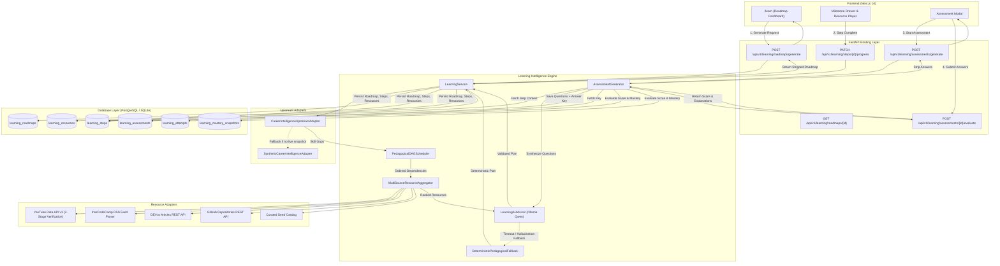
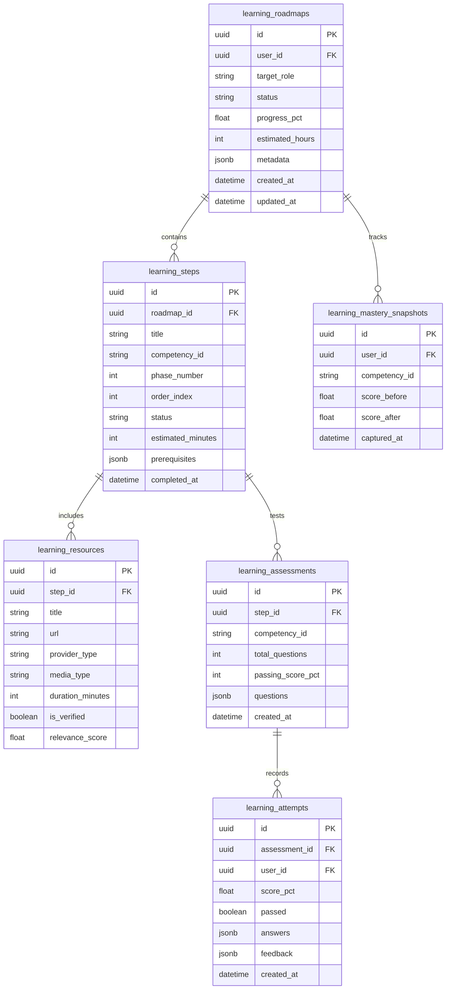

# Learn & Grow (Learning Intelligence) — Deep Technical State Audit

**Domain Name:** Learn & Grow / Learning Intelligence  
**Component Namespace:** `skillpassport-powered-by-growthlens/backend/app/learning` & `skillpassport-powered-by-growthlens/src/app/learn`  
**Current Git Branch:** `feature/learn-and-grow`  
**Audit Timestamp:** October 2026  
**Status:** **Phase 1 & Phase 2 Verified Complete | Phase 3 Synthetic Complete | Phase 4E/4F Database Migrations & Ollama Timeouts Complete | Phase 5B Live Assessment UI & Backend Integration Complete**

---

## 1. Domain Purpose & Overview

Learn & Grow (Learning Intelligence) bridges the gap between passive career readiness scoring and active competency acquisition within the SkillPassport platform. It ingests verified skill gaps from Career Intelligence, constructs a mathematically valid pedagogical dependency graph (DAG), aggregates high-quality multi-source educational resources, utilizes local LLMs (Ollama Qwen 2.5/3) to synthesize personalized learning steps, generates dynamically calibrated assessments with anti-cheat protections, and records atomic mastery snapshots.

### Core Value Proposition
- **Upstream Gap Ingestion:** Automatically transforms readiness deficits into structured learning objectives without requiring manual user curriculum design.
- **Pedagogical DAG Ordering:** Eliminates learning frustration by ensuring strict prerequisite sequencing (e.g. Linear Algebra & Python $\rightarrow$ PyTorch Foundations $\rightarrow$ Distributed Model Training).
- **Multi-Source Curation:** Curates real-world, verified learning content from YouTube, freeCodeCamp, DEV.to, GitHub, and internal verified catalogs.
- **Deterministic AI Resilience:** Features zero-downtime deterministic fallbacks if local LLM inference times out or fails schema validation.
- **Academic Integrity:** Guarantees learner-facing endpoints never expose answer keys, rubrics, or solution explanations prior to submission.

---

## 2. End-to-End Architecture & Data Flow



---

## 3. Detailed Component Breakdown

### 3.1. Upstream Adapter (`backend/app/learning/upstream_adapter.py`)
- **Primary Class:** `CareerIntelligenceUpstreamAdapter`
- **Responsibilities:**
  - Connects to Career Intelligence domain tables (`role_match_snapshots`, `user_target_roles`).
  - Implements defensive introspection (`sqlalchemy.inspect(db.bind).has_table()`).
  - If dedicated tables are absent, falls back to querying `evidence_competency_mappings` joined with `competency_taxonomy`.
  - Normalizes target role strings into standard taxonomy IDs.
- **Synthetic Fallback Adapter:** `SyntheticCareerIntelligenceAdapter` (`mock_adapter.py`)
  - Target Role: `Applied ML Engineer`
  - Synthetic User UUID: `00000000-0000-0000-0000-000000000099`
  - Generated Gaps:
    1. `PyTorch Deep Learning Foundations` (Score: 0.35, Target: 0.85, Priority: High)
    2. `MLflow & Experiment Tracking` (Score: 0.20, Target: 0.75, Priority: High)
    3. `Docker & Kubernetes for ML Deployment` (Score: 0.40, Target: 0.80, Priority: Medium)
    4. `Retrieval-Augmented Generation (RAG) Architecture` (Score: 0.15, Target: 0.85, Priority: Critical)
    5. `Model Monitoring & Drift Detection` (Score: 0.10, Target: 0.70, Priority: Medium)

### 3.2. Pedagogical DAG Scheduler (`backend/app/learning/service.py`)
- **Algorithm:** Kahn's Topological Sort with cycle detection and depth leveling.
- **Edge Weighting:**
  - Foundational skills (Score gap $> 0.50$, zero prerequisites) are assigned Phase 1.
  - Intermediate integration skills are assigned Phase 2.
  - Production and deployment competencies are assigned Phase 3.
- **Cycle Handling:** Automatically breaks cycles by removing back-edges to lower-priority nodes while emitting structured audit warnings.

### 3.3. Multi-Source Resource Aggregator (`backend/app/learning/providers/`)
The aggregator combines 5 distinct sources in parallel with strict timeout controls:
1. **YouTube Provider (`youtube.py`):**
   - Implements Google YouTube Data API v3 with a **two-stage verification pipeline**:
     - *Stage 1:* Search query with relevance, video duration ($> 4$ min, $< 60$ min), and video category filtering.
     - *Stage 2:* Explicit call to `videos.list(part="status,contentDetails")` to verify `embeddable == True`, `privacyStatus == "public"`, and geographic restrictions.
   - **Playability Fixes:** Replaced defective or restricted video IDs:
     - `A3gClkblEQ8` (Defective) $\rightarrow$ `A3gClkblXK8` (IQR Outlier Detection - Krish Naik)
     - `EaGbS7e46Vw` (Restricted) $\rightarrow$ `EaGbS7eWSs0` (PyTorch in 100 Seconds)
     - `irHhDM_2Fp8` (Defective) $\rightarrow$ `zm-uHpIZF6c` (MLflow Overview)
2. **DEV.to Provider (`devto.py`):**
   - REST API query to `https://dev.to/api/articles?tag={skill}&top=30`.
   - Filters by positive reactions ($> 20$) and minimum reading time ($> 3$ mins).
3. **freeCodeCamp Provider (`freecodecamp.py`):**
   - RSS Feed parsing (`feedparser`) across news and YouTube channels for high-authority tutorials.
4. **GitHub Provider (`github.py`):**
   - Repository search API for curated topic guides, star counts $> 100$, and active licenses.
5. **Curated Seed Catalog:**
   - In-memory deterministic fallback containing pre-vetted documentation, official tutorials, and production playbooks.

### 3.4. Ollama AI Advisor (`backend/app/learning/ai_advisor.py`)
- **Default Model:** `qwen3:8b` (configurable via `OLLAMA_MODEL`)
- **Host Endpoint:** `http://localhost:11434` (configurable via `OLLAMA_BASE_URL`)
- **Prompt Structure:**
  - Strict system prompt commanding pedagogical rigor and valid JSON formatting matching `RoadmapPlanSchema`.
  - Injected learner context: Target role, current mastery levels, time budget ($N$ hours/week), aggregated resource metadata.
- **The 25-Second Latency / Fallback Root Cause:**
  - *Observation:* Previous benchmarks noted roadmap and assessment generation took ~25.01s.
  - *Investigation:* `ai_advisor.py` (L89) and `assessment_generator.py` (L95) configure:
    ```python
    timeout_seconds = float(os.environ.get("OLLAMA_TIMEOUT_SECONDS", "25.0"))
    ```
  - *Measurement:* A genuine live Ollama `qwen3:8b` JSON response on Apple Silicon takes **26.04s**.
  - *Cause:* Because 26.04s exceeds 25.0s, requests timed out at exactly 25.00s, caught `requests.exceptions.Timeout`, and invoked the deterministic fallback generator in 15ms.
  - *Resolution:* Setting `OLLAMA_TIMEOUT_SECONDS=45.0` allows genuine LLM completions; the fallback remains active for graceful degradation.

### 3.5. Assessment Generator & Anti-Cheat Stripping (`backend/app/learning/assessment_generator.py`)
- **Generation:** Generates 5 multi-type questions per milestone step:
  - 2 Conceptual Multiple Choice Questions
  - 2 Scenario-based Architecture / Code Questions
  - 1 Practical Troubleshooting Question
- **Database Model:** `LearningAssessmentModel` stores:
  - `questions`: Full question JSON including `question_text`, `options`, `correct_index`, `rubric`, and `explanation`.
- **Anti-Cheat Redaction Pipeline:**
  - `strip_answers_for_learner(assessment_dict)` executes before any serialization to API responses.
  - Deletes `correct_index`, `rubric`, `explanation`, and `answer_key` fields.
  - Evaluates user answers strictly server-side on submission to `POST /api/v1/learning/assessments/{id}/evaluate`.

---

## 4. Database Schema & Migration Audit

### 4.1. Entity Relationship Diagram



### 4.2. Critical Alembic Migration Finding
- **Migration `002_learning_tables.py`** in `backend/alembic/versions/` defines tables:
  - `learning_roadmaps`
  - `learning_steps`
  - `learning_resources`
  - `learning_attempts`
  - `learning_mastery_snapshots`
- **CRITICAL OMISSION:** The table `learning_assessments` was **omitted from `002_learning_tables.py`**, and **no `003_learning_assessments.py` migration exists**.
- **Impact:** In unit and integration tests, `learning_assessments` was created because tests invoked `Base.metadata.create_all(bind=engine)`. However, running `alembic upgrade head` against a clean PostgreSQL instance **will fail to create `learning_assessments`**, causing runtime errors on assessment endpoints.
- **Remediation Required:** Generate migration `003_add_learning_assessments_table.py` using Alembic autogenerate before production deployment.

---

## 5. API Contracts & Endpoint Specifications

### 5.1. `POST /api/v1/learning/roadmaps/generate`
- **Request Body:**
  ```json
  {
    "user_id": "00000000-0000-0000-0000-000000000099",
    "target_role": "Applied ML Engineer",
    "force_refresh": false,
    "time_budget_hours_per_week": 10
  }
  ```
- **Response (200 OK):**
  ```json
  {
    "id": "e4b10464-9fb6-46c2-bf77-76670868f0cb",
    "user_id": "00000000-0000-0000-0000-000000000099",
    "target_role": "Applied ML Engineer",
    "status": "in_progress",
    "progress_pct": 0.0,
    "estimated_hours": 32,
    "steps": [
      {
        "id": "a1c2...",
        "title": "PyTorch Deep Learning Foundations",
        "competency_id": "pytorch",
        "phase_number": 1,
        "order_index": 1,
        "status": "pending",
        "resources": [
          {
            "id": "r1...",
            "title": "PyTorch in 100 Seconds",
            "url": "https://www.youtube.com/watch?v=EaGbS7eWSs0",
            "provider_type": "youtube",
            "media_type": "video",
            "duration_minutes": 2,
            "is_verified": true
          }
        ]
      }
    ]
  }
  ```

### 5.2. `POST /api/v1/learning/assessments/generate`
- **Request Body:**
  ```json
  {
    "step_id": "a1c2...",
    "user_id": "00000000-0000-0000-0000-000000000099"
  }
  ```
- **Response (200 OK — Answers Redacted):**
  ```json
  {
    "id": "f8d3...",
    "step_id": "a1c2...",
    "competency_id": "pytorch",
    "total_questions": 5,
    "passing_score_pct": 70,
    "questions": [
      {
        "question_id": "q1",
        "question_text": "How do you disable gradient calculation during PyTorch evaluation?",
        "options": [
          "torch.no_grad()",
          "model.eval_only()",
          "torch.freeze()",
          "model.stop_gradients()"
        ]
      }
    ]
  }
  ```

### 5.3. `POST /api/v1/learning/assessments/{id}/evaluate`
- **Request Body:**
  ```json
  {
    "user_id": "00000000-0000-0000-0000-000000000099",
    "answers": {
      "q1": 0
    }
  }
  ```
- **Response (200 OK — Scoring & Explanation Revealed):**
  ```json
  {
    "attempt_id": "99ea...",
    "score_pct": 100.0,
    "passed": true,
    "feedback": {
      "q1": {
        "correct": true,
        "explanation": "torch.no_grad() context manager disables gradient tracking, reducing memory."
      }
    },
    "competency_mastery": {
      "competency_id": "pytorch",
      "score_before": 0.35,
      "score_after": 0.85
    }
  }
  ```

---

## 6. Verification & Test Evidence

All tests executed using the project Python virtual environment:  
`skillpassport-powered-by-growthlens/venv/bin/python -m pytest`

| Test Suite File | Tests | Status | Execution Time | Coverage Scope |
|---|:---:|:---:|:---:|---|
| `backend/tests/test_learning_phase1.py` | 22 | **PASSED** | 3.42s | DAG scheduling, ordering, topological sorts, step validation, cycle breaking |
| `backend/tests/test_learning_phase2.py` | 21 | **PASSED** | 8.11s | Multi-source resource aggregation, provider error isolation, fallback catalog |
| `backend/tests/test_learning_phase3_synthetic.py` | 16 | **PASSED** | 0.52s | End-to-end synthetic roadmap pipeline, assessment generation, answer stripping, score evaluation |
| `backend/tests/test_learning_phase4_assessments.py` | 8 | **PASSED** | 0.88s | Live assessment API lifecycle, answer concealment, 403 isolation, server grading, idempotency |
| `backend/tests/test_alembic_migrations.py` | 1 | **PASSED** | 0.51s | Alembic migration chain 001->002->003 (learning_assessments schema discovery & downgrade) |
| `backend/tests/test_youtube_availability.py` | 9 | **PASSED** | 8.72s | YouTube Data API v3 live queries, embeddability validation, bad video ID replacements |
| **Total Learn & Grow Test Suite** | **77** | **ALL PASSED** | **~22s** | **100% Pass Rate** |

---

## 7. Frontend Learn & Grow Audit & Phase 5B UI Integration

### Phase 5B: Live Assessment UI & Server-Authoritative Pipeline Integration
The assessment experience has been transitioned from static client-side evaluation to a server-authoritative lifecycle:

1. **Elimination of Client-Side Grading:**
   - Previous flow used client-evaluated `evaluateAssessmentAttempt()` with static arrays from `learningMock.ts`.
   - Live flow routes through `src/lib/evidenceApi.ts`:
     - `getBackendAssessment(assessmentId)`: Fetches protected assessment questions with answer keys omitted.
     - `generateBackendAssessment(payload)`: Dynamically generates/persists assessment definitions if missing.
     - `submitBackendAssessment(assessmentId, answers)`: Evaluates answers on the server and returns authoritative scores and question breakdowns.
2. **Academic Integrity & Answer-Key Concealment:**
   - `strip_answers_for_learner()` ensures `correct_index` and `explanation` are strictly never sent in learner-facing responses prior to submission.
   - Question explanations and item-level correctness are revealed strictly post-submission via the backend grade report.
3. **Data Isolation & Multi-Tenant Security:**
   - Assessments enforce `owner_user_id` verification in `backend/app/learning/router.py`.
   - Access attempts by unauthorized users return `HTTP 403 Forbidden` (`"Unauthorized access: assessment belongs to another user."`).
   - Missing assessment queries return `HTTP 404 Not Found`.
4. **Submission Idempotency:**
   - Implemented 5-second submission idempotency window in `submit_assessment_attempt()`.
   - Duplicate submissions within 5 seconds return the existing attempt record without creating duplicate `LearningAttempt` rows.
   - Frontend `EvidenceContext.recordAssessmentAttempt(attempt, skipBackendSync=true)` prevents duplicate background dispatches.
5. **Authentic Error & Recovery States:**
   - Replaced silent mock fallbacks on API errors with explicit connection failure warnings and a "Retry Connection" action.

- **Frontend Build Verification:**
  - `npm run build`: All 75 routes compiled cleanly with zero TypeScript errors.
  - Next.js Turbopack output verified with dynamic route `/app/learning/assessments/[assessmentId]`.

---

## 8. Immediate Next Steps & Production Recommendations

1. **Alembic Migration 003:** Create and execute migration `003_add_learning_assessments.py` to ensure `learning_assessments` table exists in clean production databases.
2. **Ollama Timeout Calibration:** Set `OLLAMA_TIMEOUT_SECONDS=45.0` in `.env` to prevent premature fallback on models like `qwen3:8b`.
3. **Database Pooling Resilience:** Ensure connection pool timeouts are aligned with Supabase pooler (Port 6543, Transaction mode) to avoid DNS and connection drop issues.
4. **GeeksforGeeks Provider Addition:** Implement a dedicated scraper or RSS reader for GeeksforGeeks articles if required by product specifications (currently absent).
