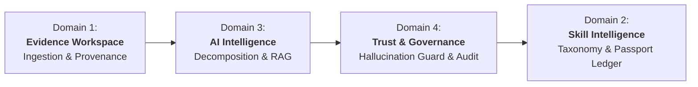

# Domain Architecture Index — Skill Passport

Skill Passport is organized into four distinct functional domains that collaborate to convert raw technical work into verifiable skill records.

---

## 1. The Four Core Domains



---

## 2. Domain Responsibility & Boundary Matrix

| Domain | Primary Responsibility | Key Tables | Key REST Endpoints | Primary Frontend Routes |
| :--- | :--- | :--- | :--- | :--- |
| **1. Evidence Workspace** | Ingestion of raw work artifacts from GitHub, Jira, multi-format documents, and web pages into tamper-evident normalized evidence. | `connected_sources`<br/>`uploaded_documents`<br/>`document_chunks`<br/>`evidence_items`<br/>`raw_source_records` | `GET/POST /api/v1/connections/*`<br/>`POST /api/v1/documents/upload`<br/>`POST /api/v1/portfolio/crawl`<br/>`GET /api/v1/evidence/items` | `/app/evidence/library`<br/>`/app/evidence/sources`<br/>`/app/evidence/upload`<br/>`/app/evidence/activity` |
| **2. Skill Intelligence** | Authoritative competency taxonomy, proficiency calculation rubrics, skill-to-evidence mappings, and the canonical Skill Passport ledger. | `competency_taxonomy`<br/>`evidence_competency_mappings`<br/>`verification_decisions` | `GET /api/v1/passport/skills`<br/>`GET /api/v1/passport/candidates`<br/>`GET /api/v1/passport/coverage`<br/>`GET /api/v1/passport/taxonomy` | `/app/passport/skills`<br/>`/app/passport/candidates`<br/>`/app/passport/coverage`<br/>`/app/passport/taxonomy` |
| **3. AI Intelligence** | Technical work decomposition, skill signal extraction, uncertainty flagging, and semantic vector indexing using local Ollama Qwen3 8B. | `ai_analysis_runs`<br/>`work_analysis_results`<br/>`evidence_quality_assessments` | `POST /api/v1/ai/analyze-work`<br/>`POST /api/v1/ai/extract-skills`<br/>`GET /api/v1/ai/bootstrap` | `/app/ai`<br/>`/app/ai/work-analysis`<br/>`/app/ai/skill-extraction` |
| **4. Trust & Governance** | Multi-gate deterministic verification, 7-point hallucination guard, prompt injection quarantine, conflict resolution, human review queue, and audit trail. | `hallucination_guard_results`<br/>`output_validation_runs`<br/>`evidence_conflicts`<br/>`prompt_injection_findings`<br/>`human_review_tasks`<br/>`review_audit_events` | `GET /api/v1/ai/guard/results`<br/>`GET /api/v1/ai/validations`<br/>`GET /api/v1/ai/conflicts`<br/>`POST /api/v1/ai/review-tasks/{id}/resolve`<br/>`GET /api/v1/ai/audit` | `/app/ai/guard`<br/>`/app/ai/validation`<br/>`/app/ai/conflicts`<br/>`/app/ai/prompt-injection`<br/>`/app/ai/review-queue`<br/>`/app/ai/audit` |

---

## 3. Inter-Domain Dependency Graph

```text
Evidence Workspace (Domain 1)
       │ (Produces normalized evidence_items)
       ▼
AI Intelligence (Domain 3)
       │ (Generates work_analysis_results & candidate skills)
       ▼
Trust & Governance (Domain 4)
       │ (Validates citations, resolves conflicts, verifies claims)
       ▼
Skill Intelligence (Domain 2)
         (Aggregates verified skills into the canonical Skill Passport)
```

---

## 4. Domain Documentation Links

- 📁 [Domain 1: Evidence Workspace Guide](EVIDENCE_WORKSPACE.md)
- 🎓 [Domain 2: Skill Intelligence Guide](SKILL_INTELLIGENCE.md)
- 🧠 [Domain 3: AI Intelligence Guide](AI_INTELLIGENCE.md)
- 🛡️ [Domain 4: Trust & Governance Guide](TRUST_AND_GOVERNANCE.md)
