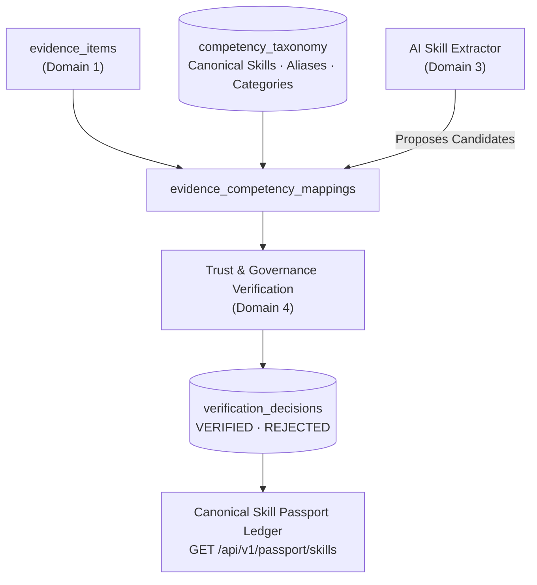

# Domain 2: Skill Intelligence — Technical Guide

The **Skill Intelligence** domain is the classification and credentialing engine of Skill Passport. It maps unstructured work evidence against a canonical competency taxonomy, calculates evidence-backed proficiency levels, tracks verification states, and generates the authoritative **Skill Passport Ledger**.

---

## 1. Domain Scope & Architecture



---

## 2. Canonical Competency Taxonomy

Rather than allowing arbitrary, fragmented skill tags, Skill Passport maintains a curated, versioned competency taxonomy in the `competency_taxonomy` table.

### 2.1 Taxonomy Record Structure
- **`canonical_name`**: Official standardized name (e.g., `PostgreSQL`, `FastAPI`, `Docker`).
- **`normalized_name`**: Lowercase alphanumeric slug for indexing (`postgresql`, `fastapi`).
- **`category`**: Technical domain grouping:
  - `backend_engineering`
  - `frontend_engineering`
  - `cloud_and_infrastructure`
  - `ai_and_machine_learning`
  - `data_engineering`
  - `security_and_governance`
- **`aliases`** (`JSONB`): Array of synonyms and alternate spellings (e.g., `["Postgres", "pg", "PostgreSQL 15", "psql"]`).
- **`parent_competency_id`**: Enables hierarchical skill grouping (e.g., `FastAPI` has parent `Python`).
- **`taxonomy_version`**: Tracks taxonomy iterations (`v1.0.0`).

---

## 3. Evidence-to-Competency Mapping

The association between a work artifact and a skill is formalized in `evidence_competency_mappings`:

```python
class EvidenceCompetencyMapping(Base):
    __tablename__ = "evidence_competency_mappings"

    id: Mapped[str] = mapped_column(String(36), primary_key=True)
    evidence_id: Mapped[str] = mapped_column(String(36), ForeignKey("evidence_items.id"))
    competency_id: Mapped[str] = mapped_column(String(36), ForeignKey("competency_taxonomy.id"))
    owner_user_id: Mapped[str] = mapped_column(String(36), index=True)
    mapping_method: Mapped[str]  # "ollama_qwen" | "deterministic_heuristic" | "manual_expert"
    relevance_score: Mapped[float]  # 0.0 to 1.0
    supporting_excerpt: Mapped[str]  # Exact citation text from evidence item
    proficiency_level: Mapped[str]  # "foundational" | "practitioner" | "advanced" | "expert"
    status: Mapped[str]  # "suggested" | "verified" | "disputed" | "rejected"
```

---

## 4. Proficiency Scoring Rubrics

Proficiency in Skill Passport is computed from verifiable evidence density and complexity:

| Level | Name | Evidence Criteria | Typical Indicator |
| :---: | :--- | :--- | :--- |
| **1** | **Foundational** | Single verified evidence item | Bug fix, tutorial project, or minor configuration update. |
| **2** | **Practitioner** | >= 2 verified evidence items across independent repositories or tasks | Feature implementation, pull request merge, or component build. |
| **3** | **Advanced** | >= 4 verified items, evidence strength >= 75, peer-reviewed artifacts | Architecture design, database optimization, or major module refactor. |
| **4** | **Expert** | Sustained track record across multiple projects, cross-team collaboration | Core system design, library authoring, or infrastructure scaling. |
| **5** | **Master** | Long-term contributions, cross-organization impact, patent/RFC authorship | Framework creator, enterprise architect, or open-source maintainer. |

---

## 5. Verification State Lifecycle

Candidate skills transition through a deterministic state machine:

```text
[Suggested by AI]
       │
       ▼
[Hallucination Guard Evaluation]
   ├── Fails Verbatim Citation ──► [Rejected]
   ├── High Uncertainty / Low Confidence ──► [Pending Review (Human Queue)]
   └── Passes All 7 Checks ──► [Verified]
```

- **`suggested`**: Extracted by Ollama Qwen3 8B or heuristic fallback; awaiting governance validation.
- **`pending_review`**: Routed to the human review queue due to low model confidence or conflicting evidence.
- **`verified`**: Cleared all 7 checks in the Hallucination Guard; published to the canonical Skill Passport.
- **`rejected`**: Disproven or failed verbatim citation check.
- **`disputed`**: Contested by user or reviewer; awaiting conflict resolution.

---

## 6. Key REST API Endpoints

All Skill Intelligence endpoints are registered under `/api/v1/passport`:

### 6.1 Canonical Passport
- **`GET /api/v1/passport/skills`**:  
  Returns the aggregated list of verified skills for the authenticated user, complete with computed proficiency level, evidence counts, and clickable artifact citations.
- **`GET /api/v1/passport/skills/{id}`**:  
  Detailed skill breakdown showing every linked evidence item, citation excerpts, and verification timestamps.

### 6.2 Candidate Skills & Coverage
- **`GET /api/v1/passport/candidates`**:  
  Returns candidate skills extracted by AI that are pending review or verification.
- **`GET /api/v1/passport/coverage`**:  
  Calculates evidence distribution across taxonomy categories (e.g., 45% Backend, 30% Cloud, 25% AI).
- **`GET /api/v1/passport/taxonomy`**:  
  Returns the complete standardized skills taxonomy tree with category groupings and aliases.

---

## 7. Frontend Routes

- **`/app/passport/skills`**: The canonical Skill Passport dashboard displaying verified skills, proficiency badges, and evidence count pills.
- **`/app/passport/candidates`**: Candidate skills review screen showing extracted signals and supporting excerpts.
- **`/app/passport/coverage`**: Visual breakdown of competency coverage by category.
- **`/app/passport/taxonomy`**: Interactive skills taxonomy browser.
