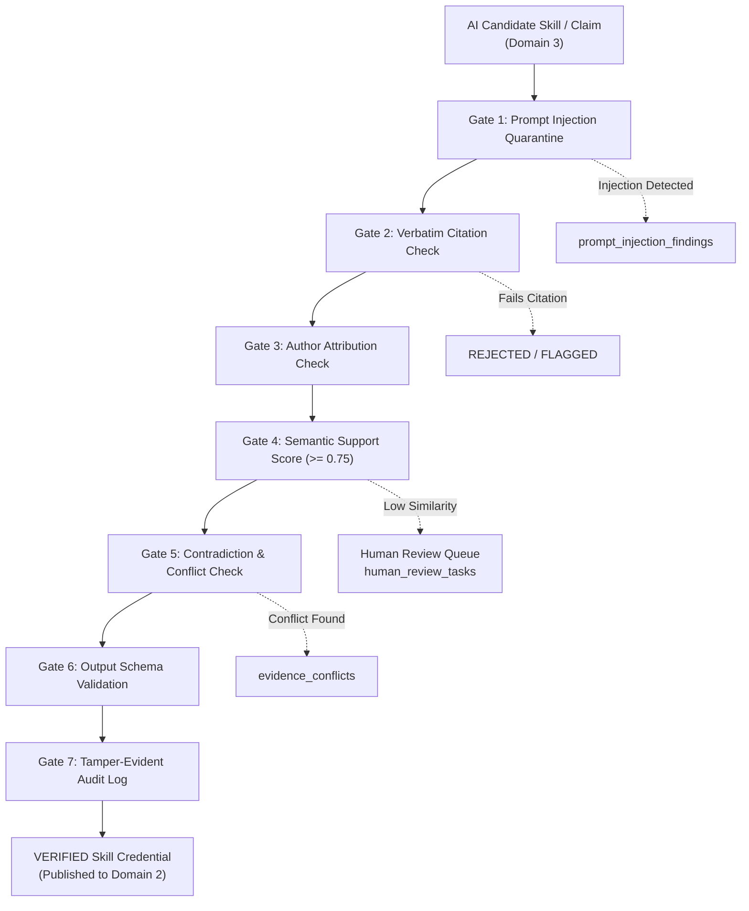

# Domain 4: Trust & Governance — Technical Guide

The **Trust & Governance** domain is the safety, verification, and auditability backbone of Skill Passport. It ensures that no hallucinated skills, unverified claims, or adversarial injections reach the canonical Skill Passport ledger.

---

## 1. Domain Scope & Architecture



---

## 2. The 7-Point Hallucination Guard

The `HallucinationGuard` ([`backend/app/ai/guard.py`](../../backend/app/ai/guard.py)) executes seven sequential validation stages on every candidate skill mapping:

### 2.1 Check 1: Verbatim Citation Verification
- **Mechanism**: The candidate claim must cite an exact excerpt string. The guard scans the original evidence item text to confirm this substring exists verbatim (`citation_verbatim_found = True`).
- **Failure Code**: `NO_VERBATIM_CITATION`. Any claim lacking exact textual backing is rejected immediately.

### 2.2 Check 2: Author Attribution Verification
- **Mechanism**: Verifies that the user identity matches the author, committer, or assignee in `evidence_items.contributor_identity`.
- **Failure Code**: `AUTHORSHIP_UNVERIFIED`. Prevents an engineer from claiming skills demonstrated exclusively by teammates on collaborative PRs.

### 2.3 Check 3: Semantic Support Scoring
- **Mechanism**: Calculates cosine similarity between the claim vector and the evidence vector using ChromaDB and `nomic-embed-text`.
- **Threshold**: Requires a semantic support score of `>= 0.75`.
- **Failure Code**: `WEAK_SEMANTIC_SUPPORT`. Flags items with marginal relevance.

### 2.4 Check 4: Contradiction & Conflict Check
- **Mechanism**: Scans existing verified evidence items for conflicting assertions (e.g., overlapping full-time dates at conflicting companies or contradictory role scopes).
- **Outcome**: If a conflict is discovered, it is logged to `evidence_conflicts` and routed to a reviewer.

### 2.5 Check 5: Schema & Reference Output Validation
- **Mechanism**: Enforces strict structural compliance against Pydantic models. Rejects malformed JSON, missing fields, or references to non-existent competency IDs.

### 2.6 Check 6: Prompt Injection Defense
- **Mechanism**: Evaluates text against a database of known jailbreaks, roleplay escapes, and instruction overrides (`backend/app/ai/prompt_injection.py`). Suspect items are quarantined into `prompt_injection_findings`.

### 2.7 Check 7: Audit Logging
- **Mechanism**: Writes an immutable state snapshot into `review_audit_events` with user ID, timestamps, and reason codes.

---

## 3. Conflict Resolution Engine

When contradictory evidence is ingested, the `ConflictService` ([`backend/app/ai/conflict_service.py`](../../backend/app/ai/conflict_service.py)) creates an `evidence_conflicts` record:

```python
class EvidenceConflict(Base):
    __tablename__ = "evidence_conflicts"

    id: Mapped[str] = mapped_column(String(36), primary_key=True)
    evidence_a_id: Mapped[str] = mapped_column(String(36), ForeignKey("evidence_items.id"))
    evidence_b_id: Mapped[str] = mapped_column(String(36), ForeignKey("evidence_items.id"))
    conflict_field: Mapped[str]  # e.g., "tenure_overlap", "proficiency_contradiction"
    evidence_a_assertion: Mapped[str]
    evidence_b_assertion: Mapped[str]
    suggested_resolution: Mapped[str]
    status: Mapped[str]  # "open", "in_review", "resolved"
    resolution_decision: Mapped[str]  # "accept_a", "accept_b", "accept_both_with_notes"
    reviewer_id: Mapped[str]
    resolved_at: Mapped[datetime]
```

Reviewers can inspect the competing assertions side-by-side in `/app/ai/conflicts` and resolve them with a documented decision rationale.

---

## 4. Human Review Queue

Items with high uncertainty (`confidence_score < 0.70`), prompt injection alerts, or unresolved conflicts are dispatched to the `human_review_tasks` queue:

- **Priority Levels**: `critical` (injections), `high` (conflicts), `medium` (weak citations), `low` (formatting discrepancies).
- **Reviewer Actions**:
  - `VERIFY`: Override guard and verify the skill into the Skill Passport.
  - `REJECT`: Permanently discard the candidate skill claim.
  - `AMEND`: Edit the proficiency level or supporting excerpt before approving.
  - `REQUEST_EVIDENCE`: Solicit additional supporting documentation from the engineer.

---

## 5. Tamper-Evident AI Audit Trail

Every state change across the governance lifecycle is logged append-only to `review_audit_events`:

```json
{
  "id": "audit-482a-921c",
  "actor_user_id": "usr-reviewer-12",
  "target_record_id": "mapping-893f",
  "target_record_type": "evidence_competency_mapping",
  "event_type": "guard_override_approved",
  "previous_state": {"status": "pending_review", "proficiency": "practitioner"},
  "new_state": {"status": "verified", "proficiency": "advanced"},
  "reason_note": "Reviewed GitHub commit history; verified full lead architecture on Alembic migration.",
  "event_timestamp": "2026-10-21T14:32:00Z"
}
```

Audit records can never be updated or deleted via the REST API.

---

## 6. Key REST API Endpoints

All Trust & Governance endpoints are grouped under `/api/v1/ai`:

### 6.1 Governance Gates & Validations
- `GET /api/v1/ai/guard/results` — Retrieves recent Hallucination Guard results with reason codes.
- `GET /api/v1/ai/validations` — Retrieves Output Validation run history and retry telemetry.
- `GET /api/v1/ai/conflicts` — Lists open and resolved evidence conflicts.
- `POST /api/v1/ai/conflicts/{id}/resolve` — Resolves an evidence conflict with reviewer decision.
- `GET /api/v1/ai/prompt-injections` — Lists quarantined prompt injection detections.

### 6.2 Review Queue & Audit
- `GET /api/v1/ai/review-tasks` — Lists open human review tasks.
- `POST /api/v1/ai/review-tasks/{id}/resolve` — Executes reviewer action (verify, reject, amend).
- `GET /api/v1/ai/audit` — Returns the immutable append-only audit trail.
- `GET /api/v1/ai/evaluation` — Retrieves AI model evaluation suite benchmark runs.

---

## 7. Frontend Routes

- **`/app/ai/guard`**: Interactive Hallucination Guard dashboard with 7-point check badges and verbatim citation viewer.
- **`/app/ai/validation`**: Schema output validation history and retry telemetry.
- **`/app/ai/conflicts`**: Side-by-side evidence conflict comparison and resolution modal.
- **`/app/ai/prompt-injection`**: Security quarantine console showing detected jailbreaks and isolated excerpts.
- **`/app/ai/review-queue`**: Task queue for managers and reviewers to process flagged claims.
- **`/app/ai/evaluation`**: AI evaluation suite running golden dataset benchmarks.
- **`/app/ai/audit`**: Searchable, tamper-evident audit event log.
